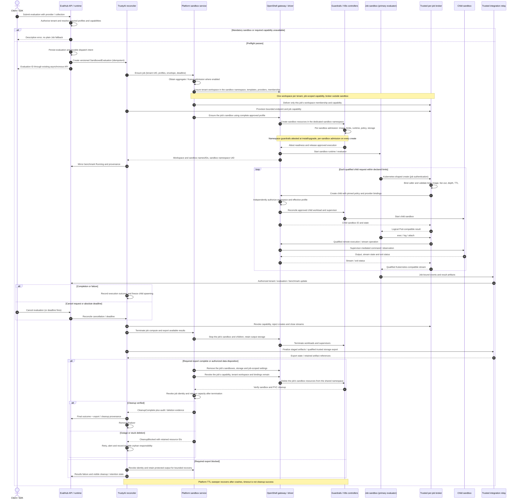
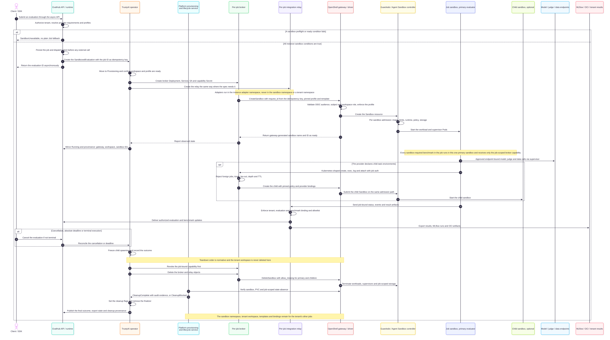

# ADR 0002: Evaluation sandboxes through the internal OpenShell gateway

- **Status:** Proposed
- **Date:** 2026-10-19
- **Decided:** 2026-11-17 — agreed with the OpenShift AI architecture team on three points: one static sandbox namespace for all evaluation job sandboxes, in the driver's `shared` workspace namespace mode; one OpenShell workspace per EvalHub tenant (`X-Tenant`); and one sandbox per evaluation job rather than one per benchmark. Decisions 2 and 4 record these. Decision 3 records the job-to-job residual risk that the model leaves. The platform still has to record the namespace model through one of the outcomes in [Platform alignment and namespace decision](#platform-alignment-and-namespace-decision), so this record stays Proposed for its remaining gates, its named approvers and the `SandboxedEvaluation` contract. This scope covers sandbox providers outside the adversarial cyber class: [ADR 0003](0003-adversarial-cyber-evaluation-isolation.md) records that class, which runs on its own gateway with one run namespace per evaluation job.
- **Revised:** 2026-11-27 (EvalHub-owned gateway deployment option) — records the platform team's suggestion that EvalHub install and operate its own gateway, in [Deployment option: an EvalHub-owned gateway](#deployment-option-an-evalhub-owned-gateway). The option is the second outcome in [Platform alignment and namespace decision](#platform-alignment-and-namespace-decision) and does not select it: until the platform records that outcome, decision 4 remains gated and this record remains Proposed. The option changes gateway ownership, attestation ownership and the namespace count; decisions 1, 2, 3, 5, 6, 7 and 9 are unchanged.
- **Revised:** 2026-11-27 (adversarial cyber class) — [ADR 0003](0003-adversarial-cyber-evaluation-isolation.md) carves out benchmarks whose evaluated agent is asked to attack, escape or misuse its environment. Decisions 1, 3, 5 and 8 keep their current meaning for that class; decisions 2, 4, 6 and 7 keep their current meaning for every other sandbox provider and no longer apply to it; and [Platform alignment and namespace decision](#platform-alignment-and-namespace-decision) gains a fourth, class-scoped outcome. For unclassified sandbox providers nothing changed: no allocation, placement or lifecycle decision was revised.
- **Revised:** 2026-11-25 (OpenShell pin) — the pinned release moves from v0.1.9 to **v0.1.10**, the latest published OpenShell release when this revision was written, and the Go SDK pin moves with it to `github.com/ai-openshell/sdk-go` v0.1.10. The re-pin is not cosmetic: v0.1.10 renames the gateway chart from `helm-chart` to `openshell` and publishes it from `oci://quay.io/ai-openshell/charts/openshell` with images under `quay.io/ai-openshell`, moves the namespace-scoped sandbox ServiceAccount, Role, RoleBinding and NetworkPolicy into a separate `openshell-workspace` chart installed once per platform-managed sandbox namespace, and stops serving gateway-mediated sandbox service URLs and HTTP/WebSocket forwarding by default in Kubernetes Helm deployments. The workspace namespace modes, the namespace-wide NetworkPolicy and supervisor egress behaviour, the capability-free OpenShift posture and 4.19 floor, the OIDC RBAC role defaults, the `request_id` durability hook, the absence of a quota or eviction RPC and the stop-preserves-storage contract were re-checked at v0.1.10 and are unchanged. No placement, namespace or lifecycle decision changed. The pin is **not yet re-qualified**: Phase 0's capability matrix, including whether the Red Hat build of Agent Sandbox v0.9.0 serves the API version the v0.1.10 preflight accepts, and the sandbox namespace attestation must be re-run at v0.1.10 before any provider is enabled.
- **Revised:** 2026-11-24 (OpenShell pin) — the pinned release moves from v0.1.4 to **v0.1.9**, the latest published OpenShell release when this revision was written (the documentation set published as `docs.nvidia.com/openshell/latest` resolves to v0.1.9), and upstream links follow the project to `ai-openshell/openshell`. The re-pin is not cosmetic: v0.1.9 renders capability-free sandbox workloads, so the privileged-SCC bootstrap exception and the OpenShift 4.21 floor are replaced by the release's own posture and its 4.19 floor, and the API-caller identity paragraph records the release's mTLS and reverse-proxy options. The workspace namespace modes, the namespace-wide NetworkPolicy and supervisor egress behaviour, the absence of a quota or eviction RPC and the stop-preserves-storage contract were re-verified at v0.1.9 and are unchanged. The official Go SDK is recorded in the implementation plan; decision 3 states that the broker uses it. No placement, namespace or lifecycle decision changed.
- **Revised:** 2026-11-23 (adapter placement and lifecycle) — closes the three gaps the operator contract left open. Decision 3 now names the per-instance adapter namespace that the trusted adapters run in, records that the adapter workloads and their garbage collection are the operator's, and decision 7 states the adapter teardown order and both collection paths. The operator's duty list, its RBAC list, its negative gates and the acceptance gates are extended to match. No change to decisions 1, 2, 4, 5, 6 and 8.
- **Revised:** 2026-11-23 (gateway interaction contract) — adds decision 8 and [Gateway interaction contract](#gateway-interaction-contract-extension): sandbox execution is off unless `spec.sandbox` explicitly enables it and the operator observes a platform-published, qualified gateway contract; the extension records the administrator bootstrap performed before the EvalHub operator, the operator's reconciliation duties and the trusted `SandboxedEvaluation` interaction surface. No change to decisions 1–7.
- **Revised:** 2026-11-19 (prose) — prose-only edit: long conjoined sentences are split and the wording is tightened for readability. No requirement, decision, reference or gate changed.
- **Revised:** 2026-11-18 (workspace decision) — the summary at the start of [Decision](#decision) and decision 2's heading now name the one-OpenShell-workspace-per-EvalHub-tenant decision explicitly, instead of leaving it in the allocation paragraphs and decision 4. No change to the decision.
- **Revised:** 2026-11-17 (sign-off review) — the first acceptance gate now allows all three recorded namespace-model outcomes. The required-OpenShell-changes gate names PR 174's both-mode rows and states that its table does not assess `shared` mode. The gate grouping is described by capability area rather than implementation phase, the supervisor egress and installation-wide wording match the pinned driver and the gateway outcomes, and the missing named approvers are flagged in the deciders and open questions. No change to the decisions.
- **Revised:** 2026-11-17 (mode mapping) — clarified that `managed` and `operator` both map one namespace to one workspace. Under this record's one-workspace-per-tenant model, either would therefore produce one sandbox namespace per tenant. `managed` is PR 174 head's choice, not this record's. No change to the decision.
- **Revised:** 2026-11-17 (namespace decision) — the divergence from PR 174 on the namespace model is now an explicit outstanding decision, with its acceptable outcomes and the per-job versus per-tenant granularity written down. Decision 4 is gated until it is resolved. No change to decision 4's selected model.
- **Revised:** 2026-11-17 (references) — removed PR 1059 and ADR 0001 references from the body; the partial-supersession note above keeps the history. No change to the decision.
- **Revised:** 2026-11-17 — review follow-up. The acceptance gates are now a grouped checklist with named owners and measurable pass criteria, covering the required-OpenShell-changes mapping, data handling, and recovery and availability. Capability precedence is normative in decision 1, decision 7 states the data-handling requirement, Consequences carries a failure and retryability matrix, and the open questions are grouped by owner. No change to the decision.
- **Revised:** 2026-11-16 (references) — references and analysis aligned with PR 174 head `97a0c4d59b34e0f9d1e6327aa79f026178b73d60` (`ODH-ADR-Operator-0021`). That revision gives each `SandboxedEvaluation` a dedicated managed Kubernetes namespace and makes `operator` mode its required fallback. Decision 4 records the difference from the platform record; the namespace model itself was decided on 2026-11-17.
- **Revised:** 2026-11-16 (placement) — sandbox containment and placement clarified after feedback from the OpenShell maintainers. Sandboxes are isolated from each other, so neither a namespace nor a workspace per sandbox is needed. All sandbox compute runs in one dedicated platform sandbox namespace using the driver's `shared` workspace namespace mode, never in tenant namespaces. No change to decision 1 (the shared-gateway decision); decisions 2 and 4 now differ from PR 174's namespace model.
- **Revised:** 2026-11-03 — record references, supersession status and local-mode wording; no change to the decision.
- **Deciders:** EvalHub, TrustyAI Service Operator, OpenShift AI platform and Security (named approvers still to be recorded)
- **Strategy:** [RHAISTRAT-2289](https://redhat.atlassian.net/browse/RHAISTRAT-2289)
- **Depends on:** [shared internal OpenShell gateway proposal, PR 174](https://github.com/opendatahub-io/architecture-decision-records/pull/174), reviewed at [`97a0c4d59b34e0f9d1e6327aa79f026178b73d60`](https://github.com/opendatahub-io/architecture-decision-records/commit/97a0c4d59b34e0f9d1e6327aa79f026178b73d60) (`ODH-ADR-Operator-0021-internal-openshell-gateway.md`). The platform record's number and filename are provisional while that PR is open. Decision 4 records the model decided with the architecture team; the platform still has to record it through one of the outcomes in [Platform alignment and namespace decision](#platform-alignment-and-namespace-decision).
- **Proposed partial supersession:** the namespace-first sandbox proposal circulated in [EvalHub PR 1059](https://github.com/eval-hub/eval-hub/pull/1059), which was closed unmerged on 2026-10-19 without landing as an ADR. ADR number 0001 stays reserved and unused, and the decisions that proposal would have recorded are restated in this record so that it stands alone.
- **Implementation plan:** [OpenShell evaluation plan](../design/openshell-evaluation-plan.md)

## Context

This record uses *evaluation job* for the unit created by one accepted request (`EvaluationJobConfig` in [pkg/api/evaluations.go](../../pkg/api/evaluations.go)); earlier drafts and PR 174 call the same lifecycle unit an *attempt*. A *sandbox* is that job's execution environment. A *workspace* is the OpenShell tenancy scope, which is not a Kubernetes namespace.

Agentic evaluation frameworks execute untrusted code, create child environments and require remote execution and observation. EvalHub must contain their access to tenants, credentials, cluster APIs, network destinations and compute capacity, and ordinary evaluations must still work.

PR 174 proposes a shared internal OpenShell gateway and makes it the baseline for sandbox-required EvalHub execution, while keeping the `SandboxedEvaluation` lifecycle and the intent to stay Kubernetes-compatible. A second, independent compute control plane would duplicate the security, lifecycle and operational work.

The shared gateway does not remove EvalHub's multi-tenancy obligations. Customer-supplied code is still untrusted when it runs as a bounded service operation. A common service identity across all evaluation workspaces, or a credential inside the untrusted process, would undermine per-evaluation containment.

The pinned [OpenShell v0.1.10 Kubernetes driver](https://github.com/ai-openshell/openshell/blob/v0.1.10/crates/openshell-driver-kubernetes/README.md) supports shared, managed and operator workspace namespace modes, separate workload/supervisor Pods and PVC-backed workspace storage. Workload identity, complete policy admission, namespace preparation and compatibility all need explicit integration, as the [authorization implementation](https://github.com/ai-openshell/openshell/blob/v0.1.10/crates/openshell-server/src/auth/workspace_authz.rs), the [API schema](https://github.com/ai-openshell/openshell/blob/v0.1.10/proto/openshell.proto) and the [PR 174 review](https://github.com/opendatahub-io/architecture-decision-records/pull/174#issuecomment-6221566587) show; workspace templates alone do not pin the policy/provider combination. PR 174 head (`97a0c4d`, `ODH-ADR-Operator-0021`) adds more: it selects `managed` mode for the platform gateway (a choice this record does not adopt; see [Platform alignment and namespace decision](#platform-alignment-and-namespace-decision)), makes `operator` its required fallback, requires a qualified OIDC issuer or token broker for gateway API callers, and records a table of OpenShell capabilities that must land before managed mode is supportable. Those requirements are the baseline for the platform-alignment analysis below.

The driver's `workspace_mode` decides how workspaces map to Kubernetes namespaces. `shared` (the default) renders every sandbox into one static namespace and disambiguates resource names as `{workspace}--{name}`. `managed` creates and deletes a generated namespace (`openshell-{gateway_id}-{workspace}`) and ServiceAccount per workspace. `operator` maps workspace names to pre-provisioned namespaces, discovered through one label selector or allowlist file, and fails closed when a workspace is not on the current allowlist. Sandbox containment does not depend on that mapping: at the pin each sandbox is a separate `Sandbox` resource with its own workload and supervisor Pods, the driver creates one namespace-wide `NetworkPolicy` that denies all workload egress and permits supervisor Pods to reach the sandbox TLS port, and supervisors keep normal egress until an operator policy restricts it. The authenticated Sandbox Protocol binds each connection to the exact sandbox and supervisor Pod identities, and `CreateSandboxRequest.name` is optional, with the server generating a name when it is empty. The placement that matters is the namespace itself: tenant namespaces already host tenant workloads, so sandbox compute must run in a namespace reserved for sandboxes and never alongside other workloads. The same driver fence also means that a defect in the shared namespace's NetworkPolicy, quota or admission affects every sandbox in it.

The strategy's [2026-10-13 refinement](https://redhat.atlassian.net/browse/RHAISTRAT-2289?focusedCommentId=18907648) adds resource-kind ceilings, Helm provisioning and synthetic canary needs. None of these can be assumed equivalent to simple OpenShell child creation.

## Platform alignment and namespace decision

[PR 174](https://github.com/opendatahub-io/architecture-decision-records/pull/174) head (`97a0c4d59b34e0f9d1e6327aa79f026178b73d60`, `ODH-ADR-Operator-0021`) is the reference for this record. It selects OpenShell's `managed` workspace namespace mode, and makes `operator` mode the required fallback when managed mode cannot satisfy its split-RBAC, namespace-read, ownership, admission, template-ordering or qualification requirements. It also states:

- "Isolate consuming services from one another through separate OpenShell workspaces, Kubernetes namespaces, identities, credentials, quotas, and policies." (Goals)
- "Each `SandboxedEvaluation` receives a short-lived OpenShell workspace and therefore a dedicated managed Kubernetes namespace." (EvalHub integration)
- "Each consuming service receives its own OpenShell workspace and OpenShell-managed Kubernetes namespace boundary." (Isolation and policy)

Decision 4 declines that namespace boundary. EvalHub settled on its own model on 2026-11-17 after review with the OpenShift AI architecture team, and decision 4 records it.

The chosen model is **one static sandbox namespace for all evaluation job sandboxes**, rendered by the driver's `shared` workspace namespace mode, with **one OpenShell workspace per EvalHub tenant (`X-Tenant`)** and **one sandbox per evaluation job** (decision 2). Workspace-per-tenant keeps the tenancy boundary that a single workspace for all consumers would lose: tenant A's jobs cannot reach tenant B's sandboxes, because gateway authorization is scoped to the workspace. Inside one tenant the jobs share the workspace, so job-to-job separation comes from the sandbox boundary and the broker's capability binding rather than from workspace scope. Decision 3 records that residual risk.

This is a deliberate trade. It removes per-workspace namespace creation, SCC allocation and namespace-scoped cleanup: per evaluation job under PR 174 head's workspace granularity, and per tenant under this record's. It also avoids the managed-mode capabilities that PR 174 head records as required but not yet available when that review was written, and the cluster-scoped namespace create/delete authority that managed mode requires. Avoiding that authority reduces the gateway's cluster blast radius even though it leaves one namespace with a larger in-namespace blast radius. The cost is the per-service, per-tenant and per-job Kubernetes namespace boundary that the workspace would otherwise provide.

Shared mode avoids the managed-mode-specific gates (namespace templates, managed-mode RBAC partitioning and the managed-namespace ownership handshake), but PR 174 head's enforceable-profile, identity/automation, policy, cleanup and availability rows still apply to both modes. Because `workspace_mode` is gateway-wide, the platform must either configure the shared gateway for all of its consumers or give EvalHub a separate gateway. EvalHub cannot opt into `shared` on its own.

Both `managed` and `operator` map one Kubernetes namespace to one workspace: `managed` has the driver create and delete that namespace, and `operator` requires it to be pre-provisioned. Neither can render several workspaces into one namespace. With this record's one-workspace-per-tenant model, either mode would therefore produce one sandbox namespace per tenant, not the installation-wide sandbox namespace decided here. PR 174 head reaches one namespace per evaluation job only because it creates a short-lived workspace per `SandboxedEvaluation`. Only `shared` separates the workspace, and with it the tenancy boundary, from a single static sandbox namespace.

The options considered were:

- **One static sandbox namespace for all evaluation job sandboxes** — chosen. Cross-consumer isolation depends on workspace identity, gateway authorization, per-sandbox isolation and admission rather than on Kubernetes namespace separation, and the platform accepts the increased blast radius and a single namespace quota for the fleet.
- **An EvalHub-scoped static sandbox namespace** — not chosen. It needs a separate gateway for EvalHub, because the driver's `shared` mode renders one static namespace per gateway.
- **A namespace per `SandboxedEvaluation`** — not chosen. That is PR 174 head's model, and the managed- or operator-mode variant this record declines.

The platform record still has to record the decision, so **this is an outstanding issue for the platform to resolve before implementation**: PR 174 head states the namespace-per-`SandboxedEvaluation` requirement, and until the platform records an outcome the platform record and this record differ. Decision 4 must not be implemented on a gateway that remains in `managed` or `operator` mode. Resolution is the first acceptance gate, owned by the platform and Security, and exactly one of the three outcomes below is required for the remaining sandbox providers:

- PR 174 is amended to `shared` mode with this record's installation-wide sandbox namespace and single fleet quota.
- EvalHub gets its own `shared`-mode gateway, which scopes the static sandbox namespace to EvalHub. [Deployment option: an EvalHub-owned gateway](#deployment-option-an-evalhub-owned-gateway) records the deployment shape of this outcome; recording the outcome here is still the platform's act.
- The platform requires one namespace per workspace. This record is then superseded by a managed- or operator-mode variant; that variant must record whether the granularity is per evaluation job (PR 174 head's model) or per tenant (one sandbox namespace per tenant, separate from tenant workload namespaces). That is a new decision, not a relaxation of this one.

A fourth, **class-scoped** outcome is recorded in [ADR 0003](0003-adversarial-cyber-evaluation-isolation.md) and is not one of the three above: the adversarial cyber class runs on its own gateway, in a mode that record chooses, with one short-lived run namespace and one run workspace per evaluation job, and with the simulated internet deployed inside that namespace. It exists so that the class never shares the installation-wide sandbox namespace or a tenant workspace. It neither satisfies nor replaces an outcome above: the remaining sandbox providers still need one of the three, and decision 4 still must not be implemented on a gateway that remains in `managed` or `operator` mode.

Until the outcome is recorded, no sandbox provider is enabled and no implementation may target the shared gateway's current `managed` configuration.

## Deployment option: an EvalHub-owned gateway

The platform team has suggested, as a delivery simplification rather than a recorded platform decision, that EvalHub install and operate its own OpenShell gateway, that only EvalHub components connect to it, that users never reach it directly, that the gateway get its own namespace, and that the first deployment use the simplest workspace arrangement that works. This section records the option so implementation does not depend on a floating assumption. **It does not select an alignment outcome by itself**: it is the second outcome in [Platform alignment and namespace decision](#platform-alignment-and-namespace-decision), an EvalHub-scoped `shared`-mode gateway, and it becomes the recorded model only when the platform records it there. Until then decision 4 stays gated exactly as it is.

It also confirms what decisions 1 and 3 already require rather than changing them: users never interact with the gateway, never supply its endpoint, template, policy or runtime, and never receive a credential for it. Every caller is a component behind the EvalHub API.

What the option changes:

- **Ownership.** EvalHub's deployment — its operator bundle or a small gateway-provisioning controller shipped with it — installs, upgrades, backs up and attests the gateway, the fail-closed interceptor, the `openshell-workspace` chart resources and the sandbox namespace guardrails. `EvalHub` instances remain consumers, exactly as they are under a platform-owned gateway.
- **Namespace count.** One more namespace. The layout becomes: the gateway namespace (gateway workloads, the interceptor and the gateway's database, KEK, JWT and PKI secrets), the sandbox namespace (decision 4), the per-instance adapter namespace (decision 3), the instance namespace, and tenant namespaces. The gateway namespace holds no sandbox workload and no evaluated code, and the socket between gateway and sandbox namespace is the only route that crosses them.
- **Attestation.** The contract keeps its shape; its publisher becomes the deployment owner. `qualified` is written by the deployment-scoped gateway-provisioning component on install and on every upgrade, never by the EvalHub operator, the API server or the broker, so the component that admits sandboxes still never self-attests. Security records the qualification outcome with the deployment owner instead of the platform team.
- **Credential separation is unchanged.** Installing the gateway does not put an administrator credential into EvalHub's request path: the provisioning controller holds it, the API server and the operator hold none, and the broker holds only a workspace `user` membership plus its job-bound capability. Decision 3's rule that no gateway credential reaches the agent is unaffected.
- **One gateway per installation, not per instance.** A gateway is a stateful service — database, KEK, JWT signing key, PKI, backups — and is upgraded as a unit. Instances in one installation share it and stay separated by tenant workspace; a gateway per `EvalHub` object would multiply state and upgrade surface for no tenancy gain.

What the option does not change: decisions 1, 2, 3, 5, 6, 7 and 9 apply unchanged. In particular the per-tenant workspace stays normative, `{workspace}--{name}` naming stays, the adapter namespace stays outside the sandbox namespace, and no `SandboxedEvaluation`, provider, collection or request input gains a gateway, namespace, template or runtime override.

Two restrictions come with it. First, "not caring about workspaces" is acceptable only for `tenancy: single` and development. Under `tenancy: multi` the workspace is the authorization scope that separates tenants ([EH-0002](https://github.com/opendatahub-io/architecture-decision-records/blob/main/architecture-decision-records/eval-hub/ODH-ADR-EH-0002-multi-tenancy-and-authz.md)), and a single workspace disambiguated by a naming scheme would move tenant separation into application code — the same weakness decision 3 records for job-to-job separation, but across tenants. A workspace is a cheap object to create; what decision 4 avoids is a namespace per workspace, not a workspace per tenant. Second, the integration must stay portable, which is the platform team's strongest point: the broker, the relay and the reconciliation code must not depend on who owns the gateway, how many gateways exist or which workspace mode is configured. Ownership and mode arrive only through the contract, so moving a deployment between a platform-owned and an EvalHub-owned gateway is a configuration change, not a code change.

What EvalHub takes on: gateway availability and its SLO, backup and restore of gateway state, version pinning and coordinated upgrades under the v0.1.10 chart split, interceptor readiness (its failure denies new dispatch), namespace and SCC lifecycle, the TTL sweeper and the attestation evidence. That is the operational cost the option trades for autonomy and for removing the platform dependency from the delivery path, and it reverses part of this record's original argument against a second control plane — not by disputing it, but by accepting it deliberately in exchange for an unblocked delivery.

## Decision

EvalHub decides to run every sandbox-required evaluation as an OpenShell sandbox on an internal OpenShell gateway — the platform's shared gateway, or EvalHub's own under [Deployment option: an EvalHub-owned gateway](#deployment-option-an-evalhub-owned-gateway) — with **one OpenShell workspace per EvalHub tenant** and **one primary sandbox per evaluation job**, all rendered into **one installation-wide sandbox namespace**. The workspace-per-tenant decision is normative. The workspace is the tenancy scope for gateway authorization, workspace membership, templates and provider and credential bindings; the platform provisioning service creates it once per authorized tenant (the `X-Tenant` namespace) and keeps it across jobs; and a tenant's jobs run as sandboxes inside that shared workspace instead of each getting its own workspace or Kubernetes namespace. Decisions 2 and 4 record the allocation, and decisions 3, 5, 6 and 7 record the broker, credential, capacity and cleanup obligations it implies. Decision 3 also records where the trusted adapters run and who creates, deletes and holds RBAC for them: one adapter namespace per `EvalHub` instance, separate from the sandbox namespace and from tenant namespaces ([The adapter namespace](#the-adapter-namespace)). Decision 4's installation-wide namespace in the driver's `shared` mode remains gated on the platform recording one of the outcomes in [Platform alignment and namespace decision](#platform-alignment-and-namespace-decision); the one-workspace-per-tenant and one-sandbox-per-job allocations are decided. Decision 8 makes the capability opt-in and contract-gated, and changes none of the allocations above.

### 1. Use the shared gateway for mandatory sandbox execution

Use one platform-managed internal gateway per OpenShift AI installation, as PR 174 proposes. Whether a benchmark runs in a sandbox is resolved from trusted provider and task configuration and from installation capabilities; provider and task classification is onboarding metadata that cannot be supplied or changed per request. Sandbox-required evaluation benchmarks run their evaluator and children as OpenShell sandboxes, never as an unsandboxed Job fallback. The existing Job backend remains for ordinary benchmarks, including those in mixed collections, and the evaluation aggregates status and results across both backends.

PR 174 defines two approved OpenShell runtime profiles, `standard` and `kata`. `standard` omits `runtimeClassName` and uses the cluster default runtime; `kata` sets a platform-approved Kata `RuntimeClass`. A provider that requires Kata fails closed if the profile is unavailable or unqualified, and a provider that does not require Kata still fails closed if `standard` is unavailable. There is no request-time escape hatch to lower a provider's requirements.

Sandbox requirements resolve in a fixed precedence. The administrator ceiling sets the outer bound. A provider minimum may only tighten inside that ceiling. A collection request may select an approved profile inside that minimum, and a user request may change neither. That means a collection request cannot move a benchmark into or out of sandbox execution, unsandbox a mandatory-sandbox provider, or expand the administrator resource-kind and resource-quantity ceiling; placement comes from the provider and task classification, not from the request. The classification that decides which execution shape applies, including the agent-target benchmark inventory, is recorded in the plan's [Agent-target classification](../design/openshell-evaluation-plan.md#agent-target-classification) section. The errors that report a refused request are recorded in [Framework compatibility](../design/openshell-evaluation-plan.md#framework-compatibility).

Local mode is outside the platform gateway's supported contract and is never reported as providing the platform sandbox guarantee. This record keeps the stricter local position: local execution rejects mandatory-sandbox providers, and a developer who needs one uses a separately deployed qualified development gateway. PR 174 head (`97a0c4d`, "EvalHub integration") permits retained warn-and-allow behaviour but does not require it, so re-adopting warn-and-allow would be a reviewable amendment to this record rather than an automatic fallback.

### 2. Preserve a versioned evaluation lifecycle, delegate compute lifecycle and allocate one OpenShell workspace per EvalHub tenant

Retain `SandboxedEvaluation` as the asynchronous cross-repository contract. EvalHub persists the accepted request and dispatch intent. TrustyAI reconciles it, reports progress, and owns finalizer-driven cancellation and cleanup. The contract's API group/version, status conditions, idempotency key and compatibility policy must be recorded in the implementation plan and the TrustyAI repository before any provider is enabled; this record treats them as versioned and requires a compatibility review before either side changes them. A platform-owned provisioning service creates workspace membership, approved templates and credential bindings through the gateway.

Allocate one OpenShell workspace per EvalHub tenant and run that tenant's evaluation jobs as sandboxes inside it. The tenant is the authorized `X-Tenant` namespace resolved at kube-rbac-proxy, and the platform provisioning service maps that identity, with its immutable namespace UID, to a bounded DNS-1123-safe workspace name derived from trusted identifiers rather than taken verbatim from caller input, because shared mode embeds the workspace name in `{workspace}--{name}` resource names. A tenant workspace is long-lived: the provisioning service creates it and its membership when the tenant is first authorized, and it outlives individual jobs, so job teardown must not delete the workspace, its templates or its provider and credential bindings. The workspace is a tenancy, membership and lifecycle scope inside the dedicated sandbox namespace rather than a Kubernetes namespace, and it separates tenants from each other, not the jobs of one tenant.

Allocate one primary sandbox per evaluation job, not one per benchmark: every sandbox-required benchmark in a job runs inside that job's sandbox, and the gateway generates a unique sandbox name when none is supplied. This record reads "one sandbox per job" as one primary sandbox per job. Whether a provider may still create the bounded child task environments that some Inspect benchmarks declare is recorded in [Open questions](#open-questions) as a point to confirm. Sandboxes remain isolated from each other by OpenShell. Record immutable tenant, evaluation, workspace and sandbox identities, including generated sandbox names. The platform owns the sandbox namespace and the tenant workspace lifecycle; TrustyAI does not create a namespace, a workspace or a primary Kubernetes Job for this path.

The platform provisioning service, gateway, admission components and Agent Sandbox controller must have named operational ownership and versioned readiness. The fail-closed gateway interceptor (or equivalent server-side admission) must be ready with the gateway, and interceptor unavailability denies new sandbox dispatch. The identity issuer is a hard dependency. PR 174 head records that OpenShell v0.1.4 did not accept OpenShift ServiceAccount tokens as ordinary gateway API credentials. v0.1.10 widens the options without closing that gap: an API caller authenticates with an OIDC bearer token (configurable `audience`, a `roles_claim` array, and `admin_role`/`user_role`, defaulting to `openshell-admin`/`openshell-user`), with a verified client certificate (mTLS), or behind reverse-proxy auth termination, while projected ServiceAccount tokens are validated only for supervisor identity. The requirement therefore stands as a qualified OIDC issuer or token broker with the required audience, stable subject and array-valued role claim, or new OpenShell API-caller `TokenReview` support. mTLS and reverse-proxy termination are recorded alternatives that need their own qualification: both move authentication outside the gateway, and neither supplies the workspace-scoped role claim on its own. The gateway must stay in RBAC mode, because explicitly emptying both role names selects auth-only mode, in which every authenticated caller is treated as a Platform Admin and workspace membership checks are bypassed. The provisioning service uses the platform record's least-privilege automation role, not unrestricted OpenShell Platform Admin authority; EvalHub and its brokers receive only the user role and explicit workspace membership. If the identity issuer is unavailable, sandbox dispatch fails closed.

### 3. Keep trusted adapters outside evaluated code

Deploy `eval-sandbox-broker` as a trusted per-job service in a control namespace. It authenticates untrusted requests using a job-bound capability and acts with its own OpenShell identity, which is a workspace user member of the tenant workspace and never a platform administrator. The capability is bound to the tenant, the evaluation job and the job's sandbox; it has a short TTL, is revocable on terminal events, and is never delivered to a sandbox it does not serve. Workspace membership separates tenants: the broker cannot operate in another tenant's workspace, and gateway authorization denies it even though both tenants share the sandbox namespace. Membership does not separate the jobs of one tenant, so within its own tenant the broker must reject every sandbox that is not its job's sandbox and every child it did not create. That check is application-level, and [Open questions](#open-questions) records it as residual risk for Security to accept or constrain further. The agent receives only the job-scoped broker capability; no OpenShell gateway credential or production Kubernetes pod-creation token is passed to the agent.

The broker reconstructs approved OpenShell requests from supported Kubernetes-shaped operations, and it is a Go service built on the official OpenShell Go SDK (`github.com/ai-openshell/sdk-go`, imported as `.../openshell/v1` and pinned with the gateway release; the pin and its constraints are recorded in the plan's [Pinned OpenShell release and Go SDK](../design/openshell-evaluation-plan.md#pinned-openshell-release-and-go-sdk)). It is not a production Kubernetes API reverse proxy. Support only provider-qualified semantics, including any required streaming channel behavior, and reject unsupported Pod fields, kinds and namespace references explicitly. Server admission independently enforces the resolved image, template, policy, provider bindings, runtime, resource and lifecycle constraints.

For Harbor, prove an OpenShell-native framework plugin or a bounded virtual compatibility implementation against the actual Helm lifecycle. Do not claim that a Pod-to-sandbox mapping supports arbitrary Helm, Services, Secrets, controllers or Kubernetes networking. A failed compatibility proof blocks that provider until the requirements or implementation change through review.

#### The adapter namespace

Decision 3 says "a control namespace" and decision 7 requires the adapters to be garbage collected, but neither names the namespace, and that choice determines the RBAC scope, the network policy and the collection mechanism. Each `EvalHub` instance that enables `spec.sandbox` therefore gets one **adapter namespace**, owned by the operator, named from the instance (for example `evalhub-adapters`), created when the feature is enabled and left in place when it is disabled so in-flight jobs can finish teardown. It is none of the three namespaces already in play:

| Namespace | What it holds | Why the adapters are not there |
|---|---|---|
| Sandbox namespace (decision 4) | OpenShell sandbox and supervisor workloads, driver-managed storage | Decision 3 keeps mediation outside the untrusted boundary, the driver and the Agent Sandbox controller hold exclusive authority there, and the namespace's PSA/SCC, quota and egress profile are qualified for sandboxed workloads rather than for a mediator that needs the gateway endpoint |
| Instance namespace | the EvalHub API `Deployment`, its `Service` and the instance ConfigMap | A per-job workload must not share a namespace, quota or network policy with the request path: a compromised broker would gain reach into EvalHub's own control plane, and under `tenancy: multi` every tenant's adapters would collapse into the API namespace |
| Tenant namespaces | ordinary Job-backed evaluations and tenant Secrets | Sandbox compute never runs in a tenant namespace, and an adapter must not be able to read tenant Secrets through co-residency |

The namespace is per `EvalHub` instance — not per tenant, which would let one tenant's broker reach another tenant's adapters on a shared instance, and not per job, which would rebuild the namespace and SCC churn decision 4 rejects. Its guardrails belong to the operator rather than the platform: `restricted` PSA, an adapter `ResourceQuota` and `LimitRange` kept separate from the sandbox namespace's fleet quota so adapter churn cannot consume sandbox capacity, and default-deny ingress and egress with explicit allowances only for the paths decisions 3 and 5 name — the sandbox namespace to the job's broker endpoint, the broker to the contract's gateway endpoint, and the broker and relay to the EvalHub API, MLflow and the approved OCI registry — and no route to the API server, node metadata or another instance's adapters.

`SandboxedEvaluation` objects live in this namespace, which is what lets their adapter workloads carry a same-namespace `ownerReference` instead of the cross-namespace reference decision 7 forbids, and it closes the placeholder in [The `SandboxedEvaluation` interaction surface](#the-sandboxedevaluation-interaction-surface). The operator publishes `SandboxAdapterNamespaceReady`; with `spec.sandbox.enabled: true` and an unready adapter namespace, dispatch is rejected with `SandboxUnavailable` rather than admitted for work that cannot be brokered.

The operator creates, owns and deletes the adapter workloads, and its grants for them are namespaced to the adapter namespace ([The operator's responsibilities](#the-operators-responsibilities)). The broker and relay remain the only components that exercise the job-bound capability and the workspace `user` identity; the operator's authority over them is object lifecycle, never request execution.

### 4. Run sandbox compute in a dedicated sandbox namespace

Use the driver's `shared` workspace namespace mode with one platform-provisioned static sandbox namespace for every evaluation job sandbox. The namespace is installation-wide for the shared gateway and hosts one workspace per EvalHub tenant, as decided in [Platform alignment and namespace decision](#platform-alignment-and-namespace-decision). Because `workspace_mode` is gateway-wide, EvalHub cannot select `shared` independently of the gateway's other consumers unless it operates the gateway itself ([Deployment option: an EvalHub-owned gateway](#deployment-option-an-evalhub-owned-gateway)). That namespace hosts only OpenShell sandboxes: never a tenant namespace, and never a namespace shared with non-sandbox workloads. Namespace separation is not what isolates sandboxes; they stay isolated from each other inside it, and the tenants' workspaces coexist there through `{workspace}--{name}` resource naming. Because one `shared`-mode gateway renders all workspaces into that single namespace, every consumer of that gateway shares it. Cross-consumer isolation therefore depends on workspace identity, gateway authorization, per-sandbox isolation and admission, and the platform must accept the blast-radius trade recorded in [Platform alignment and namespace decision](#platform-alignment-and-namespace-decision). Keep a unique immutable gateway ID and a recorded namespace ownership mapping, and reject any namespace that is not the platform-qualified sandbox namespace. PR 174 selects `managed` mode and makes `operator` mode its required fallback, while this record selects `shared` mode, so PR 174 must be amended to record that, or one of the other outcomes in [Platform alignment and namespace decision](#platform-alignment-and-namespace-decision) must be recorded, before implementation.

Apply SCC/PSA, ResourceQuota, LimitRange, approved storage class and effective ingress/egress policy when the platform provisions that namespace, and gate sandbox dispatch on a recorded readiness attestation for the namespace and the effective execution profile. Because the namespace is long-lived, that attestation is an installation and upgrade gate rather than a per-job namespace barrier; re-verify it after OpenShift, OpenShell or Agent Sandbox upgrades. Applying quota after the first sandbox starts is insufficient. Operator workspace mode is PR 174's required fallback when managed mode cannot meet its gates. It is not selected here because it keeps one namespace per workspace (one namespace per tenant under this record's workspace model), and therefore reintroduces the per-workspace namespace and SCC allocation that this decision avoids.

Only the gateway driver and its trusted Agent Sandbox controller may administer the sandbox namespace, its Sandbox resources, sandbox Pods or the configured sandbox ServiceAccount. Independently restrict the gateway and controller's cluster authority to those authorized namespace/resource operations using admission or an equivalent enforceable boundary, and deny operations against tenant namespaces and unrelated resource types even if gateway credentials are compromised. Labels alone do not constrain a compromised cluster-wide credential. Protect readiness and ownership metadata from consumers and evaluated workloads.

Pin the complete effective execution profile on the server. A template reference alone is insufficient: validate inline settings, policy, provider attachments, runtime selection, restarts and mutations. This requires the server-enforceable profile capability that PR 174 head lists as a required OpenShell change; if the supported release cannot enforce it, sandbox dispatch fails closed. Require enforced kernel policy, manual policy expansion approval and denial on interceptor unavailability. Disable exposed-service routing unless an authenticated cross-tenant-safe implementation is qualified.

Constrain both workload and supervisor network paths. Deny API-server and metadata access and unapproved endpoints. Resolve the driver's permissive supervisor egress using a supported policy change or higher-precedence cluster control; ordinary additive NetworkPolicy cannot remove an existing allowance. This is an acceptance gate, not an implementation detail: the platform and Security owners must prove the effective restriction on the supported CNI before enabling sandbox dispatch, and an unqualified CNI fails closed. Verify API-server, metadata, IPv4/IPv6, DNS and redirect behavior.

### 5. Preserve tenant and credential boundaries

Maintain the original authorized tenant and MLflow workspace independently of the shared sandbox namespace. Tenant namespaces continue to host EvalHub workloads and ordinary Jobs; sandbox compute never runs there. Preserve [EH-0002](https://github.com/opendatahub-io/architecture-decision-records/blob/main/architecture-decision-records/eval-hub/ODH-ADR-EH-0002-multi-tenancy-and-authz.md) and the credential-hiding objective of [EH-0004](https://github.com/opendatahub-io/architecture-decision-records/blob/main/architecture-decision-records/eval-hub/ODH-ADR-EH-0004-eval-sidecar-creds-injection.md).

For the sandbox backend, use approved workspace-scoped OpenShell credential delivery and a trusted remote integration relay for EvalHub callbacks, MLflow/OCI and behavior requiring EvalHub-specific adaptation. The relay authenticates each sandbox with a job-bound credential and binds every call to the tenant, the evaluation job and the benchmark. It enforces a destination allowlist and rejects calls that do not match the recorded bindings; it is not an SSRF proxy. Ordinary Jobs retain their sidecar.

Read only explicitly delegated tenant secret references. Delegation is an explicit platform authorization with an auditable scope; the provisioning service must not have cluster-wide Secret read, and the evaluated code never receives the original secret. Do not mount original secrets or asynchronous user bearer tokens into evaluated code. Synthetic canary injection is a separate bounded input capability for approved benchmark profiles. Negative-control test targets remain inside the outer sandbox, with no real Kubernetes authentication token or weakening of outer containment.

### 6. Enforce aggregate capacity and bounded lifetime

Intersect provider-declared resource kinds with an administrator ceiling and implemented operations. Enforce per-sandbox and aggregate evaluation/tenant/installation limits, including supervisors, init peaks, brokers, storage, streams, fan-out and depth.

On Kueue-enabled installations, obtain queue admission for the declared footprint before launching sandboxes and handle eviction explicitly. Existing Job admission does not automatically apply to OpenShell. OpenShell v0.1.10 still exposes no quota or eviction RPC in its public API, and `CreateSandboxRequest` still has no quota field — its resource inputs are per-sandbox limits, not an admission reservation — so the single sandbox namespace carries one installation quota. Per-job and per-tenant fairness must come from a platform-owned admission/reservation component (with a Kueue `Workload` or supported equivalent on Kueue installations) that records the reservation before the first `CreateSandbox` and prevents create races. On non-Kueue installations the same component enforces aggregate and per-tenant caps; namespace quota alone is not fairness. Namespace quotas remain necessary, but they cannot substitute for queue fairness. A compatible admission adapter is a delivery prerequisite, and its owner and eviction contract (terminate and retry, no checkpoint unless explicitly supported) must be recorded before enabling providers.

Permit only automatically provisioned, short-lived per-sandbox PVCs under a qualified storage deletion contract: a platform-approved dynamically provisioned storage class with `Delete` reclaim, encryption at rest, no snapshots or retained volumes, and verified PVC/PV reclamation. These are the driver's `/sandbox` workspace volumes inside each sandbox, not a workspace-level volume shared by a tenant's jobs. "Short-lived" means bounded by the job deadline and the platform TTL, not merely by Pod lifetime. v0.1.10 preserves the `Sandbox` resource and the `/sandbox` PVC across stop (suspending the sandbox and its pod), and `Delete` is the only lifecycle operation that removes the resource and its owned storage, so stop/suspend is never treated as deletion. This changes the prior `emptyDir`-only scope. Persistent user storage, retained workspaces, GPU passthrough and arbitrary runtime selection remain out of scope.

### 7. Make cleanup and provenance part of success

Persist lifecycle intent and external identifiers before progressing. Freeze child creation on terminal events, then terminate the job's sandbox and any children, close streams, export available results, delete the job's sandboxes, PVCs and other job-scoped objects, and revoke the job's broker capability and identity. The job's adapter objects — the broker and relay `Deployment`s, their `Service`s, `ServiceAccount`s, capability and token `Secret`s and `NetworkPolicy`s — are among those job-scoped objects. Their removal order is normative: freeze spawning, revoke the capability, delete the adapters, then delete the sandboxes, then verify. Revoking before deleting is what stops a retry from recreating a deleted adapter with a still-valid capability. `CleanupComplete` therefore requires adapter absence as well as sandbox, PVC and job-scoped gateway-state absence. The tenant workspace, its membership, templates and provider and credential bindings remain: job teardown never deletes a workspace, because the same tenant's other jobs depend on it. Deletion does not proceed without a verified export or a recorded authorized data-loss disposition; a blocked export retains protected storage under a bounded recovery record and raises a visible condition. Tenant-workspace deletion is a platform operation performed when a tenant is decommissioned, and it must remove that workspace's sandbox resources and gateway state; the platform-owned sandbox namespace remains. Verify that sandbox, PVC and job-scoped state are gone and that storage is reclaimed. Stop/suspend is not deletion, and a remaining sandbox namespace or tenant workspace is not evidence of a leak.

The platform's sandbox lifecycle controller (the PR 174 term for the provisioning and cleanup service) owns TTL expiry and abandoned-resource reconciliation; TrustyAI's finalizer owns evaluation and result recovery. Both use the same immutable ownership records and must be idempotent against each other. Finalizers retry with bounded backoff. A stalled cleanup raises an explicit condition and durable orphan record; a timeout never becomes a successful cleanup assertion. Cross-namespace garbage collection is not an ownership mechanism. Adapter collection therefore has two paths, both owned by TrustyAI and neither by the platform lifecycle controller: the same-namespace `ownerReference` from every adapter object to its `SandboxedEvaluation`, so Kubernetes deletes the adapters with the custom resource — which is why [The adapter namespace](#the-adapter-namespace) places the resource and its adapters in one namespace; and a label-scoped sweep (`evalhub.trustyai.opendatahub.io/evaluation=<uid>` together with the instance UID) that deletes adapters whose custom resource is gone, covering a crash between resource and adapter creation, a restore that loses the resource, and an operator upgrade. The platform TTL sweeper reconciles sandboxes and tenant workspaces and must not adopt, modify or delete adapter objects. An adapter whose custom resource cannot be resolved becomes an orphan record with its capability revoked first, never a silent deletion while that credential is live.

Record gateway and component versions, tenant and job IDs, workspace names and IDs, generated sandbox names/IDs, sandbox namespace name and UID, template/image digests, effective policy and runtime, resource limits, audit references and cleanup state in evaluation provenance, with a schema, retention period and access policy defined in the implementation plan. Export required artifacts before workspace or sandbox removal.

Data handling is part of the decision, not only an open question. A consuming service documents data classification, minimization, retention period, geographic and regulatory constraints, log-redaction rules and audit retention for sandbox inputs, outputs and logs before any provider is enabled. Platform telemetry must not capture credentials, raw prompts, datasets, source files or model outputs without that governance; where a benchmark requires such capture, the record names the authorized destination, retention and access policy. Provenance records identifiers, metadata digests and cleanup state, never secret values or evaluation payloads. Owner: Security and EvalHub; the qualified rules remain the question recorded in [Open questions](#open-questions).

### 8. Keep sandbox execution off by default and enable it only against a published gateway contract

Sandbox execution is a disabled capability, not a default. `EvalHub.spec.sandbox` is optional, and its absence or `enabled: false` leaves the instance with no sandbox execution path at all: the server renders no `sandbox` configuration, no gateway identity is requested, no workspace binding is recorded, and ordinary Job-backed evaluations behave exactly as they do without this feature. Existing `EvalHub` custom resources therefore keep their current behaviour across an upgrade, and an installation that never opts in never depends on the gateway.

`enabled: true` is necessary but not sufficient. The operator resolves the published contract named by `spec.sandbox.gatewayRef` — published by the platform or, under [Deployment option: an EvalHub-owned gateway](#deployment-option-an-evalhub-owned-gateway), by the deployment owner — and requires all of: `qualified: "true"`, a `workspaceMode` equal to the mode the operator and server support, a non-empty `sandboxNamespaceUID`, an `openShellVersion` and `agentSandboxVersion` on the supported matrix, and a resolvable instance identity ([Identity, admission and policy](#identity-admission-and-policy)). Until `SandboxGatewayReady`, `SandboxNamespaceAttested`, `SandboxIdentityReady` and `SandboxAdapterNamespaceReady` are all `True`, sandbox-required providers are rejected during onboarding and dispatch, `/api/v1/info` reports the reason, and no sandbox is created. The operator never infers a usable gateway from a reachable endpoint, a present ConfigMap or a populated object: an absent or malformed contract is a disabling condition, not a reason to use defaults.

Only the contract's publisher writes `qualified`, and only the publisher can withdraw it: the platform for a platform-owned gateway, and the deployment-scoped gateway-provisioning component for an [EvalHub-owned one](#deployment-option-an-evalhub-owned-gateway). No component that admits sandboxes writes or withdraws it, so the operator never self-attests. Revoking the attestation, an upgrade that invalidates it, or a contract/version mismatch stops new dispatch and is visible in status without an operator restart. No request-time input — collection, benchmark, evaluation request or tenant value — can enable, disable, broaden or retarget sandbox execution, which preserves decision 1's precedence. Local mode continues to reject mandatory-sandbox providers regardless of `spec.sandbox`, per decision 1.

Enabling the capability moves no responsibility that decisions 2, 3 and 7 already assign: the platform provisioning service still creates workspaces, membership, templates and credential bindings, TrustyAI still reconciles `SandboxedEvaluation`, and the broker still performs sandbox operations. `spec.sandbox` decides only whether this instance may participate, and against which qualified contract. The bootstrap the administrator performs before the operator, the operator's reconciliation duties and the `SandboxedEvaluation` surface are recorded in [Gateway interaction contract](#gateway-interaction-contract-extension).

## Architecture and execution


[Architecture source](../diagrams/openshell-evaluation-architecture.mmd).


[Startup sequence source](../diagrams/openshell-startup-sequence.mmd). The administrator bootstrap, the platform-published gateway contract and the operator readiness gates that must be true before this instance enables sandbox dispatch; the full checklist and operator duties follow in [Gateway interaction contract](#gateway-interaction-contract-extension).



[Sequence source](../diagrams/openshell-evaluation-sequence.mmd). The sequence covers one evaluation job inside its tenant workspace; the job's sandbox serves every sandbox-required benchmark in that job.



[Job interaction source](../diagrams/openshell-sandboxed-job-sequence.mmd). A compact view of one sandboxed evaluation job: dispatch, broker-mediated sandbox creation, in-sandbox execution, relay export and the normative teardown order. The sequence above remains the exhaustive branch and failure reference.

The gateway interaction contract — the enablement gate, the administrator bootstrap performed before the EvalHub operator, the operator's reconciliation duties and the `SandboxedEvaluation` surface it drives — is recorded in [Gateway interaction contract](#gateway-interaction-contract-extension).

## Gateway interaction contract (extension)

This section records *how* the components in decisions 1–8 fit together. It adds no placement or namespace decision and moves no responsibility: the platform provisioning service creates tenant workspaces, membership, templates and credential bindings (decision 2); TrustyAI reconciles `SandboxedEvaluation`, owns finalizer-driven cancellation and result recovery, and creates and deletes the job's adapter workloads in the instance's adapter namespace (decisions 2, 3 and 7); the `eval-sandbox-broker` performs sandbox operations with a job-bound capability (decision 3); and the platform lifecycle controller owns TTL expiry and abandoned-resource reclamation (decision 7). The EvalHub API server persists dispatch intent and observes the contract object; it never calls the gateway and never holds an OpenShell credential, so the workspace `user` identity that decision 3 assigns belongs to the broker rather than to the API process.

### Bootstrap: the administrator, before the EvalHub operator

The administrator (platform or cluster administrator, with `cluster-admin` used only for this bootstrap) completes the following before installing or upgrading the EvalHub/TrustyAI operator with the sandbox feature. The ordering matters: the operator treats an incomplete bootstrap as a disabling condition, so a half-installed gateway produces a visible `SandboxGatewayReady=False`, not a silently working or silently broken sandbox path.

Cluster prerequisites:

1. OpenShift 4.19 or later, and the Red Hat build of Agent Sandbox v0.9.0 installed in `openshift-operators` through the Software Catalog. The OpenShell Kubernetes driver depends on it, and the v0.1.10 chart preflights the live cluster for a supported Agent Sandbox API (`agentSandbox.preflight.enabled`), so the qualified build must serve the API version that preflight accepts. The 4.19 floor is a kernel constraint: the RHCOS kernels in OpenShift 4.16–4.18 are built without Landlock, so sandbox startup fails its Landlock probe there.
2. A default StorageClass that supports dynamic provisioning, recorded by name because it becomes part of the namespace attestation. The gateway database and the per-sandbox `/sandbox` volumes are PVC-backed.
3. A qualified Kata `RuntimeClass` if, and only if, a provider declares `kata`. Kata is an installation option, not a default.

Gateway installation and identity:

4. Create the gateway namespace and let SCC admission assign the sandbox ServiceAccount's UID range **before** the chart installs. At v0.1.10 OpenShell does not require the `privileged` SCC or any added Linux capability: the driver reads the namespace's `openshift.io/sa.scc.uid-range` annotation and renders the sandbox and supervisor with a numeric non-root identity from that range. The qualified runtime profile must still permit an unprivileged process to install a nested seccomp user-notification filter and use Landlock, because sandbox startup fails closed when either capability-free probe fails. If a midstream path still runs the privileged SCC, treat it as a recorded, time-boxed exception with a named owner and a replacement plan, not as a production posture.
5. Install the pinned OpenShell release from `oci://quay.io/ai-openshell/charts/openshell` with the gateway Route hostname passed to `pkiInitJob.serverDnsNames`. Where the sandbox namespace is not the gateway release namespace, set `workspaceResources.enabled=false` on that release, keep `workspaceMode: shared` and `server.sandboxNamespace` pointed at the sandbox namespace, and install the `openshell-workspace` chart from `oci://quay.io/ai-openshell/charts/openshell-workspace` in the sandbox namespace. A mismatch between the certificate DNS names and the Route host is the documented cause of a disconnected gateway, so the operator must not be asked to work around it.
6. Configure `workspace_mode: shared` and the single static `sandboxNamespace` that decision 4 requires. `workspace_mode` is gateway-wide: if the platform standardises the shared gateway on `managed` for other consumers, EvalHub needs its own `shared` gateway, and that is the second outcome in [Platform alignment and namespace decision](#platform-alignment-and-namespace-decision), not an operator option.
7. Configure gateway authentication with a qualified OIDC issuer or token broker able to issue the required audience, a stable subject and the array-valued role claim. Identity is a hard dependency: there is no anonymous or shared-identity fallback.
8. Provision the static sandbox namespace with the guardrails the attestation will check: SCC/PSA allocation and effective constraints, `ResourceQuota`, `LimitRange`, the approved storage class with `Delete` reclaim, encryption at rest and no snapshots, the driver's NetworkPolicy baseline with supervisor egress explicitly resolved, and an admission or equivalent boundary that restricts the gateway and Agent Sandbox controller to that namespace and its sandbox resources. The v0.1.10 `openshell-workspace` chart supplies the namespace-scoped sandbox ServiceAccount, Role, RoleBinding and its own NetworkPolicy; the remaining guardrails in this step stay platform-owned and attested. Labels alone do not constrain a compromised cluster-wide credential.
9. Publish the workspace baseline policy and the qualified sandbox template skeleton. Per-job policy additions must be a subset of what the server can enforce; if the supported release cannot enforce the effective profile, dispatch fails closed rather than falling back to a template reference alone.
10. Distribute the gateway CA bundle to the namespace where EvalHub runs, so the operator can mount it and the broker can verify the gateway. Verification is always on: no `insecure_skip_verify`, no `--no-verify`, no disabled-TLS gateway on any path that enables providers.

Contract publication:

11. Publish a non-secret contract that the operator consumes, and set `qualified` only after items 1–10 pass. The contract names the endpoint, the workspace mode, the sandbox namespace and its immutable UID, versions, runtime class, storage class and CA bundle. It never contains a gateway administrator credential, and its publisher is the only writer: the platform, or the deployment owner's gateway-provisioning component when the gateway is EvalHub-owned.
12. Record the qualification outcome (versions, CNI, the CNI-specific egress result, Kata qualification, quota and storage class) with Security and the deployment owner — the platform team, or EvalHub for an EvalHub-owned gateway. The operator mirrors that outcome in status; it does not re-derive it.

```yaml
apiVersion: v1
kind: ConfigMap
metadata:
  name: openshell-gateway-info          # named by EvalHub.spec.sandbox.gatewayRef
  namespace: openshift-operators        # platform-owned contract namespace
data:
  endpoint: https://openshell-openshell.apps.example.com:443
  workspaceMode: shared
  sandboxNamespace: openshell-sandboxes
  sandboxNamespaceUID: 6f1c...          # immutable; revalidated on every reconcile
  openShellVersion: v0.1.10
  agentSandboxVersion: v0.9.0
  runtimeClass: ""                      # "" = cluster default; "kata" = VM isolation
  storageClass: gp3-csi
  qualified: "true"                     # platform-only; absence or "false" disables dispatch
  caBundle: |
    -----BEGIN CERTIFICATE-----
```

The administrator does **not** create `EvalHub` or `SandboxedEvaluation` objects, tenants, providers, collections or sandboxes, does not grant EvalHub or the operator gateway `platform_admin` or cluster-admin, does not hand over the gateway database, KEK, JWT signing key or PKI, and does not share one identity across workspaces. Those boundaries are what make the operator safe to install.

The midstream OpenShell-on-OpenShift path is documented as experimental, so the following deltas are required before any provider is enabled by default:

| Midstream path (experimental) | Required for EvalHub |
|---|---|
| Gateway TLS verification disabled (`--no-verify`) | The gateway trusts the OpenShift service CA, the broker and operator verify it, and no configuration can switch verification off |
| An edge or passthrough Route from the quick-start, or a hand-made `reencrypt` Route | A `reencrypt` Route whose destination CA is recorded in the contract and covered by the qualification |
| A user's `oc whoami -t` as the model credential | A dedicated ServiceAccount token bound to a workspace-scoped provider, rotated by the platform, never a user OAuth token |
| Ad-hoc `openshell policy update` from a workstation | A workspace baseline plus per-job subsets, both server-enforced and recorded in provenance |
| No namespace attestation or quota | The attestation and quota described in items 8 and 11; an unqualified namespace blocks dispatch |
| The privileged SCC as the permanent posture | Capability-free sandbox workloads on a qualified SCC that permits the nested seccomp and Landlock probes; a path that still needs the privileged SCC requires a recorded exception with an owner and the platform's replacement plan for the sandbox ServiceAccount |

### The operator's responsibilities

The operator is the only EvalHub-aware component allowed to translate an `EvalHub` custom resource into gateway-facing intent. Its surface is additive and optional, and `sandbox` is disabled by default:

```yaml
apiVersion: trustyai.opendatahub.io/v1
kind: EvalHub
metadata:
  name: evalhub
spec:
  tenancy: multi                        # existing: single | multi
  sandbox:                              # NEW, optional; absent = disabled
    enabled: false                      # explicit default; must be true for this instance to participate
    gatewayRef:
      name: openshell-gateway-info
      namespace: openshift-operators
    workspace:
      namePrefix: evalhub-              # names are derived from the tenant, not from request input
    profile: standard                   # standard | kata; never a request-time value
    template: evalhub-evaluator-v1
    limits:
      maxConcurrentSandboxes: 20
      maxSandboxesPerTenant: 10
      maxSandboxCPU: "8"
      maxSandboxMemory: 32Gi
      maxSandboxStorage: 50Gi
    providerBindings:                   # references only; secret values never appear in the CR
      - name: rhoai
        type: openai
        credentialSecretRef:
          name: tenant-model-credentials
          key: OPENAI_API_KEY
        config:
          OPENAI_BASE_URL: https://model-route.example.com/v1
status:
  sandbox:
    gatewayReachable: true
    gatewayVersion: v0.1.10
    workspaceMode: shared
    namespaceQualified: true
    adapterNamespace:
      name: evalhub-adapters
      ready: true
    workspaces:
      - tenant: tenant-a
        workspace: evalhub-tenant-a
        ready: true
    conditions:
      - type: SandboxGatewayReady
        status: "True"
        reason: Qualified
      - type: SandboxNamespaceAttested
      - type: SandboxIdentityReady
      - type: SandboxAdapterNamespaceReady
```

The operator's duties are:

1. **Consume and validate the contract; never invent one.** Read the ConfigMap named by `spec.sandbox.gatewayRef`, require `qualified: "true"`, a supported `workspaceMode`, a non-empty `sandboxNamespaceUID` and a supported version, and set `SandboxGatewayReady` and `SandboxNamespaceAttested` from the evidence. Absence, malformation or mismatch is a disabling condition with a distinct reason, never a reason to fall back to defaults or to a discovered endpoint.
2. **Own the instance's gateway identity.** Create the ServiceAccount and the audience-scoped projected token (or the token-broker client Secret) that the broker and the API process use, mount the CA bundle, and keep the material in a Secret the operator manages rather than in the CR or the instance ConfigMap. The operator uses the platform record's least-privilege automation role for its own calls; EvalHub and its brokers receive only workspace `user` membership, never `platform_admin`.
3. **Request tenant workspace provisioning; do not create workspaces.** Under `spec.tenancy: multi`, watch the namespaces already labelled `evalhub.trustyai.opendatahub.io/tenant` and, for each authorized tenant, ask the platform provisioning service for that tenant's workspace and membership. Derive a bounded DNS-1123-safe name from trusted identifiers and the immutable namespace UID rather than from request input, because shared mode embeds the workspace name in `{workspace}--{name}` resource names. Record the returned workspace name and UID and revalidate them on restart. Under `tenancy: single` the instance has one tenant and one workspace. The operator never deletes a workspace on uninstall or job teardown; tenant decommissioning is a platform operation (decision 7).
4. **Reconcile `SandboxedEvaluation`.** Report phase and progress from broker observations, set conditions for each benchmark, keep the idempotency key stable across retries, run finalizer-driven cancellation and result recovery, revoke the job's broker capability on terminal events, and remain idempotent against the platform lifecycle controller that owns TTL expiry and abandoned-resource reclamation. A stalled cleanup raises a condition and a durable orphan record; it never becomes a success assertion.

5. **Create and own the job-scoped adapters; never act with their identity.** For each admitted `SandboxedEvaluation`, create the broker and, where the spec requires relay operations, the relay as one workload per job in the instance's adapter namespace: a `Deployment`, a `Service`, a `ServiceAccount`, the projected-token volume duty 2 already owns, a `NetworkPolicy` and the labels that bind them to the evaluation UID. The custom resource is the adapter workload's `ownerReference` target in the same namespace ([The adapter namespace](#the-adapter-namespace)). The operator creates and deletes these objects; it never calls a broker endpoint, never presents a broker capability and never authenticates as the adapter's workspace `user`. Creation happens only in the reconcile loop, so an API-process crash between the accepted request and the broker cannot lose the run, and a duplicate create is a no-op.
6. **Render the server's sandbox configuration.** Write the `sandbox:` block and its env vars into the instance ConfigMap the operator already produces, so the API process never discovers the gateway at runtime and cannot be pointed somewhere else by a caller. With `enabled: false` or absent, the block is omitted entirely and the rendered configuration is indistinguishable from a build without the feature.
7. **Publish status and Events, not logs.** Set `SandboxGatewayReady`, `SandboxNamespaceAttested`, `SandboxIdentityReady`, `SandboxAdapterNamespaceReady` and a per-tenant `SandboxWorkspaceReady`, emit a `SandboxWorkspaceFailed` event with a reason, and keep secret material out of status. `/api/v1/info` and the API's own degraded reporting read this surface, so a reviewer can see *why* dispatch is off without the operator's logs.
8. **Validate at admission.** Reject `sandbox.enabled: true` with no resolvable contract, `profile: kata` when the contract does not qualify Kata, limits above the published administrator ceiling, inline credential values in `providerBindings`, and `workspace` settings that contradict the contract's `workspaceMode`. Admission runs before persistence so a rejected CR never renders a half-configured instance.
9. **Hold only the RBAC it needs.** `configmaps` read where the contract lives; `secrets` create/update in its own namespace; `serviceaccounts` and token projection; `namespaces` get/list/watch for the tenant label; `evalhubs/status` patch; the `SandboxedEvaluation` resources it reconciles; and, granted by `Role`/`RoleBinding` scoped to the adapter namespace rather than by a `ClusterRole`, create/update/delete on `apps/deployments`, `core` `services`, `serviceaccounts`, `secrets` and `configmaps`, and `networking.k8s.io/networkpolicies`, with `pods` read and `pods/log` read for observability only. No such grant exists in tenant namespaces, the sandbox namespace or any other namespace. It does not need `sandboxes`, namespace create/delete, cluster-wide Secret read, or any gateway administrator role.

What the operator must not do, and why:

| Must not | Reason |
|---|---|
| Create or delete sandboxes, execute commands, or stream logs | That is per-job data-plane work performed by the broker under a job-bound capability (decision 3); the operator has no job-scoped authority and duplicating it would create a second, weaker enforcement path |
| Install or own the OpenShell gateway, Agent Sandbox operator or sandbox namespace | Platform scope: HA, PKI, database/KEK, version skew and the namespace attestation are platform properties (decisions 2 and 4) |
| Create or delete tenant workspaces | Decision 2 assigns workspace provisioning to the platform provisioning service; the operator requests and records |
| Hold gateway `platform_admin` | One compromised administrator credential would reach every consumer's workspaces |
| Copy credentials into the CR, the instance ConfigMap or the Deployment environment | Defeats the credential-hiding objective of EH-0004 and moves secret values into objects with broader read access |
| Delete a tenant workspace on uninstall by default | Other jobs and consumers may depend on it; decommissioning is an explicit platform operation (decision 7) |
| Treat "gateway reachable" as "sandbox enabled" | Decision 8 requires the published contract and the published ready conditions, not endpoint reachability |
| Create a broker or relay that is not bound to a `SandboxedEvaluation` it reconciles | An unbound adapter holds a live workspace credential with no owning lifecycle to revoke it, and decision 3 makes the capability job-scoped by construction |
| Present a broker capability, call a broker endpoint or act with the adapter's workspace identity | Creation is control-plane work; enforcement must stay in the single component whose authority is job-scoped, so the operator cannot bypass its own admission gate |

### The `SandboxedEvaluation` interaction surface

Decision 2 keeps `SandboxedEvaluation` as the asynchronous cross-repository contract, so it — not a direct gRPC client in the API server — is where EvalHub meets the gateway. The concrete group/version, conditions, idempotency key and compatibility policy are recorded in the implementation plan and the TrustyAI repository before a provider is enabled. The shape below is what this record requires of that contract: field names may change, the semantics may not.

```yaml
apiVersion: trustyai.opendatahub.io/v1alpha1   # placeholder; the group/version is recorded per decision 2
kind: SandboxedEvaluation
metadata:
  name: <evaluation job id>
  namespace: <instance adapter namespace, per The adapter namespace in decision 3>
spec:
  idempotencyKey: <evaluation job GUID>        # stable across retries; drives the gateway request_id
  tenant: tenant-a
  workspace: evalhub-tenant-a
  workspaceUID: 6f1c...
  profile: standard                            # standard | kata
  template: evalhub-evaluator-v1
  image: registry.example.com/eval-hub@sha256:...   # immutable digest
  command: [...]
  env: [...]                                   # non-secret only
  resources: {cpu: "4", memory: 8Gi, storage: 20Gi}
  deadline: 2026-11-23T12:00:00Z
  providerBindings: [rhoai]
  policy: {profile: evalhub-restricted, addEndpoints: [...]}
  relay: {url: "https://evalhub-relay.example.svc:8443", audience: evalhub-sandbox-relay}
status:
  phase: Pending | Provisioning | Running | Succeeded | Failed | Cancelled
  sandboxName: evalhub-tenant-a--evalhub-abc123    # gateway-generated; {workspace}--{name}
  sandboxUID: ...
  benchmarks: [{id: toxicity, index: 0, state: Running}]
  conditions: [...]
  cleanup: {capabilityRevoked: true, brokerRemoved: true, relayRemoved: true,
            sandboxRemoved: true, pvcReclaimed: true}
  observedGatewayVersion: v0.1.10
```

Every gateway call stays behind this object, so neither the API server nor a client request ever names a gateway endpoint, a workspace, a template or a policy directly:

| Step | `SandboxedEvaluation` behaviour | Gateway operation | Performed by |
|---|---|---|---|
| Create | Spec accepted; `phase: Provisioning`; one object per evaluation job | `CreateSandbox` with `request_id` = idempotency key, one primary sandbox for every sandbox-required benchmark in the job | broker |
| Start | `phase: Running`; main process is the template command | Sandbox main process; the workload and supervisor Pods are the driver's | broker, through the template |
| Observe | Phase and per-benchmark conditions update | `GetSandbox` / `ListSandboxes`, workspace-scoped, with bounded backoff | broker, reported through the operator |
| Logs | `StreamEvaluationLogs` keeps the existing byte cap and stream timeout | log/attach stream for the sandbox main process | broker |
| Cancel | Deletion timestamp or an explicit cancel; finalizer runs | `DeleteSandbox` (cancel is not `stop`, and `stop` is not deletion) | broker, driven by the operator finalizer |
| Teardown | `cleanup.*` (`capabilityRevoked`, `brokerRemoved`, `relayRemoved`, `sandboxRemoved`, `pvcReclaimed`) gate success | capability revocation and adapter deletion, then `DeleteSandbox(allow_missing=true)` and PVC/PV reclamation verification | operator deletes the adapters; broker deletes the sandbox; platform lifecycle controller verifies reclamation |
| Results | Benchmarks reach a terminal state after the export is accepted | relay calls to the EvalHub events API, MLflow and OCI with a job-bound credential | relay |
| Credentials | Only binding names appear in the spec | Provider attachment resolution at approved endpoints inside the sandbox | gateway |

### Enablement and degradation

`spec.sandbox` is off by default, and every way it can be on without working has a named condition. The table is normative for the status names; the user-visible conditions in the right-hand column use the plan's [Framework compatibility](../design/openshell-evaluation-plan.md#framework-compatibility) taxonomy.

| State | Operator status | API and server behaviour |
|---|---|---|
| `spec.sandbox` absent or `enabled: false` | No sandbox conditions are set | No `sandbox:` configuration is rendered; sandbox-required providers are rejected during onboarding as unsupported on this instance; ordinary Job-backed evaluations are unchanged |
| `enabled: true`, contract ConfigMap missing or unreadable | `SandboxGatewayReady=False`, reason `ContractNotFound` | Sandbox-required dispatch rejected with `SandboxUnavailable`; `/api/v1/info` reports the reason; ordinary Jobs continue |
| Contract present, `qualified` not `"true"` | `SandboxNamespaceAttested=False`, reason `AttestationNotQualified` | Same as above; the operator does not substitute its own assessment |
| `workspaceMode` differs from the supported mode | `SandboxGatewayReady=False`, reason `WorkspaceModeMismatch` | Same as above; this is also the signal that the platform selected a different namespace-model outcome |
| `openShellVersion` or `agentSandboxVersion` outside the supported matrix | `SandboxGatewayReady=False`, reason `UnsupportedVersion` | Same as above, until the support matrix or the release changes |
| Identity cannot be issued or resolved | `SandboxIdentityReady=False`, reason `IdentityUnavailable` | Same as above; no shared-identity fallback and no anonymous dispatch |
| Tenant workspace not yet ready | `SandboxWorkspaceReady{tenant}=False` | Degraded condition scoped to that tenant; other tenants and ordinary Jobs continue, and the evaluation is rejected rather than queued indefinitely |
| Adapter namespace not ready or not attested | `SandboxAdapterNamespaceReady=False` | Sandbox-required dispatch rejected with `SandboxUnavailable`; ordinary Jobs continue; no adapter is created outside a ready adapter namespace |
| Attestation withdrawn or invalidated by an upgrade | Conditions flip to `False` without an operator restart | New dispatch stops immediately; in-flight sandboxes stay visible and are reconciled to a terminal state |
| Gateway or issuer outage at dispatch | Conditions unchanged until the next reconcile | The affected evaluation fails with `SandboxUnavailable`; ordinary evaluations continue; no unsandboxed fallback |
| Teardown blocked by an export or a retained storage decision | Cleanup condition remains `False` with a durable orphan record | Deletion is not reported as successful and protected storage is retained until an authorized disposition is recorded |
| Local mode (`--local`) with a mandatory-sandbox provider | Not applicable; no gateway contract is consumed | The provider is rejected at validation regardless of `spec.sandbox`, per decision 1 |

A provider is enabled only while every row that applies to it is in its ready state. Enabling a provider is never a way to work around a failed gate.

## Alternatives considered

- **Independent namespace/Kubernetes broker with optional OpenShell:** preserves Kubernetes semantics more directly, but duplicates compute, policy and lifecycle ownership. Rejected as the default under PR 174. A separately reviewed provider-specific exception is a different architecture and never an automatic fallback.
- **One workspace and one broker identity for every tenant:** reduces churn further, but it combines tenants, so a compromised broker reaches every other tenant's evaluations. Rejected; the chosen model keeps one workspace per tenant for this reason.
- **Untrusted evaluator as a plain Job, sandbox only its children:** leaves the evaluator itself outside the required boundary and does not cover adversarial framework code. Rejected for mandatory-sandbox providers.
- **Broker sidecar inside an OpenShell sandbox:** assumes a multi-container credential/trust model not supplied by this integration and places privileged mediation beside untrusted code. Rejected in favor of an external per-job adapter.
- **Operator workspace mode:** maps workspace names to pre-provisioned namespaces and gives the platform explicit namespace lifecycle control, but yields one namespace per workspace. PR 174 head makes it the required fallback when managed mode cannot meet its gates, so selecting it would not need a new platform amendment. Not selected here: it keeps a namespace boundary that the sandbox boundary already provides, while bringing back namespace and SCC allocation churn and a second lifecycle controller. Its allowlist is not a tenant isolation boundary; isolation still comes from workspace identity, gateway authorization and per-sandbox isolation.
- **Managed workspace mode, including a namespace per evaluation job or per sandbox:** provides per-job namespace quota and fresh OpenShift SCC allocation, but adds namespace creation/deletion churn, a first-sandbox readiness barrier and namespace-scoped cleanup without improving sandbox isolation. Rejected for this path; revisit only if a reviewed requirement needs per-job namespace-level quota or admission.
- **Per-consumer/customer-managed gateway:** appropriate where a distinct administrative or compromise boundary is required. Not the supported shared internal path selected here.
- **Defer sandbox-required providers until the platform gateway is ready:** keeps the existing Job path and avoids a premature dependency, but leaves the strategy's mandatory-sandbox requirements unmet and delays provider coverage. Rejected as the long-term path; it is the safe fallback if the platform amendment or Phase 0 gates fail.
- **One static namespace per consumer or trust domain:** uses shared mode but gives each consumer or trust domain its own qualified namespace. It preserves a service-level boundary without per-job namespace churn, but requires a separate gateway per namespace because one `shared`-mode gateway renders into one static namespace. Not selected for this record; it is the preferred alternative if platform/Security rejects an installation-wide shared namespace but does not require per-`SandboxedEvaluation` namespaces.
- **Dedicated EvalHub gateway:** gives EvalHub a distinct compromise and administrative boundary, but duplicates packaging, state, upgrades, credentials, observability and security qualification. Rejected for the default path under PR 174; use only if the platform determines EvalHub's threat model or release lifecycle cannot use the shared gateway.
- **A direct gRPC gateway client inside the EvalHub API server:** shortens the path to `CreateSandbox` and avoids a custom resource, but hands the API process a workspace credential, makes dispatch state non-durable across restarts and contradicts decision 2's asynchronous contract. Rejected; the credential stays with the broker and the durable intent stays in `SandboxedEvaluation`.

## Open questions

Each question names an owner and what it blocks.

### Platform contract and ownership

- Which named approvers accept this record for EvalHub, TrustyAI Service Operator, the platform and Security? Owner: the four decider organizations, each naming its approver. Blocking for acceptance.
- Which namespace-model outcome resolves the PR 174 divergence: amend PR 174 to `shared`, give EvalHub its own `shared` gateway, or supersede this record with a managed- or operator-mode variant at per-job or per-tenant granularity? Owner: OpenShift AI platform and Security. Blocking for decision 4 and every sandboxed provider. See [Platform alignment and namespace decision](#platform-alignment-and-namespace-decision).
- How are tenant workspaces provisioned, named and decommissioned, and who reconciles membership when a tenant or an EvalHub instance is removed? Owner: platform and EvalHub. Blocking for tenant onboarding and removal.
- Which platform operator owns the gateway and sandbox lifecycle controller, and what are the HA, backup/restore, version-skew and cleanup SLOs? Owner: platform. Blocking for readiness.
- Which component is the platform provisioning service for EvalHub tenants, and does the operator act as its client through a documented request resource, or does the service watch tenant namespaces and the `EvalHub` resource independently? Owner: platform and EvalHub. Blocking for the operator's workspace duties and for tenant onboarding.
- Where is the gateway contract published, who may write it, and how is a change to it authorised and audited? Owner: platform and Security. Blocking for decision 8's enablement gate.
- How are the gateway database, KEK, JWT signing key, PKI and stable gateway ID preserved across restore or clone, and how are the workspace-to-tenant mappings revalidated? Owner: platform. Blocking for recovery.

### Identity, admission and policy

- Which supported OIDC issuer or token broker can issue the required audience, stable subject and array-valued role claim, and what is the fallback if none exists? Owner: platform identity. Blocking for every sandboxed evaluation.
- Who owns the platform admission/reservation component and Kueue adapter, what are the per-job, per-tenant and per-consumer caps, and what is the eviction contract? Owner: platform scheduling and EvalHub. Blocking for capacity claims.
- Does Security accept job-to-job separation inside a shared tenant workspace resting on the broker's capability binding and the sandbox boundary, or must it be constrained further with a per-job workspace identity or per-sandbox authorization? Owner: Security and EvalHub broker. Blocking for multi-job tenants. This question does not cover the adversarial cyber class: [ADR 0003](0003-adversarial-cyber-evaluation-isolation.md) removes that class from the shared workspace and namespace model instead of answering the question for it.
- Does one sandbox per evaluation job still permit the bounded child task environments that several Inspect benchmarks declare, or is the job sandbox the only sandbox? Owner: EvalHub, OpenShell integration and QE. Blocking for those providers.
- Where is the administrator resource-kind and resource-quantity ceiling configured, and who can change it? Owner: platform and Security. Blocking for provider onboarding.

### Storage and data handling

- What is the qualified storage class, deletion contract and export/data-loss disposition? Owner: platform storage and EvalHub. Blocking for teardown.
- What data classification, minimization, telemetry-redaction and audit-retention rules apply to sandbox inputs, outputs and logs? Owner: Security and EvalHub. Blocking for data handling.

### Support matrix and qualification

- Which OpenShell, Agent Sandbox, OpenShift, CNI and Kata versions are supported, and what is the upgrade/rollback order? Owner: platform and OpenShell integration. Blocking for the support matrix.
- Which rows of PR 174 head's "Required OpenShell changes" table are implemented in the supported release, and which gate shared mode? Owner: OpenShell integration and platform. Blocking for the support matrix.
- What are the measured dispatch-latency and concurrency targets for the performance envelope? Owner: EvalHub and QE. Blocking for capacity claims.

### Re-review trigger

- If PR 174 moves past `97a0c4d`, which changes require re-review of decision 4? Owner: EvalHub and platform. Re-review trigger for this analysis.

## Consequences

The design gives EvalHub a common platform sandbox runtime and removes its production Kubernetes API proxy and independent compute lifecycle. Per-tenant OpenShell workspaces, per-job sandboxes, job-bound identities and finalizers preserve containment and recovery, and they let the platform apply policy and audit across the fleet. Sandboxes share one dedicated sandbox namespace and are isolated from each other there, so containment rests on the sandbox boundary and admission rather than on a namespace per sandbox, and one workspace per tenant keeps other tenants outside that boundary.

It makes the shared gateway, privileged platform provisioning service, interceptor, identity issuer, Agent Sandbox controller, storage and admission integration mandatory dependencies. A compromised shared control plane can affect multiple internal consumers, and workspace boundaries do not eliminate that risk. One shared sandbox namespace concentrates risk too: a namespace-level admission, quota or network-policy defect affects every sandbox in that namespace, and its quota must be sized for every consumer that shares it. Workspace-per-tenant bounds a compromised or misconfigured workspace to one tenant, but a workspace-level membership, template or provider-binding defect affects every job of that tenant, and job-to-job separation inside a tenant rests on the broker's own capability checks rather than on gateway-scoped authorization. Standard containers still share the host kernel; Kata reduces a workload risk without isolating the whole control plane.

Compatibility translation, per-job sandbox churn, two-Pod sandbox footprint, storage cleanup and Kueue integration can dominate complexity and latency. Removing per-job namespace provisioning avoids repeated OpenShift SCC allocation and namespace lifecycle work, but concentrates all sandboxes under one quota and guardrail surface. The project must measure supported concurrency and prove representative frameworks before committing provider coverage or delivery dates.

A gateway or identity-issuer outage disables new sandbox-required evaluations while ordinary Jobs continue, so EvalHub inherits a fail-closed shared dependency and must expose a degraded condition. Each sandbox carries workload, supervisor, init and PVC overhead, so dispatch latency and cost must be measured against the capacity envelope rather than inferred from the two-Pod footprint. For an installation-wide namespace, cross-consumer fairness and blast radius are platform properties, not EvalHub properties: EvalHub cannot offer a per-evaluation Kubernetes namespace guarantee. Provider coverage is limited to the compatibility matrices proven in Phase 0, and the platform may need upstream OpenShell changes before managed mode is supportable.

Failure behavior follows from the decisions above; the user-visible condition column uses the names in the plan's [Framework compatibility](../design/openshell-evaluation-plan.md#framework-compatibility) taxonomy.

| Component failure | Behavior | User-visible condition | Retryable |
|---|---|---|---|
| Gateway or sandbox API unavailable | Dispatch rejected before provisioning; no sandbox created | `SandboxUnavailable` on the evaluation; ordinary Jobs unaffected | Yes, after gateway readiness |
| Tenant workspace or its membership unavailable | Dispatch fails closed for that tenant only; other tenants and ordinary Jobs continue | Degraded condition scoped to the tenant | Yes, after provisioning recovers |
| Guardrail interceptor or effective policy unavailable | New sandbox work denied (fail closed) | `SandboxUnavailable`; no unsandboxed fallback | Yes, after interceptor readiness |
| OIDC issuer or token broker outage | No job identity, so no new sandbox-required evaluation | Degraded condition on the installation and evaluation | Yes, after issuer recovery |
| Admission/reservation component or Kueue unavailable | Create not admitted and no reservation recorded | `SandboxCapacityExceeded` or queued, never oversubscribed | Yes, with backoff |
| Namespace attestation withdrawn or invalidated by an upgrade | Dispatch gated off for the installation | Installation-level readiness condition | Yes, after re-attestation |
| Supervisor egress not qualified on the CNI | Provider not enabled | `IsolationProfileUnavailable` at provider preflight | No, until the CNI is qualified |
| Export or result retrieval blocked at teardown | Deletion blocked; protected storage retained under a bounded recovery record | Visible export condition | No, until an authorized data-loss disposition is recorded |
| Broker or relay cannot be created or scheduled | No capability is issued and no sandbox is created for that job | `SandboxUnavailable` on the evaluation; the phase stays `Provisioning` with a sanitized reason | Yes, with bounded backoff |
| Capability revocation or adapter deletion stalls | The terminal state is not reported as clean; the custom resource keeps its finalizer and a durable orphan record is created | Visible cleanup condition | Yes, with bounded backoff |
| Cleanup reconciliation stalls or reclamation fails | Explicit condition plus durable orphan record; never recorded as success | Orphan or reclamation condition | Yes, with bounded backoff |

On acceptance, update the strategy and obtain the PR 174 namespace-model amendment before implementing decision 4. Keep dedicated-evaluation isolation, governed provider selection, image controls, resource limits and lifecycle intent. This record remains Proposed until the responsible reviewers accept it.

## Acceptance gates

Approval of this design does not assert implementation readiness. A provider is enabled only after every gate that applies to it passes; a failed gate blocks that provider rather than lowering the requirement. Gates are grouped by capability area, not by implementation phase, and each names the owner that must evidence it.

### Platform contract and amendment

- [ ] One of the three outcomes in [Platform alignment and namespace decision](#platform-alignment-and-namespace-decision) is recorded: PR 174 carries the decided installation-wide sandbox namespace in `shared` mode; EvalHub receives its own `shared`-mode gateway with an EvalHub-scoped static namespace; or this record is superseded by a managed- or operator-mode variant at per-job or per-tenant granularity rather than relaxed. Security also records acceptance of the resulting blast radius and fleet-quota model (owner: OpenShift AI platform and Security).
- [ ] A tenant workspace is provisioned with a bounded DNS-1123-safe name derived from the authorized tenant identity and its immutable namespace UID, with membership for the provisioning service, EvalHub and the job brokers; decommissioning a tenant removes that workspace and its sandbox resources without touching another tenant's workspace (owner: platform and EvalHub).
- [ ] Each row of PR 174 head's "Required OpenShell changes" table that applies to both its `managed` and `operator` modes (enforceable sandbox profiles, workload identity and scoped automation, recoverable workspace lifecycle) is mapped to the supported release, and every unimplemented row carries a recorded upstream change and owner. That table does not assess `shared` mode, so shared-mode qualification rests on this record's namespace, isolation and recovery gates (owner: OpenShell integration and platform).
- [ ] The supported OpenShell, Agent Sandbox, OpenShift, CNI and Kata versions and the upgrade/rollback order are recorded, and upgrade/rollback is exercised before a provider is enabled (owner: platform and OpenShell integration).

- [ ] If the [EvalHub-owned gateway option](#deployment-option-an-evalhub-owned-gateway) is recorded, the gateway namespace holds no sandbox workload and no evaluated code, the deployment-scoped gateway-provisioning component is the only writer of `qualified`, and a negative test shows the EvalHub operator, the API server and the broker cannot write it (owner: EvalHub and Security).

### Enablement and operator contract

- [ ] `spec.sandbox` absent or `enabled: false` renders a configuration indistinguishable from a build without the feature, and existing `EvalHub` custom resources and Job-backed evaluations are unchanged across an upgrade (owner: EvalHub and QE).
- [ ] Every disabling state in [Enablement and degradation](#enablement-and-degradation) is exercised and produces its named condition and user-visible error, with no default endpoint, CA, workspace, template or version assumed (owner: EvalHub and platform).
- [ ] Attestation revocation, and an upgrade that invalidates the attestation, stop new dispatch without an operator restart and are visible in status (owner: platform and Security).
- [ ] The platform-published contract is the only source of endpoint, workspace mode, namespace UID, versions, runtime class and CA, and a contract that fails any check cannot be overridden by CR fields, request input or environment variables (owner: EvalHub and Security).
- [ ] The operator is verified to hold no gateway `platform_admin` credential, no namespace create/delete and no Secret read beyond its delegated references, by RBAC review and a negative test (owner: EvalHub and Security).
- [ ] The operator's adapter grants are namespace-scoped: RBAC review and a negative test show that it cannot create, update or delete a broker, relay, `ServiceAccount`, `Secret` or `NetworkPolicy` outside its adapter namespace, cannot create an adapter without a `SandboxedEvaluation` it reconciles, and cannot authenticate as the broker's workspace identity (owner: EvalHub and Security).
- [ ] The `SandboxedEvaluation` group/version, status conditions, idempotency key and compatibility policy are recorded in both repositories and exercised end to end before a provider is enabled (owner: EvalHub and TrustyAI Service Operator).
- [ ] The operator finalizer and the platform lifecycle controller are exercised together for cancel, deadline, orphan and blocked-export cases without double deletion or a lost cleanup record (owner: EvalHub and platform).
- [ ] Tenant workspace request, record and verify survive an operator restart with immutable-UID revalidation, and uninstall leaves the workspace intact (owner: EvalHub and platform).
- [ ] The adapter namespace is attested before dispatch: `restricted` PSA, an adapter `ResourceQuota` and `LimitRange` separate from the sandbox namespace's fleet quota, default-deny ingress and egress with only the allowances decisions 3 and 5 name, and `SandboxedEvaluation` objects for an instance existing only there. An unready adapter namespace rejects dispatch with `SandboxUnavailable` (owner: EvalHub and Security).

### Identity, admission and capacity

- [ ] A qualified OIDC issuer or token broker issues the required audience, stable subject and array-valued role claim; missing, invalid or expired identity fails closed with no shared service identity (owner: platform identity).
- [ ] The guardrail interceptor reports ready, and interceptor unavailability denies new sandbox work instead of admitting it (owner: platform guardrail controller).
- [ ] Every job runs under its own job-bound broker capability and sandbox principal credential inside the tenant workspace, and a replayed, expired or foreign capability is rejected (owner: EvalHub and platform identity).
- [ ] The admission/reservation component and Kueue adapter enforce the per-job, per-tenant and per-consumer caps with the recorded eviction contract, and parallel create races cannot oversubscribe declared limits (owner: platform scheduling and EvalHub).

### Isolation, policy and credentials

- [ ] The sandbox namespace is ready and under exclusive control: SCC allocation, effective PSA/SCC constraints, ResourceQuota, LimitRange, approved storage class and effective policy are recorded in a readiness attestation, and an unqualified namespace blocks dispatch (owner: platform and Security).
- [ ] Namespace-attestation revocation is tested: withdrawing or invalidating the attestation stops new dispatch (owner: platform and Security).
- [ ] Cross-tenant and cross-job calls are denied: a broker in one tenant gets `PermissionDenied` for another tenant's workspace, and for another job's sandbox inside its own tenant (owner: EvalHub broker and Security).
- [ ] Broker and relay authentication, relay destination allowlisting and the absence of cluster-wide Secret read are verified (owner: EvalHub broker and platform credential owners).
- [ ] Supervisor egress is denied on the supported CNI for the API server, node metadata, unapproved endpoints, IP literals, redirects and IPv6, and an unqualified CNI fails closed (owner: platform and Security).
- [ ] Security signs off the adversary, asset, trust-boundary and residual-risk record for this path, including the residual risks recorded in decisions 2 and 3 (owner: Security).
- [ ] The adversarial cyber class is excluded from this record's shared-namespace model: a benchmark carrying the class is admitted only against the class contract and per-run namespace attestation recorded in [ADR 0003](0003-adversarial-cyber-evaluation-isolation.md), never against the installation-wide sandbox namespace, and a negative test shows dispatch is refused when the class contract is absent (owner: EvalHub and Security).
- [ ] Effective policy and credentials are server-enforced; a template reference alone never enables dispatch, and an unenforceable profile fails closed (owner: platform guardrail controller).

### Lifecycle, storage and data handling

- [ ] Restart, teardown and cancellation tests satisfy the termination and healthy-dependency cleanup targets, and a stalled cleanup stays visible and recoverable (owner: EvalHub and platform).
- [ ] `CleanupComplete` requires adapter absence: the job's broker and relay `Deployment`s, `Service`s, `ServiceAccount`s, capability and token `Secret`s and `NetworkPolicy`s are gone, the capability was revoked before deletion, and a crash between revocation and deletion leaves no live credential (owner: EvalHub and TrustyAI Service Operator).
- [ ] Adapter garbage collection is exercised on both paths: owner-reference deletion when the `SandboxedEvaluation` is deleted, and the label-scoped sweep for adapters whose custom resource is gone, with the platform TTL sweeper verified not to modify or delete adapter objects (owner: EvalHub, TrustyAI Service Operator and platform).
- [ ] A job that contains several sandbox-required benchmarks runs them in one primary sandbox, and job teardown leaves the tenant workspace, its membership, templates and provider bindings intact (owner: EvalHub and QE).
- [ ] Storage reclamation is verified for every job, and stop/suspend is never recorded as deletion (owner: platform storage and EvalHub).
- [ ] Export or a recorded authorized data-loss disposition exists before any deletion, and a blocked export retains protected storage (owner: EvalHub and Security).
- [ ] Data classification, minimization, retention, geographic/regulatory constraints and log-redaction rules are recorded for sandbox inputs, outputs and logs, and platform telemetry captures no credentials, raw prompts, datasets, source files or model outputs outside that governance (owner: Security and EvalHub).
- [ ] Ordinary providers keep the Job/sidecar path, mixed-collection results stay unified across both backends, and local mode rejects mandatory-sandbox providers (owner: EvalHub and QE).

### Recovery and availability

- [ ] The platform operator that owns the gateway and the sandbox lifecycle controller is named, with HA, cleanup-SLO and version-skew targets recorded (owner: platform).
- [ ] A restore or clone preserves the gateway database, KEK, JWT signing key, PKI and stable gateway ID, or a recorded re-enrollment procedure replaces them. The namespace ownership mapping and workspace-to-tenant mappings are revalidated by immutable UIDs (owner: platform).
- [ ] A gateway or identity-issuer outage fails closed for new sandbox-required evaluations while ordinary Jobs continue, and EvalHub exposes the degraded condition (owner: EvalHub and platform).

### Provider qualification and performance

- [ ] Each provider's compatibility matrix passes in Phase 0, including create/observe/delete and exec/log/attach, and unsupported operations produce the documented errors rather than raw Kubernetes forwarding (owner: EvalHub, OpenShell integration and QE).
- [ ] The measured dispatch-latency and concurrency targets are met on the supported capacity envelope before provider coverage or a delivery date is committed (owner: EvalHub and QE).

The implementation plan names proposed phase owners and cleanup/qualification targets; Phase 1 ownership remains unassigned and no delivery date is asserted.

## References

- [PR 174 at `97a0c4d`](https://github.com/opendatahub-io/architecture-decision-records/commit/97a0c4d59b34e0f9d1e6327aa79f026178b73d60), `ODH-ADR-Operator-0021-internal-openshell-gateway.md` (open draft; the earlier `57bc18b`/`ODH-ADR-Operator-0019` revision is superseded for this analysis).
- [OpenShell v0.1.10 Kubernetes driver](https://github.com/ai-openshell/openshell/blob/v0.1.10/crates/openshell-driver-kubernetes/README.md).
- [OpenShell v0.1.10 workspace authorization](https://github.com/ai-openshell/openshell/blob/v0.1.10/crates/openshell-server/src/auth/workspace_authz.rs).
- [OpenShell v0.1.10 API schema](https://github.com/ai-openshell/openshell/blob/v0.1.10/proto/openshell.proto).
- [OpenShell v0.1.10 release](https://github.com/ai-openshell/openshell/releases/tag/v0.1.10) with the gateway and workspace Helm charts under [`deploy/helm`](https://github.com/ai-openshell/openshell/tree/v0.1.10/deploy/helm), and the official Go SDK [`github.com/ai-openshell/sdk-go`](https://github.com/ai-openshell/sdk-go) at [v0.1.10](https://github.com/ai-openshell/sdk-go/releases/tag/v0.1.10) ([Go SDK docs](https://docs.nvidia.com/openshell/latest/sdk/go)), which the broker uses and which is pinned with the gateway release.
- [ODH-ADR-Operator-0016 network-policy platform contract](https://github.com/opendatahub-io/architecture-decision-records/blob/main/architecture-decision-records/operator/ODH-ADR-Operator-0016-networkpolicy-platform-contract.md).
- [EH-0002 multi-tenancy and authz](https://github.com/opendatahub-io/architecture-decision-records/blob/main/architecture-decision-records/eval-hub/ODH-ADR-EH-0002-multi-tenancy-and-authz.md).
- [EH-0004 eval sidecar credential injection](https://github.com/opendatahub-io/architecture-decision-records/blob/main/architecture-decision-records/eval-hub/ODH-ADR-EH-0004-eval-sidecar-creds-injection.md).
- [Implementation plan](../design/openshell-evaluation-plan.md).
- [OpenShell on OpenShift guides and demos](https://github.com/opendatahub-io/agent-ops), used for the bootstrap prerequisites, the Route/PKI requirement and the hardening deltas. The repository documents the OpenShift install path as experimental.
- [OpenShell gateway management](https://docs.nvidia.com/openshell/how-it-works/gateways/overview.md), [workspaces and role model](https://docs.nvidia.com/openshell/how-it-works/workspaces.md) and [sandbox lifecycle](https://docs.nvidia.com/openshell/how-it-works/sandboxes/overview.md).
- [EvalHub custom resource definition](https://github.com/opendatahub-io/trustyai-service-operator/blob/main/config/components/evalhub/crd/trustyai.opendatahub.io_evalhubs.yaml) in the TrustyAI Service Operator, including `spec.tenancy` and the tenant namespace label.
