# ADR 0002: Evaluation sandboxes through the internal OpenShell gateway

- **Status:** Proposed
- **Date:** 2026-10-19
- **Decided:** 2026-11-17 — agreed with the OpenShift AI architecture team: one static sandbox namespace for all evaluation job sandboxes, one OpenShell workspace per EvalHub tenant (`X-Tenant`), and one sandbox per evaluation job rather than one per benchmark. Decisions 2, 3 and 4 record this; PR 174 still has to record the namespace model, and this record remains Proposed for its remaining gates and the `SandboxedEvaluation` contract.
- **Revised:** 2026-11-17 — review follow-up: the acceptance gates are now a grouped checklist with named owners and measurable pass criteria, including the required-OpenShell-changes mapping, data handling and recovery/availability; capability precedence is normative in decision 1; decision 7 states the data-handling requirement; Consequences carries a failure/retryability matrix; open questions are grouped by owner. No change to the decision.
- **Revised:** 2026-11-16 (references) — references and analysis aligned with PR 174 head `97a0c4d59b34e0f9d1e6327aa79f026178b73d60` (`ODH-ADR-Operator-0021`). That revision states that each `SandboxedEvaluation` receives a dedicated managed Kubernetes namespace and makes `operator` mode its required fallback; decision 4 records that difference from the platform record (the namespace model itself was decided on 2026-11-17).
- **Revised:** 2026-11-16 (placement) — sandbox containment and placement clarified from OpenShell maintainer feedback: sandboxes are isolated from each other, so neither a namespace nor a workspace per sandbox is needed; all sandbox compute runs in one dedicated platform sandbox namespace using the driver's `shared` workspace namespace mode, never in tenant namespaces. No change to decision 1 (the shared-gateway decision); decisions 2 and 4 now differ from PR 174's namespace model.
- **Revised:** 2026-11-03 — record references, supersession status and local-mode wording; no change to the decision.
- **Deciders:** EvalHub, TrustyAI Service Operator, OpenShift AI platform and Security
- **Strategy:** [RHAISTRAT-2289](https://redhat.atlassian.net/browse/RHAISTRAT-2289)
- **Depends on:** [shared internal OpenShell gateway proposal, PR 174](https://github.com/opendatahub-io/architecture-decision-records/pull/174), reviewed at [`97a0c4d59b34e0f9d1e6327aa79f026178b73d60`](https://github.com/opendatahub-io/architecture-decision-records/commit/97a0c4d59b34e0f9d1e6327aa79f026178b73d60) (`ODH-ADR-Operator-0021-internal-openshell-gateway.md`). The platform record's number and filename are provisional while that PR is open. Decision 4 records the namespace model decided with the architecture team, which PR 174 still has to record; see [Platform alignment and namespace decision](#platform-alignment-and-namespace-decision).
- **Proposed partial supersession:** the namespace-first sandbox proposal circulated in [EvalHub PR 1059](https://github.com/eval-hub/eval-hub/pull/1059), which was closed unmerged on 2026-10-19 without landing as an ADR. ADR number 0001 stays reserved and unused, and the decisions that proposal would have recorded are restated in this record so that it stands alone.
- **Implementation plan:** [OpenShell evaluation plan](../design/openshell-evaluation-plan.md)

## Context

This record uses *evaluation job* for the unit created by one accepted request (`EvaluationJobConfig` in [pkg/api/evaluations.go](../../pkg/api/evaluations.go)); earlier drafts, PR 1059 and PR 174 call the same lifecycle unit an *attempt*. A *sandbox* is that job's execution environment, and a *workspace* is the OpenShell tenancy scope, not a Kubernetes namespace.

Agentic evaluation frameworks execute untrusted code, create child environments and require remote execution and observation. EvalHub must contain their access to tenants, credentials, cluster APIs, network destinations and compute capacity, while preserving ordinary evaluations.

The earlier EvalHub proposal (PR 1059, closed unmerged) uses an ephemeral namespace and a Kubernetes API broker sidecar as its initial boundary, with OpenShell added later as an optional policy layer. Platform PR 174 instead proposes a shared internal OpenShell gateway and makes it the baseline for sandbox-required EvalHub execution; its current revision partially supersedes the PR 1059 execution architecture while retaining the `SandboxedEvaluation` lifecycle and Kubernetes compatibility intent. Implementing both independent compute control planes would duplicate security, lifecycle and operational work.

The shared gateway does not remove EvalHub's multi-tenancy obligations. Customer-supplied code remains untrusted even when executing as a bounded service operation. A common service identity across all evaluation workspaces, or a credential in the untrusted process, would undermine per-evaluation containment.

The pinned [OpenShell Kubernetes driver](https://github.com/NVIDIA/OpenShell/blob/v0.1.4/crates/openshell-driver-kubernetes/README.md) supports shared, managed and operator workspace namespace modes, separate workload/supervisor Pods and PVC-backed workspace storage. The [authorization implementation](https://github.com/NVIDIA/OpenShell/blob/v0.1.4/crates/openshell-server/src/auth/workspace_authz.rs), [API schema](https://github.com/NVIDIA/OpenShell/blob/v0.1.4/proto/openshell.proto) and [PR 174 review](https://github.com/opendatahub-io/architecture-decision-records/pull/174#issuecomment-6221566587) show that workload identity, complete policy admission, namespace preparation and compatibility require explicit integration. Workspace templates alone do not pin the policy/provider combination. PR 174 head (`97a0c4d`, `ODH-ADR-Operator-0021`) additionally selects `managed` mode, makes `operator` its required fallback, requires a qualified OIDC issuer or token broker for gateway API callers, and records a table of OpenShell capabilities that must land before managed mode is supportable. Those requirements are the baseline for the platform-alignment analysis below.

The driver's `workspace_mode` decides how workspaces map to Kubernetes namespaces: `shared` (the default) renders every sandbox into one static namespace and disambiguates resource names as `{workspace}--{name}`, `managed` creates and deletes a generated namespace and ServiceAccount per workspace, and `operator` maps workspace names to pre-provisioned namespaces. Sandbox containment does not depend on that mapping. In v0.1.4 each sandbox is a separate `Sandbox` resource with its own workload and supervisor Pods; the driver creates one namespace-wide `NetworkPolicy` that denies all workload egress and permits supervisor Pods to reach the sandbox TLS port; the authenticated Sandbox Protocol binds each connection to the exact sandbox and supervisor Pod identities; and `CreateSandboxRequest.name` is optional, with the server generating a name when it is empty. The placement that matters is the namespace itself: tenant namespaces already host tenant workloads, so sandbox compute must run in a namespace reserved for sandboxes and never alongside other workloads. The same driver fence also means a defect in the shared namespace's NetworkPolicy, quota or admission affects every sandbox in it.

The strategy's [2026-10-13 refinement](https://redhat.atlassian.net/browse/RHAISTRAT-2289?focusedCommentId=18907648) adds resource-kind ceilings, Helm provisioning and synthetic canary needs. These cannot be assumed equivalent to simple OpenShell child creation.

## Platform alignment and namespace decision

PR 174 head (`97a0c4d59b34e0f9d1e6327aa79f026178b73d60`, `ODH-ADR-Operator-0021`) is the reference for this record. It selects OpenShell's `managed` workspace namespace mode and makes `operator` mode the required fallback when managed mode cannot satisfy its split-RBAC, namespace-read, ownership, admission, template-ordering or qualification requirements. It also states:

- "Isolate consuming services from one another through separate OpenShell workspaces, Kubernetes namespaces, identities, credentials, quotas, and policies." (Goals)
- "Each `SandboxedEvaluation` receives a short-lived OpenShell workspace and therefore a dedicated managed Kubernetes namespace." (EvalHub integration)
- "Each consuming service receives its own OpenShell workspace and OpenShell-managed Kubernetes namespace boundary." (Isolation and policy)

Decision 4 does not adopt that namespace boundary. EvalHub adopted the namespace model on 2026-11-17 after review with the OpenShift AI architecture team, and decision 4 records it.

The chosen model is **one static sandbox namespace for all evaluation job sandboxes**, rendered by the driver's `shared` workspace namespace mode, with **one OpenShell workspace per EvalHub tenant (`X-Tenant`)** and **one sandbox per evaluation job** (decision 2). The workspace-per-tenant choice preserves the tenancy boundary that a single workspace for all consumers would lose: tenant A's jobs cannot reach tenant B's sandboxes, because gateway authorization is workspace-scoped. Within one tenant, jobs share the workspace, so job-to-job separation rests on the sandbox boundary and the broker's capability binding rather than on workspace scope; decision 3 records that residual risk explicitly.

This is a deliberate trade. It removes per-job namespace creation, SCC allocation and namespace-scoped cleanup, and it avoids the managed-mode capabilities that PR 174 head records as required but not yet available in OpenShell v0.1.4. Shared mode also avoids the cluster-scoped namespace create/delete authority that managed mode requires, which reduces the gateway's cluster blast radius even though it leaves one namespace with a larger in-namespace blast radius. It also removes the per-service and per-job Kubernetes namespace boundary.

Shared mode avoids the managed-mode-specific gates (namespace templates, managed-mode RBAC partitioning and the managed-namespace ownership handshake), but PR 174 head's enforceable-profile, identity/automation, policy, cleanup and availability rows still apply to both modes. Because `workspace_mode` is gateway-wide, the platform must either configure the shared gateway for all of its consumers or give EvalHub a separate gateway; EvalHub cannot opt into `shared` independently.

The options considered were:

- **One static sandbox namespace for all evaluation job sandboxes** — chosen. Cross-consumer isolation rests on workspace identity, gateway authorization, per-sandbox isolation and admission rather than on Kubernetes namespace separation, and the platform accepts the increased blast radius and a single namespace quota for the fleet.
- **An EvalHub-scoped static sandbox namespace** — not chosen; it requires a separate gateway for EvalHub, because the driver's `shared` mode renders one static namespace per gateway.
- **A namespace per `SandboxedEvaluation`** — not chosen; that is PR 174 head's model and the managed- or operator-mode variant this record declines.

The platform record still has to record the decision: PR 174 head states the namespace-per-`SandboxedEvaluation` requirement, so until PR 174 is amended the platform record and this record differ. That alignment is the first acceptance gate, owned by the platform, rather than an open question in this record. If the platform reinstates the namespace-per-`SandboxedEvaluation` requirement, this record must be superseded by a managed- or operator-mode variant rather than silently relaxing the platform boundary.

## Decision

### 1. Use the shared gateway for mandatory sandbox execution

Use one platform-managed internal gateway per OpenShift AI installation, as proposed by PR 174. Sandboxing is resolved from trusted provider/task configuration and installation capabilities; provider/task classification is onboarding metadata and cannot be supplied or changed per request. Sandbox-required evaluation benchmarks run their evaluator and children as OpenShell sandboxes, never as an unsandboxed Job fallback. The existing Job backend remains for ordinary benchmarks, including those in mixed collections; the evaluation aggregates status and results across both backends.

`standard` and `kata` are the approved OpenShell runtime profiles defined by PR 174: `standard` omits `runtimeClassName` and uses the cluster default runtime, while `kata` sets a platform-approved Kata `RuntimeClass`. A provider requiring Kata fails closed if the profile is unavailable or unqualified; a provider that does not require Kata still fails closed if `standard` is unavailable. There is no request-time escape hatch to lower a provider's requirements.

Sandbox requirements resolve in a fixed precedence: the administrator ceiling sets the outer bound, a provider minimum may only tighten inside that ceiling, a collection request may select an approved profile inside that minimum, and a user request may change neither. A collection request therefore cannot move a benchmark into or out of sandbox execution, unsandbox a mandatory-sandbox provider, or expand the administrator resource-kind and resource-quantity ceiling; placement comes from the provider/task classification, not from the request. The classification that decides which execution shape applies, including the agent-target benchmark inventory, is recorded in the plan's [Agent-target classification](../design/openshell-evaluation-plan.md#agent-target-classification) section, and the errors that report a refused request are recorded in [Framework compatibility](../design/openshell-evaluation-plan.md#framework-compatibility).

Local mode is outside the platform gateway's supported contract and is never reported as providing the platform sandbox guarantee. This record keeps the stricter local position: local execution rejects mandatory-sandbox providers, and a developer who needs one uses a separately deployed qualified development gateway. PR 174 head (`97a0c4d`, "EvalHub integration") permits but does not require retained warn-and-allow behaviour; PR 174 calls that behaviour "EvalHub ADR 0001's", referring to the unmerged PR 1059 proposal, while this repository keeps ADR number 0001 reserved. Re-adopting warn-and-allow is therefore a reviewable amendment to this record rather than an automatic fallback.

### 2. Preserve a versioned evaluation lifecycle, delegate compute lifecycle

Retain `SandboxedEvaluation` as the asynchronous cross-repository contract. EvalHub persists the accepted request and dispatch intent; TrustyAI reconciles it, reports progress and owns finalizer-driven cancellation and cleanup. The contract's API group/version, status conditions, idempotency key and compatibility policy must be recorded in the implementation plan and the TrustyAI repository before any provider is enabled; this record treats them as versioned and requires a compatibility review before either side changes them. A platform-owned provisioning service creates workspace membership, approved templates and credential bindings through the gateway.

Allocate one OpenShell workspace per EvalHub tenant and run that tenant's evaluation jobs as sandboxes inside it. The tenant is the authorized `X-Tenant` namespace resolved at kube-rbac-proxy; the platform provisioning service maps that identity, with its immutable namespace UID, to a bounded DNS-1123-safe workspace name derived from trusted identifiers rather than taken verbatim from caller input, because shared mode embeds the workspace name in `{workspace}--{name}` resource names. A tenant workspace is long-lived: the provisioning service creates it and its membership when the tenant is first authorized, and it outlives individual jobs, so job teardown must not delete the workspace, its templates or its provider and credential bindings. The workspace is a tenancy, membership and lifecycle scope inside the dedicated sandbox namespace rather than a Kubernetes namespace, and it separates tenants, not the jobs of one tenant.

Allocate one primary sandbox per evaluation job, not one per benchmark: every sandbox-required benchmark in a job runs inside that job's sandbox, and the gateway generates a unique sandbox name when none is supplied. This record reads "one sandbox per job" as one primary sandbox per job; whether a provider may still create the bounded child task environments that some Inspect benchmarks declare is recorded in [Open questions](#open-questions) as a point to confirm. Sandboxes remain isolated from each other by OpenShell. Record immutable tenant, evaluation, workspace and sandbox identities, including generated sandbox names. The platform owns the sandbox namespace and the tenant workspace lifecycle; TrustyAI does not create a namespace, a workspace or a primary Kubernetes Job for this path.

The platform provisioning service, gateway, admission components and Agent Sandbox controller must have named operational ownership and versioned readiness. The fail-closed gateway interceptor (or equivalent server-side admission) must be ready with the gateway; interceptor unavailability denies new sandbox dispatch. The identity issuer is a hard dependency: PR 174 head records that OpenShell v0.1.4 does not accept OpenShift ServiceAccount tokens as ordinary gateway API credentials and requires a qualified OIDC issuer or token broker with the required audience, stable subject and array-valued role claim, or new OpenShell API-caller `TokenReview` support. The provisioning service uses the platform record's least-privilege automation role, not unrestricted OpenShell Platform Admin authority; EvalHub and its brokers receive only the user role and explicit workspace membership. If the identity issuer is unavailable, sandbox dispatch fails closed.

### 3. Keep trusted adapters outside evaluated code

Deploy `eval-sandbox-broker` as a trusted per-job service in a control namespace. It authenticates untrusted requests using a job-bound capability and acts with its own OpenShell identity, which is a workspace user member of the tenant workspace and never a platform administrator. The capability is bound to the tenant, the evaluation job and the job's sandbox, has a short TTL, is revocable on terminal events, and is never delivered to a sandbox it does not serve. Workspace membership separates tenants: the broker cannot operate in another tenant's workspace, and gateway authorization denies it even though both tenants share the sandbox namespace. Membership does not separate the jobs of one tenant, so within its own tenant the broker must reject every sandbox that is not its job's sandbox and every child it did not create; that check is application-level, and [Open questions](#open-questions) records it as residual risk for Security to accept or constrain further. The agent receives only the job-scoped broker capability; no OpenShell gateway credential or production Kubernetes pod-creation token is passed to the agent.

The broker reconstructs approved OpenShell requests from supported Kubernetes-shaped operations. It is not a production Kubernetes API reverse proxy. Support only provider-qualified semantics, including any required streaming channel behavior; reject unsupported Pod fields, kinds and namespace references explicitly. Server admission independently enforces the resolved image, template, policy, provider bindings, runtime, resource and lifecycle constraints.

For Harbor, prove an OpenShell-native framework plugin or bounded virtual compatibility implementation against the actual Helm lifecycle. Do not claim arbitrary Helm, Services, Secrets, controllers or Kubernetes networking are supported by a Pod-to-sandbox mapping. A failed compatibility proof blocks that provider until the requirements or implementation change through review.

### 4. Run sandbox compute in a dedicated sandbox namespace

Use the driver's `shared` workspace namespace mode with one platform-provisioned static sandbox namespace for every evaluation job sandbox. The namespace is installation-wide and hosts one workspace per EvalHub tenant, as decided in [Platform alignment and namespace decision](#platform-alignment-and-namespace-decision); because `workspace_mode` is gateway-wide, EvalHub cannot select `shared` independently of the gateway's other consumers. That namespace hosts only OpenShell sandboxes: never a tenant namespace, and never a namespace shared with non-sandbox workloads. Namespace separation is not the sandbox isolation mechanism; sandboxes stay isolated from each other inside it, and the tenants' workspaces coexist there through `{workspace}--{name}` resource naming. Because one `shared`-mode gateway renders all workspaces into that single namespace, every consumer of that gateway shares it; cross-consumer isolation therefore rests on workspace identity, gateway authorization, per-sandbox isolation and admission, and the platform must accept the blast-radius trade recorded in [Platform alignment and namespace decision](#platform-alignment-and-namespace-decision). Keep a unique immutable gateway ID and a recorded namespace ownership mapping, and reject any namespace that is not the platform-qualified sandbox namespace. PR 174 selects `managed` mode and makes `operator` mode its required fallback; this record instead selects `shared` mode, and PR 174 must be amended to record that.

Apply SCC/PSA, ResourceQuota, LimitRange, approved storage class and effective ingress/egress policy when the platform provisions that namespace, and gate sandbox dispatch on a recorded readiness attestation for the namespace and the effective execution profile. Because the namespace is long-lived, that attestation is an installation and upgrade gate rather than a per-job namespace barrier; re-verify it after OpenShift, OpenShell or Agent Sandbox upgrades. Applying quota after first sandbox startup is insufficient. Operator workspace mode is PR 174's required fallback when managed mode cannot meet its gates; it is not selected here because it keeps one namespace per workspace and therefore reintroduces the namespace and SCC allocation churn this decision avoids.

Only the gateway driver and its trusted Agent Sandbox controller may administer the sandbox namespace, its Sandbox resources, sandbox Pods or the configured sandbox ServiceAccount. Independently restrict the gateway and controller's cluster authority to those authorized namespace/resource operations using admission or an equivalent enforceable boundary, and deny operations against tenant namespaces and unrelated resource types even if gateway credentials are compromised. Labels alone do not constrain a compromised cluster-wide credential. Protect readiness and ownership metadata from consumers and evaluated workloads.

Pin the complete effective execution profile on the server. A template reference alone is insufficient: validate inline settings, policy, provider attachments, runtime selection, restarts and mutations. This requires the server-enforceable profile capability that PR 174 head lists as a required OpenShell change; if the supported release cannot enforce it, sandbox dispatch fails closed. Require enforced kernel policy, manual policy expansion approval and denial on interceptor unavailability. Disable exposed-service routing unless an authenticated cross-tenant-safe implementation is qualified.

Constrain both workload and supervisor network paths. Deny API-server and metadata access and unapproved endpoints. Resolve the driver's permissive supervisor egress using a supported policy change or higher-precedence cluster control; ordinary additive NetworkPolicy cannot remove an existing allowance. This is an acceptance gate, not an implementation detail: the platform and Security owners must prove the effective restriction on the supported CNI before enabling sandbox dispatch, and an unqualified CNI fails closed. Verify API-server, metadata, IPv4/IPv6, DNS and redirect behavior.

### 5. Preserve tenant and credential boundaries

Maintain the original authorized tenant and MLflow workspace independently of the shared sandbox namespace. Tenant namespaces continue to host EvalHub workloads and ordinary Jobs; sandbox compute never runs there. Preserve [EH-0002](https://github.com/opendatahub-io/architecture-decision-records/blob/main/architecture-decision-records/eval-hub/ODH-ADR-EH-0002-multi-tenancy-and-authz.md) and the credential-hiding objective of [EH-0004](https://github.com/opendatahub-io/architecture-decision-records/blob/main/architecture-decision-records/eval-hub/ODH-ADR-EH-0004-eval-sidecar-creds-injection.md).

For the sandbox backend, use approved workspace-scoped OpenShell credential delivery and a trusted remote integration relay for EvalHub callbacks, MLflow/OCI and behavior requiring EvalHub-specific adaptation. The relay authenticates each sandbox with a job-bound credential, binds every call to the tenant, the evaluation job and the benchmark, enforces a destination allowlist, is not an SSRF proxy, and rejects calls that do not match the recorded bindings. Ordinary Jobs retain their sidecar.

Read only explicitly delegated tenant secret references. Delegation is an explicit platform authorization with an auditable scope; the provisioning service must not have cluster-wide Secret read, and the evaluated code never receives the original secret. Do not mount original secrets or asynchronous user bearer tokens into evaluated code. Synthetic canary injection is a separate bounded input capability for approved benchmark profiles. Negative-control test targets remain inside the outer sandbox, with no real Kubernetes authentication token or weakening of outer containment.

### 6. Enforce aggregate capacity and bounded lifetime

Intersect provider-declared resource kinds with an administrator ceiling and implemented operations. Enforce per-sandbox and aggregate evaluation/tenant/installation limits, including supervisors, init peaks, brokers, storage, streams, fan-out and depth.

On Kueue-enabled installations, obtain queue admission for the declared footprint before launching sandboxes and handle eviction explicitly. Existing Job admission does not automatically apply to OpenShell. OpenShell v0.1.4 exposes no quota or eviction RPC in its public API, and `CreateSandboxRequest` has no quota field; the single sandbox namespace therefore carries one installation quota, and per-job and per-tenant fairness must come from a platform-owned admission/reservation component (with a Kueue `Workload` or supported equivalent on Kueue installations) that records the reservation before the first `CreateSandbox` and prevents create races. On non-Kueue installations the same component enforces aggregate and per-tenant caps; namespace quota alone is not fairness. Namespace quotas remain necessary but cannot substitute for queue fairness. A compatible admission adapter is a delivery prerequisite, and its owner and eviction contract (terminate and retry, no checkpoint unless explicitly supported) must be recorded before enabling providers.

Permit only automatically provisioned, short-lived per-sandbox PVCs under a qualified storage deletion contract: a platform-approved dynamically provisioned storage class with `Delete` reclaim, encryption at rest, no snapshots or retained volumes, and verified PVC/PV reclamation. These are the driver's `/sandbox` workspace volumes inside each sandbox, not a workspace-level volume shared by a tenant's jobs. "Short-lived" means bounded by the job deadline and the platform TTL, not merely by Pod lifetime; v0.1.4 preserves the PVC on stop and only removes storage when the Sandbox is deleted, so stop/suspend is never treated as deletion. This changes the prior `emptyDir`-only scope. Persistent user storage, retained workspaces, GPU passthrough and arbitrary runtime selection remain out of scope.

### 7. Make cleanup and provenance part of success

Persist lifecycle intent and external identifiers before progressing. Freeze child creation on terminal events; terminate the job's sandbox and any children, close streams, export available results, delete the job's sandboxes, PVCs and other job-scoped objects, and revoke the job's broker capability and identity. The tenant workspace, its membership, templates and provider and credential bindings remain: job teardown never deletes a workspace, because the same tenant's other jobs depend on it. Deletion does not proceed without verified export or a recorded authorized data-loss disposition; a blocked export retains protected storage under a bounded recovery record and raises a visible condition. Tenant-workspace deletion is a platform operation performed when a tenant is decommissioned, and it must remove that workspace's sandbox resources and gateway state; the platform-owned sandbox namespace remains. Verify sandbox, PVC and job-scoped state absence and storage reclamation; stop/suspend is not deletion, and a remaining sandbox namespace or tenant workspace is not evidence of a leak.

The platform's sandbox lifecycle controller (the PR 174 term for the provisioning and cleanup service) owns TTL expiry and abandoned-resource reconciliation; TrustyAI's finalizer owns evaluation and result recovery. Both use the same immutable ownership records and must be idempotent against each other. Finalizers retry with bounded backoff. A stalled cleanup raises an explicit condition and durable orphan record; a timeout never becomes a successful cleanup assertion. Cross-namespace garbage collection is not an ownership mechanism.

Record gateway and component versions, tenant and job IDs, workspace names and IDs, generated sandbox names/IDs, sandbox namespace name and UID, template/image digests, effective policy and runtime, resource limits, audit references and cleanup state in evaluation provenance, with a schema, retention period and access policy defined in the implementation plan. Export required artifacts before workspace or sandbox removal.

Data handling is part of the decision, not only an open question. A consuming service documents data classification, minimization, retention period, geographic and regulatory constraints, log-redaction rules and audit retention for sandbox inputs, outputs and logs before any provider is enabled. Platform telemetry must not capture credentials, raw prompts, datasets, source files or model outputs without that governance; where a benchmark requires such capture, the record names the authorized destination, retention and access policy. Provenance records identifiers, metadata digests and cleanup state, never secret values or evaluation payloads. Owner: Security and EvalHub; the qualified rules remain the question recorded in [Open questions](#open-questions).

## Architecture and execution

[Architecture source](../diagrams/openshell-evaluation-architecture.mmd).

[Sequence source](../diagrams/openshell-evaluation-sequence.mmd). The sequence covers one evaluation job inside its tenant workspace; the job's sandbox serves every sandbox-required benchmark in that job.

## Alternatives considered

- **Independent namespace/Kubernetes broker with optional OpenShell:** preserves Kubernetes semantics more directly but duplicates compute, policy and lifecycle ownership. Rejected as the default under PR 174. A separately reviewed provider-specific exception is a different architecture, never automatic fallback.
- **One workspace and one broker identity for every tenant:** reduces churn further but combines tenants, and a compromised broker reaches every other tenant's evaluations. Rejected; the chosen model keeps one workspace per tenant for exactly this reason.
- **Untrusted evaluator as a plain Job, sandbox only its children:** leaves the evaluator itself outside the required boundary and does not cover adversarial framework code. Rejected for mandatory-sandbox providers.
- **Broker sidecar inside an OpenShell sandbox:** assumes a multi-container credential/trust model not supplied by this integration and places privileged mediation beside untrusted code. Rejected in favor of an external per-job adapter.
- **Operator workspace mode:** maps workspace names to pre-provisioned namespaces and gives the platform explicit namespace lifecycle control, but produces one namespace per workspace. PR 174 head makes it the required fallback when managed mode cannot meet its gates, so selecting it would not require a new platform amendment. Not selected here: it preserves a namespace boundary that the sandbox boundary already provides, while reintroducing namespace and SCC allocation churn and a second lifecycle controller. Its allowlist is not a tenant isolation boundary; isolation still rests on workspace identity, gateway authorization and per-sandbox isolation.
- **Managed workspace mode, including a namespace per evaluation job or per sandbox:** provides per-job namespace quota and fresh OpenShift SCC allocation, but adds namespace creation/deletion churn, a first-sandbox readiness barrier and namespace-scoped cleanup without improving sandbox isolation. Rejected for this path; revisit only if a reviewed requirement needs per-job namespace-level quota or admission.
- **Per-consumer/customer-managed gateway:** appropriate where a distinct administrative or compromise boundary is required. Not the supported shared internal path selected here.
- **Defer sandbox-required providers until the platform gateway is ready:** keeps the existing Job path and avoids a premature dependency, but leaves the strategy's mandatory-sandbox requirements unmet and delays provider coverage. Rejected as the long-term path; it is the safe fallback if the platform amendment or Phase 0 gates fail.
- **One static namespace per consumer or trust domain:** uses shared mode but gives each consumer or trust domain its own qualified namespace. It preserves a service-level boundary without per-job namespace churn, but requires a separate gateway per namespace because one `shared`-mode gateway renders into one static namespace. Not selected for this record; it is the preferred alternative if platform/Security rejects an installation-wide shared namespace but does not require per-`SandboxedEvaluation` namespaces.
- **Dedicated EvalHub gateway:** gives EvalHub a distinct compromise and administrative boundary, but duplicates packaging, state, upgrades, credentials, observability and security qualification. Rejected for the default path under PR 174; use only if the platform determines EvalHub's threat model or release lifecycle cannot use the shared gateway.

## Open questions

Each question names an owner and what it blocks.

### Platform contract and ownership

- How are tenant workspaces provisioned, named and decommissioned, and who reconciles membership when a tenant or an EvalHub instance is removed? Owner: platform and EvalHub. Blocking for tenant onboarding and removal.
- Which platform operator owns the gateway and sandbox lifecycle controller, and what are the HA, backup/restore, version-skew and cleanup SLOs? Owner: platform. Blocking for readiness.
- How are the gateway database, KEK, JWT signing key, PKI and stable gateway ID preserved across restore or clone, and how are the workspace-to-tenant mappings revalidated? Owner: platform. Blocking for recovery.

### Identity, admission and policy

- Which supported OIDC issuer or token broker can issue the required audience, stable subject and array-valued role claim, and what is the fallback if none exists? Owner: platform identity. Blocking for every sandboxed evaluation.
- Who owns the platform admission/reservation component and Kueue adapter, what are the per-job, per-tenant and per-consumer caps, and what is the eviction contract? Owner: platform scheduling and EvalHub. Blocking for capacity claims.
- Does Security accept job-to-job separation inside a shared tenant workspace resting on the broker's capability binding and the sandbox boundary, or must it be constrained further with a per-job workspace identity or per-sandbox authorization? Owner: Security and EvalHub broker. Blocking for multi-job tenants.
- Does one sandbox per evaluation job still permit the bounded child task environments that several Inspect benchmarks declare, or is the job sandbox the only sandbox? Owner: EvalHub, OpenShell integration and QE. Blocking for those providers.
- Where is the administrator resource-kind and resource-quantity ceiling configured, and who can change it? Owner: platform and Security. Blocking for provider onboarding.

### Storage and data handling

- What is the qualified storage class, deletion contract and export/data-loss disposition? Owner: platform storage and EvalHub. Blocking for teardown.
- What data classification, minimization, telemetry-redaction and audit-retention rules apply to sandbox inputs, outputs and logs? Owner: Security and EvalHub. Blocking for data handling.

### Support matrix and qualification

- Which OpenShell, Agent Sandbox, OpenShift, CNI and Kata versions are supported, and what is the upgrade/rollback order? Owner: platform and OpenShell integration. Blocking for the support matrix.
- Which rows of PR 174 head's "Required OpenShell changes" table are implemented in the supported release, and which gate shared mode? Owner: OpenShell integration and platform. Blocking for the support matrix.
- What are the measured dispatch-latency and concurrency targets for the performance envelope? Owner: EvalHub and QE. Blocking for capacity claims.

### Re-review trigger

- If PR 174 moves past `97a0c4d`, which changes require re-review of decision 4? Owner: EvalHub and platform. Re-review trigger for this analysis.

## Consequences

The design gives EvalHub a common platform sandbox runtime and removes its production Kubernetes API proxy and independent compute lifecycle. Per-tenant OpenShell workspaces, per-job sandboxes, job-bound identities and finalizers preserve containment and recovery while enabling platform-wide policy and audit. Sandboxes share one dedicated sandbox namespace and are isolated from each other there, so containment rests on the sandbox boundary and admission rather than on a namespace per sandbox, while one workspace per tenant keeps other tenants outside that boundary.

It makes the shared gateway, privileged platform provisioning service, interceptor, identity issuer, Agent Sandbox controller, storage and admission integration mandatory dependencies. A compromised shared control plane can affect multiple internal consumers. Workspace boundaries do not eliminate that risk. One shared sandbox namespace also concentrates risk: a namespace-level admission, quota or network-policy defect affects every sandbox in that namespace, and its quota must be sized for every consumer that shares it. Workspace-per-tenant bounds a compromised or misconfigured workspace to one tenant, but a workspace-level membership, template or provider-binding defect affects every job of that tenant, and job-to-job separation inside a tenant rests on the broker's own capability checks rather than on gateway-scoped authorization. Standard containers still share the host kernel; Kata reduces a workload risk without isolating the whole control plane.

Compatibility translation, per-job sandbox churn, two-Pod sandbox footprint, storage cleanup and Kueue integration can dominate complexity and latency. Removing per-job namespace provisioning avoids repeated OpenShift SCC allocation and namespace lifecycle work, but concentrates all sandboxes under one quota and guardrail surface. The project must measure supported concurrency and prove representative frameworks before committing provider coverage or delivery dates.

A gateway or identity-issuer outage disables new sandbox-required evaluations while ordinary Jobs continue, so EvalHub inherits a fail-closed shared dependency and must expose a degraded condition. Each sandbox carries workload, supervisor, init and PVC overhead, so dispatch latency and cost must be measured against the capacity envelope rather than inferred from the two-Pod footprint. For an installation-wide namespace, cross-consumer fairness and blast radius are platform properties, not EvalHub properties; EvalHub cannot offer a per-evaluation Kubernetes namespace guarantee. Provider coverage is limited to the compatibility matrices proven in Phase 0, and the platform may need upstream OpenShell changes before managed mode is supportable.

Failure behavior follows from the decisions above; the user-visible condition column uses the names in the plan's [Framework compatibility](../design/openshell-evaluation-plan.md#framework-compatibility) taxonomy.

| Component failure | Behavior | User-visible condition | Retryable |
|---|---|---|---|
| Gateway or sandbox API unavailable | Dispatch rejected before provisioning; no sandbox created | `SandboxUnavailable` on the evaluation; ordinary Jobs unaffected | Yes, after gateway readiness |
| Tenant workspace or its membership unavailable | Dispatch fails closed for that tenant only; other tenants and ordinary Jobs continue | Degraded condition scoped to the tenant | Yes, after provisioning recovers |
| Guardrail interceptor or effective policy unavailable | New sandbox work denied (fail closed) | `SandboxUnavailable`; no unsandboxed fallback | Yes, after interceptor readiness |
| OIDC issuer or token broker outage | No job identity, so no new sandbox-required evaluation | Degraded condition on the installation and evaluation | Yes, after issuer recovery |
| Admission/reservation component or Kueue unavailable | Create not admitted and no reservation recorded | `SandboxCapacityExceeded` or queued, never oversubscribed | Yes, with backoff |
| Namespace attestation withdrawn or invalidated by an upgrade | Dispatch gated off for the installation | Installation-level readiness condition | Yes, after re-attestation |
| Supervisor egress not qualified on the CNI | Provider not enabled | `IsolationProfileUnavailable` at provider preflight | No, until the CNI is qualified |
| Export or result retrieval blocked at teardown | Deletion blocked; protected storage retained under a bounded recovery record | Visible export condition | No, until an authorized data-loss disposition is recorded |
| Cleanup reconciliation stalls or reclamation fails | Explicit condition plus durable orphan record; never recorded as success | Orphan or reclamation condition | Yes, with bounded backoff |

On acceptance, update the strategy and partially supersede the PR 1059 proposal's compute ownership, namespace ownership, broker placement, optional OpenShell phasing, local warn-and-allow, Job scheduling and storage decisions, and obtain the PR 174 namespace-model amendment before implementing decision 4. Keep its dedicated-evaluation isolation, governed provider selection, image controls, resource limits and lifecycle intent. This record remains Proposed until the responsible reviewers accept it; because PR 1059 never landed, there is no earlier accepted record to amend.

## Acceptance gates

Approval of this design does not assert implementation readiness. A provider is enabled only after every gate that applies to it passes; a failed gate blocks that provider rather than lowering the requirement. Gates are grouped by the phase that owns them in the implementation plan, and each names the owner that must evidence it.

### Platform contract and amendment

- [ ] PR 174 records the decided installation-wide sandbox namespace, and Security records acceptance of the resulting blast radius and single fleet quota; if the platform reinstates the namespace-per-`SandboxedEvaluation` requirement, this record is superseded by a managed- or operator-mode variant rather than relaxed (owner: OpenShift AI platform and Security).
- [ ] A tenant workspace is provisioned with a bounded DNS-1123-safe name derived from the authorized tenant identity and its immutable namespace UID, with membership for the provisioning service, EvalHub and the job brokers; decommissioning a tenant removes that workspace and its sandbox resources without touching another tenant's workspace (owner: platform and EvalHub).
- [ ] Each both-mode row of PR 174 head's "Required OpenShell changes" table (enforceable profile, identity/automation, policy, cleanup, availability) is mapped to the supported release, and every unimplemented row carries a recorded upstream change and owner (owner: OpenShell integration and platform).
- [ ] The supported OpenShell, Agent Sandbox, OpenShift, CNI and Kata versions and the upgrade/rollback order are recorded, and upgrade/rollback is exercised before a provider is enabled (owner: platform and OpenShell integration).

### Identity, admission and capacity

- [ ] A qualified OIDC issuer or token broker issues the required audience, stable subject and array-valued role claim; missing, invalid or expired identity fails closed with no shared service identity (owner: platform identity).
- [ ] The guardrail interceptor reports ready, and interceptor unavailability denies new sandbox work instead of admitting it (owner: platform guardrail controller).
- [ ] Every job runs under its own job-bound broker capability and sandbox principal credential inside the tenant workspace, and a replayed, expired or foreign capability is rejected (owner: EvalHub and platform identity).
- [ ] The admission/reservation component and Kueue adapter enforce the per-job, per-tenant and per-consumer caps with the recorded eviction contract, and parallel create races cannot oversubscribe declared limits (owner: platform scheduling and EvalHub).

### Isolation, policy and credentials

- [ ] The sandbox namespace is ready and under exclusive control: SCC allocation, effective PSA/SCC constraints, ResourceQuota, LimitRange, approved storage class and effective policy are recorded in a readiness attestation, and an unqualified namespace blocks dispatch (owner: platform and Security).
- [ ] Namespace-attestation revocation is tested: withdrawing or invalidating the attestation stops new dispatch (owner: platform and Security).
- [ ] Cross-tenant and cross-job calls are denied: a broker in one tenant gets `PermissionDenied` for another tenant's workspace, and for another job's sandbox inside its own tenant (owner: EvalHub broker and Security).
- [ ] Broker and relay authentication, relay destination allowlisting and the absence of cluster-wide Secret read are verified (owner: EvalHub broker and platform credential owners).
- [ ] Supervisor egress is denied on the supported CNI for the API server, node metadata, unapproved endpoints, IP literals, redirects and IPv6, and an unqualified CNI fails closed (owner: platform and Security).
- [ ] Effective policy and credentials are server-enforced; a template reference alone never enables dispatch, and an unenforceable profile fails closed (owner: platform guardrail controller).

### Lifecycle, storage and data handling

- [ ] Restart, teardown and cancellation tests satisfy the termination and healthy-dependency cleanup targets, and a stalled cleanup stays visible and recoverable (owner: EvalHub and platform).
- [ ] A job that contains several sandbox-required benchmarks runs them in one primary sandbox, and job teardown leaves the tenant workspace, its membership, templates and provider bindings intact (owner: EvalHub and QE).
- [ ] Storage reclamation is verified for every job, and stop/suspend is never recorded as deletion (owner: platform storage and EvalHub).
- [ ] Export or a recorded authorized data-loss disposition exists before any deletion, and a blocked export retains protected storage (owner: EvalHub and Security).
- [ ] Data classification, minimization, retention, geographic/regulatory constraints and log-redaction rules are recorded for sandbox inputs, outputs and logs, and platform telemetry captures no credentials, raw prompts, datasets, source files or model outputs outside that governance (owner: Security and EvalHub).
- [ ] Ordinary providers keep the Job/sidecar path, mixed-collection results stay unified across both backends, and local mode rejects mandatory-sandbox providers (owner: EvalHub and QE).

### Recovery and availability

- [ ] The platform operator that owns the gateway and the sandbox lifecycle controller is named, with HA, cleanup-SLO and version-skew targets recorded (owner: platform).
- [ ] A restore or clone preserves the gateway database, KEK, JWT signing key, PKI and stable gateway ID, or a recorded re-enrollment procedure replaces them, and the namespace ownership mapping and workspace-to-tenant mappings are revalidated by immutable UIDs (owner: platform).
- [ ] A gateway or identity-issuer outage fails closed for new sandbox-required evaluations while ordinary Jobs continue, and EvalHub exposes the degraded condition (owner: EvalHub and platform).

### Provider qualification and performance

- [ ] Each provider's compatibility matrix passes in Phase 0, including create/observe/delete and exec/log/attach, and unsupported operations produce the documented errors rather than raw Kubernetes forwarding (owner: EvalHub, OpenShell integration and QE).
- [ ] The measured dispatch-latency and concurrency targets are met on the supported capacity envelope before provider coverage or a delivery date is committed (owner: EvalHub and QE).

The implementation plan names proposed phase owners and cleanup/qualification targets; Phase 1 ownership remains unassigned and no delivery date is asserted.

## References

- [PR 174 at `97a0c4d`](https://github.com/opendatahub-io/architecture-decision-records/commit/97a0c4d59b34e0f9d1e6327aa79f026178b73d60), `ODH-ADR-Operator-0021-internal-openshell-gateway.md` (open draft; the earlier `57bc18b`/`ODH-ADR-Operator-0019` revision is superseded for this analysis).
- [OpenShell v0.1.4 Kubernetes driver](https://github.com/NVIDIA/OpenShell/blob/v0.1.4/crates/openshell-driver-kubernetes/README.md).
- [OpenShell v0.1.4 workspace authorization](https://github.com/NVIDIA/OpenShell/blob/v0.1.4/crates/openshell-server/src/auth/workspace_authz.rs).
- [OpenShell v0.1.4 API schema](https://github.com/NVIDIA/OpenShell/blob/v0.1.4/proto/openshell.proto).
- [ODH-ADR-Operator-0016 network-policy platform contract](https://github.com/opendatahub-io/architecture-decision-records/blob/main/architecture-decision-records/operator/ODH-ADR-Operator-0016-networkpolicy-platform-contract.md).
- [EvalHub PR 1059](https://github.com/eval-hub/eval-hub/pull/1059) (closed unmerged).
- [EH-0002 multi-tenancy and authz](https://github.com/opendatahub-io/architecture-decision-records/blob/main/architecture-decision-records/eval-hub/ODH-ADR-EH-0002-multi-tenancy-and-authz.md).
- [EH-0004 eval sidecar credential injection](https://github.com/opendatahub-io/architecture-decision-records/blob/main/architecture-decision-records/eval-hub/ODH-ADR-EH-0004-eval-sidecar-creds-injection.md).
- [Implementation plan](../design/openshell-evaluation-plan.md).
