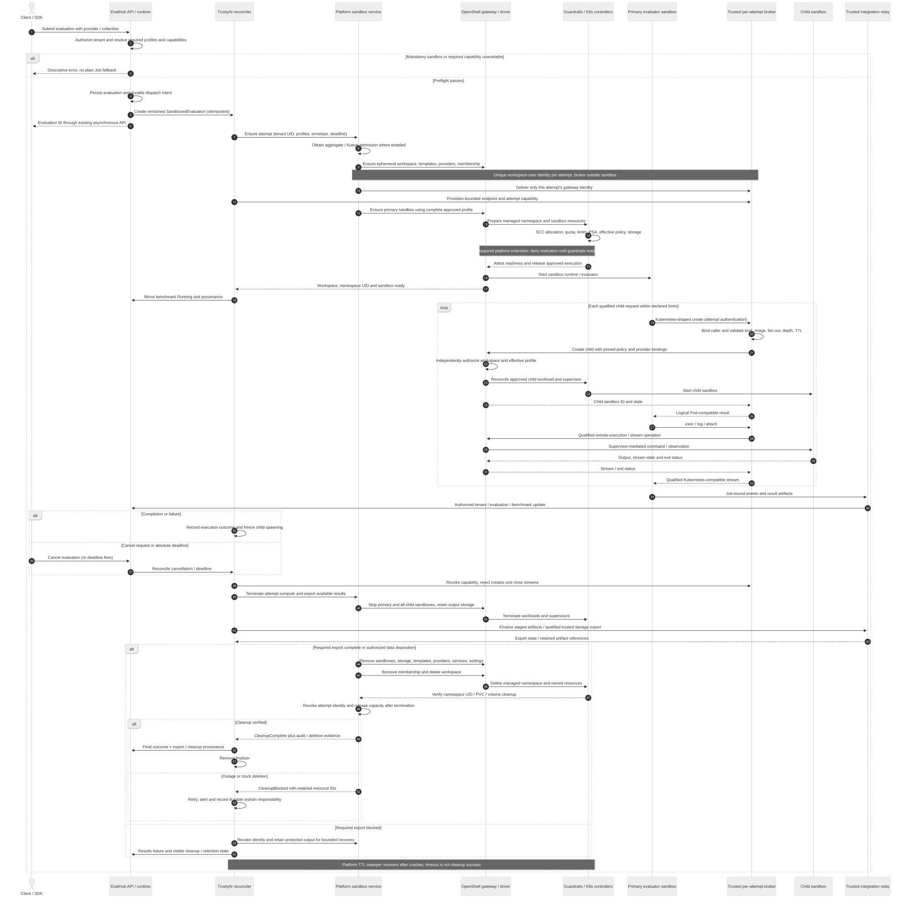

# EvalHub evaluation sandbox plan using the internal OpenShell gateway

Status: Proposed. Date: 2026-10-19. Delivery teams: EvalHub, TrustyAI Service Operator, OpenShift AI platform, OpenShell integration, Security and QE.

## Proposed outcome

Use the platform-managed internal OpenShell gateway proposed in [architecture PR 174](https://github.com/opendatahub-io/architecture-decision-records/pull/174) as the mandatory execution backend for sandbox-required evaluation providers. Give each evaluation attempt an ephemeral OpenShell workspace and managed Kubernetes namespace. Run the evaluator and its child execution environments as OpenShell sandboxes. Keep a restricted Kubernetes compatibility adapter for providers that need it, outside the untrusted workload boundary.

This replaces the independent namespace-and-Kubernetes-proxy control plane proposed in [EvalHub PR 1059](https://github.com/eval-hub/eval-hub/pull/1059). It preserves the isolation, resource, lifecycle, connectivity and provenance requirements of [RHAISTRAT-2289](https://redhat.atlassian.net/browse/RHAISTRAT-2289), with the requirement changes below submitted for review. It does not claim that OpenShell already implements every required platform control.

The decision is recorded in [ADR 0002](../adr/0002-evaluation-sandboxes-through-internal-openshell-gateway.md). Both referenced PRs were open when read; their proposals are dependencies, not accepted platform contracts.

## What changes from the previous plan

- **Execution:** OpenShell is P0 for sandbox-required providers. The namespace-only `runc` path is removed as a fallback. `standard` means an OpenShell sandbox on the cluster default runtime; `kata` means an OpenShell sandbox on a qualified Kata runtime. Neither profile permits fallback to a plain Job.
- **Namespace ownership:** OpenShell's managed Kubernetes driver creates and deletes workspace namespaces. TrustyAI reconciles evaluation lifecycle and requests platform operations; it no longer independently provisions or deletes those namespaces. The platform installs namespace guardrails and owns the authorization and admission controls.
- **Broker:** `eval-sandbox-broker` translates a qualified subset of Kubernetes behavior into OpenShell operations. It does not forward arbitrary requests to the production API and holds no Kubernetes pod-creation credential. It runs as a trusted service per evaluation attempt, outside the primary and child sandboxes, rather than as a sidecar in the evaluated Pod.
- **Identity:** each attempt has its own OpenShell workspace-user identity. A common EvalHub identity with membership in every evaluation workspace is prohibited for broker execution. The platform provisioning service alone holds the administrative authority needed for workspace and membership setup.
- **Credentials:** sandboxed runs replace the co-located credential sidecar with approved OpenShell credential delivery and a remote EvalHub integration relay for operations that do not map to that delivery. Existing plain Job runs keep their current sidecar.
- **Local mode:** sandbox-required providers fail closed in local execution. This intentionally replaces PR 1059's warn-and-allow behavior. Developers can use a separately deployed qualified development gateway; local processes are not reported as sandboxed execution.
- **Storage:** OpenShell currently uses PVC-backed workspaces. Short-lived, automatically deleted PVCs therefore require an explicit amendment to the strategy's `emptyDir`-only scope; user-provided PVCs and retained workspaces remain unsupported.
- **Kueue:** moving the primary evaluator out of a `batch/v1.Job` removes the existing Job scheduling hook. Explicit admission integration is required; namespace quotas alone do not preserve queue fairness.
- **Compatibility:** support for Helm and resource kinds beyond Pods is a first-phase feasibility gate. A restricted OpenShell adapter cannot be described as a general Kubernetes API proxy.

## Sources and current constraints

The baseline is PR 174 at [`57bc18b`](https://github.com/opendatahub-io/architecture-decision-records/blob/57bc18bca3c487bc56b3be18ca147f112141d37b/architecture-decision-records/operator/ODH-ADR-Operator-0019-internal-openshell-gateway.md), PR 1059 at [`3219296`](https://github.com/eval-hub/eval-hub/blob/3219296e2811b0d27d58c6284baa1d8d34e26d55/docs/adr/0001-sandboxed-evaluation-runtime-for-agentic-frameworks.md), and the strategy including its 2026-10-13 refinement comment. The PR 174 ADR number is provisional because its review identifies a numbering collision.

The existing repository implements plain Kubernetes Jobs and an [ingress-only execution NetworkPolicy](../network-policies.md). That policy does not provide egress containment. The new sandbox path must establish and test its own effective egress controls.

Pinned OpenShell v0.1.4 [driver source](https://github.com/NVIDIA/OpenShell/blob/v0.1.4/crates/openshell-driver-kubernetes/README.md), [workspace authorization](https://github.com/NVIDIA/OpenShell/blob/v0.1.4/crates/openshell-server/src/auth/workspace_authz.rs), [API schema](https://github.com/NVIDIA/OpenShell/blob/v0.1.4/proto/openshell.proto) and the [PR review](https://github.com/opendatahub-io/architecture-decision-records/pull/174#issuecomment-6221566587) establish important constraints:

- Managed workspaces map to separate namespaces, with OpenShift assigning SCC MCS, UID and group ranges. Workspace creation alone does not establish all evaluation guardrails before the first sandbox creation.
- Workload and supervisor are separate Pods. The supervisor performs authorized upstream requests; the agent must not receive the supervisor's bootstrap token or gateway credentials. Each child environment adds supervisor, workload, storage and other control-plane resources.
- Templates describe workload and driver settings. Policy and provider bindings must also be enforced on requests; selecting a template is insufficient.
- Workspace authorization requires an actual role and membership configuration. The authorization source treats an authenticated caller as Platform Admin when no admin role is configured. Kubernetes ServiceAccount authentication for supervisors does not establish API-caller authentication for EvalHub.
- The review identifies cluster-wide managed-mode RBAC, permissive supervisor egress, exposed-service routing, and first-sandbox provisioning order as gaps. These require platform work and negative tests before rollout. An additional ordinary NetworkPolicy cannot subtract an existing allow rule.

The [latest strategy refinement](https://redhat.atlassian.net/browse/RHAISTRAT-2289?focusedCommentId=18907648) also requires provider-declared allowed resource kinds capped by an administrator ceiling, Helm compatibility for [Inspect Harbor](https://redhat.atlassian.net/browse/RHAIRFE-3002), and synthetic canary injection for the [credential-exfiltration suite](https://redhat.atlassian.net/browse/RHAIRFE-3676). These are requirements to resolve, not features implicitly supplied by OpenShell.

## Architecture

[Editable architecture diagram](../diagrams/openshell-evaluation-architecture.mmd). Arrows distinguish orchestration, agent requests and model/result data flows. A plain Job is shown only for providers that do not require sandboxing.

### Ownership and trust boundaries

**EvalHub API and runtime dispatch** preserve the existing tenant and owner authorization at kube-rbac-proxy and storage. The runtime resolves trusted provider configuration, validates required capabilities, stores the evaluation and creates a `SandboxedEvaluation` request. Users select a provider or collection; they cannot submit a gateway URL, template, arbitrary image, policy or runtime override. Persisting work and creating the CR require a recoverable outbox or equivalent idempotent reconciliation so an API-process crash cannot lose an accepted run.

**TrustyAI's evaluation reconciler** owns the `SandboxedEvaluation` CRD, its status and finalizer, job deadlines, runtime-to-EvalHub status translation, result export and cancellation. It calls a narrow platform provisioning API using its workload identity. It does not hold OpenShell Platform Admin credentials or perform namespace CRUD. It creates the trusted per-attempt compatibility broker and integration relay using namespaced permissions outside the sandbox namespace.

**The platform sandbox service** is a new logical interface owned and operated by the same platform module that owns the shared gateway. It can be implemented within that module's controller. It owns approved integration profiles, per-attempt identities, workspaces, workspace membership, templates and credential-provider setup. It holds OpenShell Platform Admin authority, making it part of the shared trusted control plane. Its API accepts a profile reference, authorized tenant and evaluation identifiers, bounded inputs, credential references and an idempotency key; it does not expose arbitrary gateway administration. Validate callers against permitted EvalHub instances and their delegated tenants. Use authenticated TLS and workload authorization on this API.

**The platform guardrail controller and gateway interceptor** enforce the effective profile at the server. They own namespace preparation, gateway operation restrictions and recovery. They must be available with the gateway; interceptor failure denies new work. Define an owner, deployment, readiness condition and upgrade contract for these components before enabling EvalHub consumption.

**The shared gateway and Kubernetes driver** own sandbox compute, workspace-to-namespace mapping, supervisor connections and sandbox deletion. The Agent Sandbox CRDs and controller are separately versioned platform dependencies. They are cluster-scoped and may be shared with customer-managed gateways, so upgrade and uninstall must coordinate with those consumers.

**The compatibility broker** accepts untrusted framework requests and reconstructs safe OpenShell requests. A per-attempt deployment and identity contain its application-level authority to one workspace. It has no workspace-admin or platform-admin role. Its endpoint is reachable only through an approved policy and requires an attempt-scoped capability; source IP alone is insufficient. Bind capability audience, workspace, evaluation UID, attempt and expiry. Authenticate the calling sandbox when provisioning that capability; redact it and revoke it during teardown.

**The integration relay** provides job-bound status callbacks, result upload and any MLflow/OCI or credential-injection operations that require EvalHub-specific behavior. It enforces tenant, evaluation UID, benchmark and attempt on every request and reconstructs trusted upstream headers. The agent cannot choose another tenant, MLflow workspace, model credential binding or arbitrary upstream URL. It may share a per-attempt trusted deployment with the broker, but exposes separate authorized operations.

## Execution and lifecycle contract

[Editable sequence diagram](../diagrams/openshell-evaluation-sequence.mmd). This shows one sandbox-required benchmark and a child sandbox; repeat within the evaluation's resource envelope for additional benchmarks.

### Versioned asynchronous contract

Retain the `SandboxedEvaluation` name from PR 1059, with a revised, jointly versioned schema. The CRD's API group, served version and platform provisioning API must be agreed by both teams before implementation. The following fields are a proposed contract, not an existing manifest:

- `spec`: immutable evaluation UID, EvalHub instance UID, tenant namespace UID, owner reference in the tenant namespace, attempt ID, benchmark identities, approved profile references and revisions, job-spec reference/hash, authorized secret references, deadline, maximum fan-out and effective resource envelope. No secret values. `cancelRequested` is a controlled lifecycle mutation.
- `status`: observed generation, workspace ID, namespace name and UID, primary and child sandbox IDs, policy/template hashes, active profile, effective limits, per-benchmark outcomes, export state, cleanup state and sanitized reason codes.
- Conditions: `Accepted`, `Admitted`, `WorkspaceReady`, `PolicyReady`, `Running`, `ResultsExported`, `CleanupComplete`, plus `CleanupBlocked` for actionable failures. Readiness is derived from verified platform state, not a namespace name appearing in status.
- Suggested internal phases: `Pending`, `Admitting`, `Provisioning`, `Running`, `Exporting`, `Cleaning`, `Succeeded` / `Failed` / `Cancelled`. Keep public evaluation outcomes distinct from resource-cleanup status; existing API consumers must not depend on new internal phases.
- Correlation key: `(EvalHub instance UID, tenant UID, evaluation UID, attempt, benchmark, child request ID)`. Persist it before external creation. A timed-out create is reconciled by that key before retry; do not create a second sandbox blindly.

For mixed collections, the runtime chooses a backend per benchmark from trusted provider requirements. Sandbox-required benchmarks use primary sandboxes in the evaluation-attempt workspace; other benchmarks retain the existing Job backend. Overall completion and cancellation aggregate both paths. If a provider's configuration covers both Harbor and ordinary tasks, task classification must be trusted onboarding metadata; a caller cannot relabel a mandatory-sandbox task to bypass dispatch.

### Admission before execution

Preflight distinguishes configuration/capability failure from temporary capacity or service failure. Missing mandatory sandbox configuration or unsupported resource kinds produces a descriptive validation error; transient gateway unavailability produces a retryable service error. Revalidate at dispatch because preflight cannot reserve resources or guarantee future readiness. No sandbox-required run starts during a capability mismatch, lost policy service or profile outage.

Reserve each evaluation's maximum declared footprint before creating its first sandbox. On Kueue-enabled clusters, a platform-owned integration must obtain admission for the primary and permitted child footprint, including supervisors and scheduling overhead, before sandbox launch. Use a Kueue Workload or a supported equivalent adapter; its exact integration is a feasibility deliverable, not an assertion that OpenShell participates in Kueue today. Revocation freezes spawning and terminates or checkpoints according to a defined eviction contract. Do not add Kueue-managed labels to ephemeral namespaces merely to approximate Job admission. Release reservations only after compute termination is confirmed.

### Managed namespace readiness barrier

Use `workspace_mode: managed` as proposed by PR 174. Set a unique, immutable gateway ID derived from installation identity, respecting the selected release's naming limits. Protect namespace ownership using recorded gateway/workspace mappings and immutable namespace UIDs, not a caller-settable label alone. Reject adoption of a pre-created conflicting namespace.

Before any workload or supervisor Pod runs, require namespace SCC allocation, the effective PSA/SCC constraints, ResourceQuota and LimitRange, approved storage class, effective network controls and protected ownership metadata. `baseline` is the minimum PSA requirement; use `restricted` where the qualified OpenShell release supports it. Validate actual rendered Pods against OpenShift SCC rather than copying privilege claims from a profile name.

Current managed-mode ordering needs a platform/upstream extension. The preferred contract is **prepare managed workspace namespace, apply and verify guardrails, then release sandbox execution**. If implemented using Kubernetes admission, deny Pod creation or scheduling-gate removal until a trusted readiness attestation exists; missing attestation is a denial, including the first namespace creation race. Only the guardrail controller can write that attestation. Verify that a failed first create can resume idempotently. Creating quota after an already running sandbox is unacceptable. If the selected release cannot support this barrier, block delivery or propose an explicit amendment to PR 174 for operator workspace mode; do not silently switch namespace owners.

Managed-mode cluster permissions need independent admission restricting the gateway and Agent Sandbox controller to authorized namespaces and resource types. Deny operations against tenant/customer namespaces even if gateway credentials are compromised. Ordinary RBAC and ownership labels alone are insufficient. The privileged provisioning service and guardrail controller remain trusted and require separate access protection.

### Framework compatibility

Qualify a finite operation matrix for each provider and library version. Supported operations may include Pod-shaped create/get/list/watch/delete and exec/log/attach, with explicit logical-resource-to-sandbox mappings. Preserve exit status, stdout/stderr, stdin, TTY resize, cancellation, deadlines and supported streaming protocols. OpenShell's remote execution transport is a backend detail; it does not prove Kubernetes SPDY/WebSocket compatibility. Return Kubernetes-shaped errors where the plugin expects them.

The effective resource-kind allowlist is the intersection of provider declaration, administrator ceiling and implemented gateway-backed operations. Distinguish `SandboxUnavailable`, `ResourceKindNotAllowed`, `UnsupportedSandboxSemantics`, `IsolationProfileUnavailable` and `SandboxCapacityExceeded`. Do not ignore unsupported Pod fields. Reject privileged/host configurations, arbitrary volumes, real token mounts, direct API access and requests outside the logical workspace.

Services, ConfigMaps, Secrets, Helm release storage and controllers are not transparently equivalent to OpenShell sandboxes. The initial spike must run Inspect Harbor's actual install/upgrade/uninstall path, inventory its rendered chart resources and transport calls, and decide between:

1. An approved OpenShell-native framework plugin that replaces Helm provisioning while preserving benchmark behavior; or
2. A bounded virtual compatibility layer with explicit semantics for every required kind and operation, whose state cannot become an arbitrary route to the cluster API.

Neither option is implemented by changing environment variables alone. If neither passes, report Harbor as blocked and obtain a requirements decision. A separate provider-specific legacy architecture requires its own review and is outside this implementation. Direct production Kubernetes API access is never an automatic escape path.

Agent connectivity is part of the provider profile: broker endpoint, authentication, child name mapping, exec/attach transport and permitted inter-sandbox services. Disable `ExposeService` and create-time service exposures by default. A provider needing peer HTTP services or an independent canary receiver requires an authenticated tenant/attempt-bound route; raw Host-based routing on the shared gateway is not an acceptable tenancy boundary. Lack of such a route blocks that provider.

### Credentials, inputs and results

Preserve [EH-0002's tenant boundaries](https://github.com/opendatahub-io/architecture-decision-records/blob/main/architecture-decision-records/eval-hub/ODH-ADR-EH-0002-multi-tenancy-and-authz.md) and [EH-0004's credential-hiding intent](https://github.com/opendatahub-io/architecture-decision-records/blob/main/architecture-decision-records/eval-hub/ODH-ADR-EH-0004-eval-sidecar-creds-injection.md). The compute namespace is ephemeral; the business tenant and MLflow workspace remain the authorized original tenant. Do not infer tenancy from a sandbox namespace or from the caller's ServiceAccount namespace.

Resolve only authorized tenant secret references through a narrowly delegated credential integration. The platform service creates workspace-scoped OpenShell provider bindings; evaluated code receives neither the original Kubernetes Secret nor reusable control-plane credentials. For endpoint-bound injection use qualified OpenShell profiles; for MLflow, OCI and callback behavior use the integration relay until equivalence is proven. Provisioning authority to read tenant secrets must be explicitly delegated; a cluster-wide Secret reader is not implied by gateway ownership. Never reuse the incoming user's bearer token for asynchronous execution.

Copy only the authorized job spec, benchmark inputs and datasets into the sandbox. Replace localhost sidecar URLs with the approved relay/provider endpoints for this path. Stage results through the relay during execution and finalize them in the tenant's durable result store before normal workspace deletion. On cancellation or security failure, terminate agent execution promptly; export available artifacts through trusted bounded mechanisms, without extending the agent's permission to run. Retrieval from stopped PVCs requires an explicitly authorized trusted export mechanism, proven during integration; do not assume gateway exec works after stop. If required export cannot finish, retain protected storage under a bounded recovery record or record an authorized data-loss disposition before deleting it.

Synthetic credential canaries are a separate provider-declared test-input channel, not production credential providers. Permit only bounded canary env/file payloads and, where implemented, virtual Secret semantics. A token-shaped fixture at a test path must never authenticate to Kubernetes. Negative-control variants may weaken the *inner test target* under approved profiles while retaining outer OpenShell and namespace containment. The independent receiver and per-scenario scoring belong to the benchmark; audit canary exposure without logging production secrets. Supporting actual Kubernetes Secret behavior remains gated by the compatibility spike.

### Teardown and failure recovery

Completion, failure, cancellation and absolute deadline all enter the same reconciled teardown. Freeze spawning and revoke broker capabilities; stop primary and children, close active exec streams, export available outputs, delete sandboxes and their storage, delete templates/providers/services/settings, remove memberships and revoke attempt identity, then delete the workspace. OpenShell deletes the managed namespace. Verify namespace UID disappearance, PVC deletion and backend volume disposition before reporting `CleanupComplete`. Stop/suspend is insufficient because OpenShell retains storage across stop/start.

Persist a finalizer before provisioning. Cross-namespace owner references cannot clean up the workspace namespace; use explicit reconciliation with recorded immutable IDs. Cleanup is idempotent across controller and gateway restarts. A platform TTL sweeper independently finds expired resources and orphan workspaces by trusted ownership records. It must not adopt or delete unrelated namespaces by name prefix.

Targets proposed for qualification: agent/child termination within 30 seconds of deadline; complete normal teardown within 60 seconds of terminal execution when dependencies are healthy; after five minutes without progress, set `CleanupBlocked`, alert and create a durable orphan record. Keep the finalizer until cleanup completes or an authorized administrator transfers responsibility to that record. An elapsed timeout never means cleanup succeeded. Gateway outage or stuck volume deletion can exceed the cleanup target; publish age and reason. The platform owns namespace/storage recovery; TrustyAI owns evaluation and result recovery.

## Required policy and capacity controls

The platform profile binds immutable image digests, resolved template revision, runtime profile, effective network/filesystem policy, credential-provider set, permitted mutations, resource limits, fan-out, nesting depth and absolute lifetime. Gateway admission must enforce the complete resolved request, including attempts to skip the template, supply inline configuration, change runtime or attach another provider. Cover create, update/config, provider attachment, restart and exposure operations. Templates are replicated into each workspace and deleted before workspace teardown. Keep policy proposals in manual approval mode and require Landlock enforcement; unsupported kernel enforcement fails startup.

Deny agent access to Kubernetes API endpoints, node/cloud metadata, host filesystems and other tenants. Allow only approved model/judge/attacker endpoints, the per-attempt broker and relay, necessary data sources and authenticated supervisor channels. Supervisor egress must also be constrained: remove/replace the driver's permissive rule through a supported integration or apply a qualified higher-precedence cluster control. Test the complete policy union, DNS behavior, IP literals, redirects, IPv6 and alternate API/metadata addresses. NetworkPolicy object creation is not proof of CNI enforcement.

Apply per-sandbox limits, per-attempt namespace quota and installation/tenant-wide caps. Budget workload, supervisor and init resource peaks, brokers/relays, every permitted child, PVC count and bytes, streaming sessions, gateway state and provisioning rate. The driver's current default workspace storage is not evidence of an `emptyDir` implementation. Select an approved dynamically provisioned storage class with deletion semantics and verify actual volume reclamation; retained volumes require governed manual recovery. No user PVC attachment, in-sandbox GPU or arbitrary RuntimeClass is supported initially.

For Kata-required providers, enforce runtime at admission and bound time spent Pending when capacity is absent. Qualify the guest kernel's Landlock and nested seccomp behavior and recognize that the supervisor can still run on the default runtime. Kata is a stronger workload boundary, not a claim that the whole shared control plane runs inside a VM.

## Delivery plan and gates

### Phase 0 — Contract and compatibility proof, before committing a delivery date

Owners: EvalHub and OpenShell integration, with platform, Security and QE.

- Agree the revised ADR and obtain explicit disposition of gateway-required P0, local fail-closed behavior, ephemeral PVCs, Kueue admission, allowed resource kinds and the Harbor collection profile conflict. Collection metadata may request only an approved profile; it cannot lower a provider minimum or expand the administrator ceiling.
- Execute a minimal primary-plus-child create, exec, log, attach, delete flow through the pinned gateway. Run representative Inspect Harbor / Terminal-Bench and AgentDojo paths; distinguish actual required APIs from assumed ones. Demonstrate canary env/file injection and receiver connectivity.
- Prototype managed namespace readiness, API-caller authentication, per-attempt membership, policy admission and cross-workspace denials. Test coexistence with a customer gateway and a pre-created namespace collision.
- Measure cold/warm dispatch, child fan-out, concurrent streams, storage and control-plane footprint, and teardown. Agree and record p95 latency and maximum concurrent evaluations/children before increasing rollout concurrency; do not substitute the strategy's unvalidated estimate for these measurements.
- Prove Kueue admission/eviction mapping and the storage deletion contract. Stop affected workstreams when a gate fails; publish required upstream changes and owners.

Exit: a versioned capability matrix, measured capacity envelope, ownership agreement and a go/no-go for each target provider. Passing one provider does not qualify all agentic frameworks.

### Phase 1 — Platform shared service

Owner: designated OpenShift AI infrastructure module; OpenShell integration and Security support it. This ownership must be assigned, not assumed to exist already.

Package the pinned gateway, Agent Sandbox dependencies, provisioning API, fail-closed interceptor, namespace guardrails, workload identity integration, storage profile and sweeper. Provide encrypted transport, no customer-facing Route, stable unique gateway ID, coordinated database/KEK/JWT/PKI persistence and restore. Use the shared database capability where approved. Operator reconciliation must preserve generated secrets across renders. Define availability and backup/recovery for the interceptor and provisioning service as well as the gateway.

Exit: positive/negative isolation tests, dependency/version discovery, managed-namespace readiness proof, controller restart recovery, restore and uninstall tests. Expose a consumer-specific readiness condition; a gateway outage must not disable ordinary EvalHub Jobs or unrelated platform components.

### Phase 2 — EvalHub lifecycle and provider dispatch

Owner: EvalHub and TrustyAI Service Operator.

Implement the CRD and platform API clients, durable dispatch, capability preflight, per-benchmark backend routing, status/log/result integration, deadline and finalizer reconciliation. Extend provider schema with required capabilities, approved profile reference, allowed resource kinds, aggregate/per-child limits, nesting and connectivity requirements. Keep new fields optional for existing providers. Add sandbox state filters if retained from RHAI-736, without changing existing job response semantics.

Exit: a sandbox-required benchmark runs and produces standard results, mixed collections aggregate both backends, unavailable/mismatched services fail closed, cancellation survives restarts, and existing non-sandboxed provider execution passes regression checks.

### Phase 3 — Qualified compatibility and credentials

Owner: EvalHub broker/provider maintainers; platform credential and policy owners.

Deliver only the provider matrices proven in Phase 0, including streaming behavior, resource ceilings, identity binding, child audit and concurrency controls. Complete remote relay and OpenShell credential integration. Implement the approved Harbor provisioning choice and canary target profiles. Unsupported operations produce descriptive errors before or during execution, never raw Kubernetes forwarding.

Exit: end-to-end target benchmarks, successful and denied credential flows, denial of cross-evaluation broker access, no real credentials in evaluated containers, and complete child and storage teardown.

### Phase 4 — Adversarial qualification and bounded rollout

Owners: QE and Security with all implementation teams.

Exercise privilege/host mount attempts, policy/provider mutation, cross-tenant logs and exec, namespace impersonation, direct API/metadata egress, exposed-service routing, malicious DNS/redirects, resource exhaustion, gateway/interceptor/controller failure, duplicate dispatch, mixed-backend cancellation, orphan and stuck-volume recovery. Test the maximum approved fan-out and stream count, customer-gateway coexistence and coordinated upgrades.

Enable only approved providers on explicitly opted-in installations, cap admission to the measured capacity and expand based on evidence. Disable new sandbox admission on rollback; reconcile existing resources using the compatible platform version. Disabling the feature never reroutes mandatory-sandbox providers to plain Jobs.

## Acceptance and requirement coverage

- **Restricted execution and streaming (strategy P0; RHAI-731):** primary and child code run only in approved OpenShell sandboxes; each supported provider passes its create/observe/delete and exec/log/attach matrix. Helm and additional kinds have an explicit supported implementation or a blocking decision.
- **Isolation (P0):** one workspace/namespace per evaluation attempt, per-attempt identities, independent gateway admission, namespace readiness barrier, enforced quota/PSA/SCC and tested API/metadata/tenant denials. No Kubernetes pod-creation credential is present in evaluated code or its broker.
- **Lifecycle (P0):** completion/failure/cancellation/deadline/restart tests satisfy termination and healthy-dependency cleanup targets; incomplete cleanup remains visible and recoverable. Namespace and volume absence are checked.
- **Resource envelope (P0):** provider declarations are capped by administrator policy; primary, children and supervisors count toward quota and queue admission. Parallel create races cannot oversubscribe declared limits.
- **Provider preflight/connectivity (P0; RHAI-736):** incompatible API versions, missing required profiles, unsupported resource kinds and unavailable services have distinct errors; the provider's required child connectivity succeeds without service-route tenancy bypass.
- **Policy (formerly P1):** OpenShell policy and mandatory enforcement are baseline for this path; outage or missing kernel support fails closed. There is no `namespace-baseline` provenance for successful sandbox-required runs.
- **Provenance (formerly P1):** cards record gateway/version, tenant and attempt, workspace/namespace UID, primary/children, template/image digest, effective policy hash, provider binding identifiers without secret values, runtime class/profile, enforced limits, network qualification/profile revision, cleanup outcome and audit references.
- **Image controls (strategy P2, PR 1059 P0):** approved immutable image digests are baseline at both broker and server admission. The revised priority resolves the earlier mismatch explicitly.
- **Kata (P2):** optional integration per installation; mandatory for a provider that declares it. A missing/unqualified runtime or provisioning timeout cannot lower that requirement.
- **Consumer refinements:** Inspect Harbor requires the proven provisioning mapping; the credential-exfiltration suite requires synthetic canaries and a contained receiver/negative-control profile. Neither weakens the outer sandbox or introduces production test credentials.
- **Compatibility and queueing:** existing ordinary providers retain their Job/sidecar path; mixed collection results remain unified. Kueue-enabled sandbox execution requires demonstrated admission and eviction behavior.

## Review decisions still required

Platform ownership and machine identity issuance; the managed-mode readiness extension and namespace admission mechanism; Harbor's plugin versus virtual API approach; authenticated child service connectivity; ephemeral PVC scope and reclamation; Kueue reservation integration; supported OpenShell/Agent Sandbox/OpenShift versions; initial concurrency/latency budgets; and Kata qualification.

These decisions block enabling affected providers, not preparation of this plan. Update the strategy and child epics after review rather than marking the previous acceptance criteria complete under different semantics. No release date or reduced effort estimate is asserted: the shared gateway removes duplicate lifecycle implementation but adds platform, compatibility, identity and scheduling dependencies.
