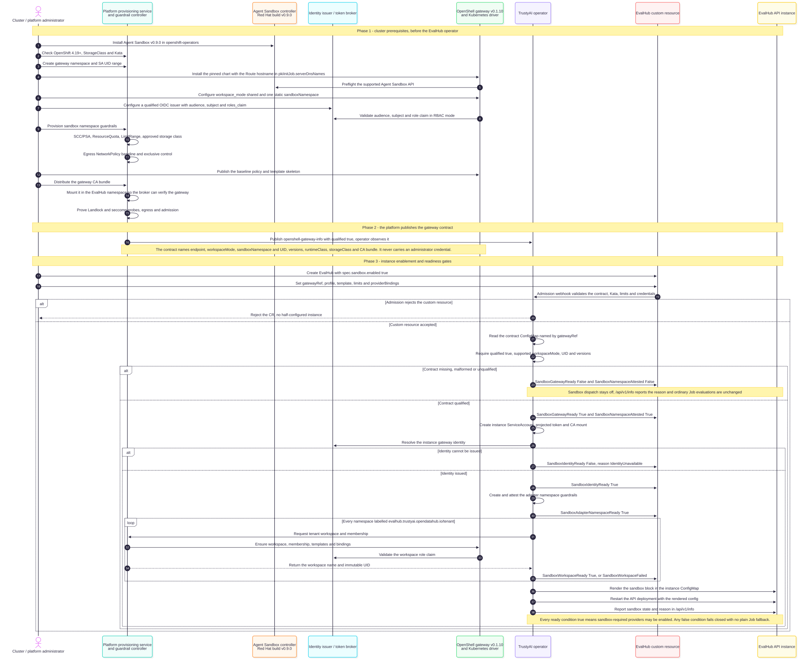
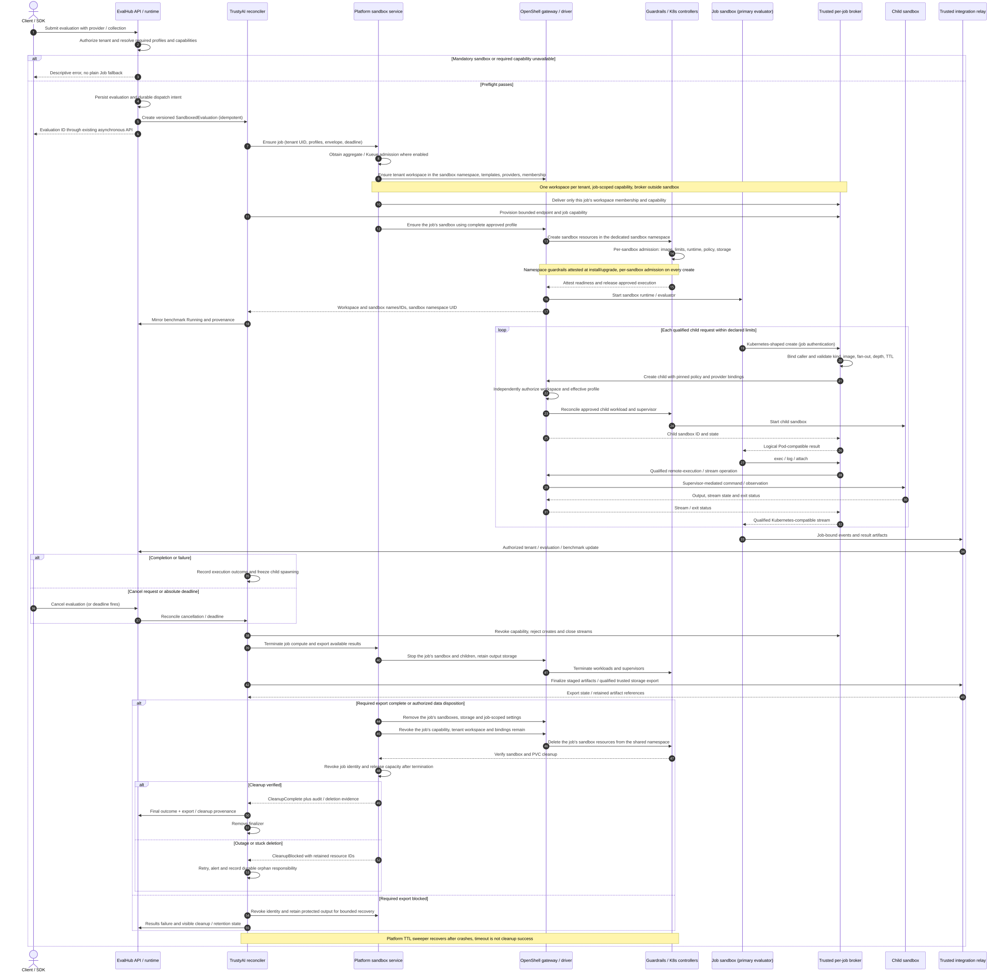
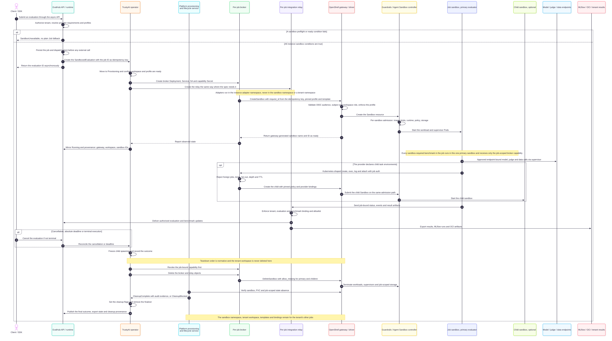

# EvalHub evaluation sandbox plan using the internal OpenShell gateway

Status: Proposed. Date: 2026-10-19. Revised: 2026-11-25 — the OpenShell pin moves from v0.1.9 to **v0.1.10** and the Go SDK pin moves with it; v0.1.10 renames the gateway chart to `openshell` on `oci://quay.io/ai-openshell/charts/openshell` with images under `quay.io/ai-openshell`, splits the namespace-scoped sandbox ServiceAccount, RBAC and NetworkPolicy into the `openshell-workspace` chart, and turns gateway-mediated service routing off by default in Kubernetes Helm deployments. The Phase 0 capability matrix and the sandbox namespace attestation must be re-run at the new pin before a provider is enabled; 2026-11-24 — the OpenShell pin moves from v0.1.4 to **v0.1.9**, the latest published release, and the official Go SDK is recorded in [Pinned OpenShell release and Go SDK](#pinned-openshell-release-and-go-sdk); the authorization, quota, storage and OpenShift claims were re-verified at the new pin and the privileged-SCC bootstrap and OpenShift 4.21 floor are corrected to the release's capability-free posture and 4.19 floor; 2026-11-23 — adapter placement, the operator's adapter RBAC and adapter garbage collection are now recorded in ADR 0002's adapter-namespace subsection, its operator contract and decision 7, and the dispatch, teardown and exit text here points to them; 2026-11-17 — decided with the OpenShift AI architecture team: one static sandbox namespace for all evaluation job sandboxes, one OpenShell workspace per EvalHub tenant (`X-Tenant`), one primary sandbox per evaluation job, recorded in ADR 0002; 2026-11-16 — references and analysis aligned with PR 174 head `97a0c4d` (`ODH-ADR-Operator-0021`) and ADR 0002's platform-alignment section; dedicated sandbox namespace and `shared` workspace namespace mode, aligned with ADR 0002; 2026-11-10 — agent-target classification; 2026-11-03 — references and local-mode wording. Delivery teams: EvalHub, TrustyAI Service Operator, OpenShift AI platform, OpenShell integration, Security and QE.

## Proposed outcome

Use the platform-managed internal OpenShell gateway proposed in [architecture PR 174](https://github.com/opendatahub-io/architecture-decision-records/pull/174) as the mandatory execution backend for sandbox-required evaluation providers. Run every evaluator and child execution environment as an OpenShell sandbox in a dedicated, platform-provisioned sandbox namespace using the driver's `shared` workspace namespace mode: one static sandbox namespace for every evaluation job, one OpenShell workspace per EvalHub tenant (`X-Tenant`), and one primary sandbox per evaluation job rather than one per benchmark, with no namespace or workspace per sandbox. Keep a restricted Kubernetes compatibility adapter for providers that need it, outside the untrusted workload boundary.

This replaces the earlier independent namespace-and-Kubernetes-proxy control plane. It preserves the isolation, resource, lifecycle, connectivity and provenance requirements of [RHAISTRAT-2289](https://redhat.atlassian.net/browse/RHAISTRAT-2289), with the requirement changes below submitted for review. It does not claim that OpenShell already implements every required platform control.

The decision is recorded in [ADR 0002](../adr/0002-evaluation-sandboxes-through-internal-openshell-gateway.md). PR 174 was open when read, so it is not an accepted platform contract. The enablement gate and the component contract are recorded in ADR 0002's [Gateway interaction contract](../adr/0002-evaluation-sandboxes-through-internal-openshell-gateway.md#gateway-interaction-contract-extension): sandbox execution stays off unless `EvalHub.spec.sandbox` enables it and the operator observes a qualified, platform-published gateway contract, and this plan's phases do not change that default.

## What changes from the previous plan

- **Execution:** OpenShell is P0 for sandbox-required providers. The namespace-only `runc` path is removed as a fallback. `standard` means an OpenShell sandbox on the cluster default runtime; `kata` means an OpenShell sandbox on a qualified Kata runtime. Neither profile permits fallback to a plain Job.
- **Namespace ownership:** sandbox compute runs in one static, platform-provisioned sandbox namespace per gateway (`workspace_mode: shared`), separate from tenant namespaces and from any namespace shared with non-sandbox workloads. The namespace scope is decided: installation-wide for all evaluation job sandboxes, recorded in ADR 0002's [Platform alignment and namespace decision](../adr/0002-evaluation-sandboxes-through-internal-openshell-gateway.md#platform-alignment-and-namespace-decision) section; because `workspace_mode` is gateway-wide, EvalHub cannot opt into `shared` independently. One OpenShell workspace per EvalHub tenant and every job's sandbox share it, with `{workspace}--{name}` resource naming. Cross-consumer isolation rests on workspace identity, gateway authorization, per-sandbox isolation and admission, not namespace separation. TrustyAI reconciles evaluation lifecycle and requests platform operations; it does not provision or delete namespaces. The platform owns the sandbox namespace, its guardrails and the authorization and admission controls.
- **Broker:** `eval-sandbox-broker` translates a qualified subset of Kubernetes behavior into OpenShell operations. It does not forward arbitrary requests to the production API and holds no Kubernetes pod-creation credential. It runs as a trusted service per evaluation job, outside the primary and child sandboxes, rather than as a sidecar in the evaluated Pod.
- **Identity:** each EvalHub tenant has one OpenShell workspace, and each job's broker and sandbox principals are members of that workspace. A common EvalHub identity with membership in every tenant workspace is prohibited for broker execution. Workspace membership does not separate jobs of one tenant, so job-to-job separation rests on the job-bound broker capability and the sandbox boundary. The platform provisioning service alone holds the least-privilege OpenShell automation authority needed for workspace and membership setup; it does not hold unrestricted Platform Admin authority, and EvalHub and its brokers receive only the user role and explicit workspace membership.
- **Credentials:** sandboxed runs replace the co-located credential sidecar with approved OpenShell credential delivery and a remote EvalHub integration relay for operations that do not map to that delivery. Existing plain Job runs keep their current sidecar.
- **Local mode:** sandbox-required providers fail closed in local execution, which is stricter than the optional warn-and-allow that PR 174 permits for development. Developers who need one use a separately deployed qualified development gateway, and local processes are never reported as sandboxed execution or as providing the platform guarantee. Adopting warn-and-allow later requires an amendment to this plan and to ADR 0002.
- **Storage:** OpenShell uses PVC-backed `/sandbox` workspaces, and at the pin a stop preserves the `Sandbox` resource and its PVC while `Delete` is the only lifecycle operation that removes the storage. Short-lived, automatically deleted PVCs therefore require an explicit amendment to the strategy's `emptyDir`-only scope; user-provided PVCs and retained workspaces remain unsupported.
- **Kueue:** moving the primary evaluator out of a `batch/v1.Job` removes the existing Job scheduling hook. Explicit admission integration is required; namespace quotas alone do not preserve queue fairness.
- **Compatibility:** support for Helm and resource kinds beyond Pods is a first-phase feasibility gate. A restricted OpenShell adapter cannot be described as a general Kubernetes API proxy.

## Sources and current constraints

The baseline is [platform PR 174](https://github.com/opendatahub-io/architecture-decision-records/pull/174) as reviewed at [`97a0c4d`](https://github.com/opendatahub-io/architecture-decision-records/commit/97a0c4d59b34e0f9d1e6327aa79f026178b73d60) (`ODH-ADR-Operator-0021-internal-openshell-gateway.md` on the PR branch) and the strategy including its 2026-10-13 refinement comment. The platform record's number and filename are provisional: the PR branch currently uses `ODH-ADR-Operator-0021-internal-openshell-gateway.md`, while `ODH-ADR-Operator-0019` on `main` is an unrelated record on structured reconciliation error logs. The earlier `57bc18b` draft used 0019; this revision follows head. Reference the PR, not the number, until it lands.

The existing repository implements plain Kubernetes Jobs and an [ingress-only execution NetworkPolicy](../network-policies.md). That policy does not provide egress containment. The new sandbox path must establish and test its own effective egress controls.

Pinned OpenShell v0.1.10 [driver source](https://github.com/ai-openshell/openshell/blob/v0.1.10/crates/openshell-driver-kubernetes/README.md), [workspace authorization](https://github.com/ai-openshell/openshell/blob/v0.1.10/crates/openshell-server/src/auth/workspace_authz.rs), [API schema](https://github.com/ai-openshell/openshell/blob/v0.1.10/proto/openshell.proto) and the [PR review](https://github.com/opendatahub-io/architecture-decision-records/pull/174#issuecomment-6221566587) establish important constraints:

- In `shared` workspace namespace mode all sandboxes render into one static namespace, so workspace and sandbox names, not namespaces, scope an evaluation job (`{workspace}--{name}` avoids collisions); `managed` mode instead maps each workspace to its own generated namespace with OpenShift-assigned SCC MCS, UID and group ranges. Because `managed` and `operator` both map one namespace to one workspace, either would give one sandbox namespace per tenant under this plan's one-workspace-per-tenant model; only `shared` keeps a single static namespace, and PR 174 head gets one namespace per evaluation job from `managed` only because it creates a workspace per `SandboxedEvaluation`. Guardrails belong to the platform-provisioned sandbox namespace and must be verified before sandbox dispatch.
- Workload and supervisor are separate Pods. The supervisor performs authorized upstream requests; the agent must not receive the supervisor's bootstrap token or gateway credentials. Each child environment adds supervisor, workload, storage and other control-plane resources.
- Templates describe workload and driver settings. Policy and provider bindings must also be enforced on requests; selecting a template is insufficient.
- Workspace authorization requires an actual role and membership configuration. At v0.1.10 the OIDC role mapping defaults to `openshell-admin`/`openshell-user` with a configurable `roles_claim`, and explicitly emptying both role names selects auth-only mode, in which every authenticated caller is treated as a Platform Admin and workspace membership checks are bypassed. The gateway contract must therefore record RBAC mode and the role/claim mapping, and auth-only mode is unqualified. Kubernetes ServiceAccount authentication for supervisors (the driver validates the projected token) does not establish API-caller authentication for EvalHub.
- The review identifies cluster-wide gateway RBAC, permissive supervisor egress, exposed-service routing, and first-sandbox provisioning order as gaps. These require platform work and negative tests before rollout. An additional ordinary NetworkPolicy cannot subtract an existing allow rule.

### Pinned OpenShell release and Go SDK

Both documents pin OpenShell **v0.1.10**, the latest published release when this revision was written (tag published 2026-11-24), together with its Go SDK **v0.1.10**, published the same day. The pin is a reviewed value, not a floating "latest": the gateway contract's `openShellVersion`, the provenance record and the Phase 0 capability matrix all name it, and moving it re-runs the Phase 0 matrix and re-attests the sandbox namespace. The v0.1.10 packaging changes are part of the pin rather than a routine dependency update: the gateway chart is renamed to `openshell` and published from `oci://quay.io/ai-openshell/charts/openshell` with images under `quay.io/ai-openshell`, the namespace-scoped sandbox ServiceAccount, Role, RoleBinding and NetworkPolicy move to the separate `openshell-workspace` chart, and Kubernetes Helm deployments no longer serve gateway-mediated sandbox service URLs or HTTP/WebSocket forwarding unless `enable_gateway_service_routing` is enabled. With this plan's single static sandbox namespace, keep `workspaceMode: shared`, set `server.sandboxNamespace`, install the gateway chart with `workspaceResources.enabled=false` and install `openshell-workspace` in that sandbox namespace; the Phase 0 matrix must confirm that split before providers are enabled.

| Component | Pin | Notes |
|---|---|---|
| OpenShell gateway and Kubernetes driver | `v0.1.10` | Gateway chart `oci://quay.io/ai-openshell/charts/openshell` and workspace chart `oci://quay.io/ai-openshell/charts/openshell-workspace` at the same version, with images under `quay.io/ai-openshell`. Published to EvalHub as `openShellVersion` in the contract. |
| OpenShell Go SDK | `github.com/ai-openshell/sdk-go` `v0.1.10` | Official SDK, developed in the OpenShell project and Apache-2.0 licensed. `go get github.com/ai-openshell/sdk-go@v0.1.10`. The v0.1.10 bindings are generated from core v0.1.10 and add typed `cedar_policy`, `provider_credential_rules` and `endpoint_settings` policy fields plus the new provider and secret RPCs; none of them changes the broker's qualified operation set. |
| SDK import path | `github.com/ai-openshell/sdk-go/openshell/v1` | Sub-packages include `openshell/v1/{oidc,gateway,edge,fake,types}`. |
| Go toolchain floor | `go 1.26` | The SDK's `go.mod` declares `go 1.26.0`; this repository builds with `go 1.27.3`, so no toolchain pin changes and `make lint` keeps using the `go.mod` toolchain. |
| Wire protocol | gRPC, `openshell.v1` | Public schema [`proto/openshell.proto`](https://github.com/ai-openshell/openshell/blob/v0.1.10/proto/openshell.proto) at the pin. |

- **The v0.1.10 chart split is part of the pin.** The gateway chart no longer has to install the namespace-scoped sandbox resources. Where the sandbox namespace is not the gateway release namespace, install the gateway with `workspaceResources.enabled=false` and `server.sandboxNamespace` set, then install `openshell-workspace` in that namespace with `gateway.serviceAccount.name` and `gateway.serviceAccount.namespace` pointing at the gateway identity. The workspace chart creates no namespace and deploys no gateway; it owns only the sandbox ServiceAccount, Role, RoleBinding and NetworkPolicy. One pre-provisioned sandbox namespace keeps `workspaceMode: shared`; `operator` mode is only for mapping several pre-provisioned namespaces, which this plan does not select. `enable_gateway_service_routing` stays off, matching this plan's default-disabled exposed services.

The constraints that follow from those pins:

- **The SDK and the gateway share one release.** SDK vX.Y.Z targets a gateway at vX.Y.Z. Bump both together, and treat a mismatch as a contract change rather than a routine dependency update: the SDK version is recorded next to `openShellVersion` in the same review.
- **Only the broker holds an SDK client.** Decision 2 and decision 8 keep the EvalHub API server out of the gateway — it persists dispatch intent and observes `SandboxedEvaluation`. The `eval-sandbox-broker`, plus the relay for its own EvalHub-specific calls, is the only component that imports the SDK, and it authenticates as a workspace `user` member of the tenant workspace, never as a platform administrator.
- **The SDK is not an enforcement layer.** `Sandboxes().Create` sends the request; server-side admission, the fail-closed interceptor and the effective-template checks remain the enforcement points, and client-side validation only produces better errors.
- **Use the SDK's authentication helpers, not hand-rolled TLS.** `v1.StaticToken` with `v1.TLSConfig{CAFile: ...}` for the projected token or broker client credentials, `oidc.NewClientCredentialsAuth` for renewable OIDC credentials, and `v1.NoAuth()` only against a local development gateway. The qualified configuration supplies the CA bundle through `TLSConfig`; it never disables verification.
- **Do not add the legacy module.** `github.com/NVIDIA/OpenShell/sdk/go` is deprecated and receives no further changes, including dependency and security updates. Its packages and APIs match the new module's, so migrating is an import rewrite only.
- **`request_id` is the durability hook.** `CreateSandboxRequest.request_id` takes a nonzero UUID and gives durable at-most-once admission, replaying a successful result for 24 hours (see [Versioned asynchronous contract](#versioned-asynchronous-contract)).
- **Testing without a gateway.** `openshell/v1/fake` returns `Unimplemented` for operations it cannot simulate, so dispatch, error mapping and the `IsNotFound` / `IsAlreadyExists` / `IsPermissionDenied` / `IsUnavailable` predicates are unit-testable; exec, log and attach paths still need a real gateway in Phase 0 and Phase 4.

At the pin the broker relies on `Sandboxes()` (create, wait-ready, delete), `SandboxTemplates()`, `SandboxSuspendResume()`, `SandboxLogsWatch()` (resumable log and event watch), `Exec()`, `Files()`, `Providers()`, `Policy()`, `Workspaces()` and `Services()`. Resource methods take an explicit workspace, which matches the one-workspace-per-tenant model, and list methods return lazy pagers so the broker bounds each page itself.

The [latest strategy refinement](https://redhat.atlassian.net/browse/RHAISTRAT-2289?focusedCommentId=18907648) also requires provider-declared allowed resource kinds capped by an administrator ceiling, Helm compatibility for [Inspect Harbor](https://redhat.atlassian.net/browse/RHAIRFE-3002), and synthetic canary injection for the [credential-exfiltration suite](https://redhat.atlassian.net/browse/RHAIRFE-3676). These are requirements to resolve, not features implicitly supplied by OpenShell.

## Architecture

[Editable architecture diagram](../diagrams/openshell-evaluation-architecture.mmd). Arrows distinguish orchestration, agent requests and model/result data flows. A plain Job is shown only for providers that do not require sandboxing.

[Editable startup sequence](../diagrams/openshell-startup-sequence.mmd). Cluster prerequisites, the platform-published gateway contract and the TrustyAI readiness gates that must be true before an EvalHub instance enables sandbox dispatch. ADR 0002 records the binding checklist and operator duties.

### Ownership and trust boundaries

**EvalHub API and runtime dispatch** preserve the existing tenant and owner authorization at kube-rbac-proxy and storage. The runtime resolves trusted provider configuration, validates required capabilities, stores the evaluation and creates a `SandboxedEvaluation` request. Users select a provider or collection; they cannot submit a gateway URL, template, arbitrary image, policy or runtime override. Persisting work and creating the CR require a recoverable outbox or equivalent idempotent reconciliation so an API-process crash cannot lose an accepted run.

**TrustyAI's evaluation reconciler** owns the `SandboxedEvaluation` CRD, its status and finalizer, job deadlines, runtime-to-EvalHub status translation, result export and cancellation. It calls a narrow platform provisioning API using its workload identity. It does not hold OpenShell Platform Admin credentials or perform namespace CRUD. It creates the trusted per-job compatibility broker and integration relay using namespaced permissions outside the sandbox namespace. Those objects live in the instance's adapter namespace — never the sandbox namespace, the EvalHub instance namespace or a tenant namespace — and the operator's namespaced RBAC for creating and deleting them is recorded in ADR 0002's operator contract; the reconciler creates and deletes them but never uses the broker's capability.

**The platform sandbox service** is a new logical interface owned and operated by the same platform module that owns the shared gateway. It can be implemented within that module's controller. It owns approved integration profiles, tenant workspaces, workspace membership, per-job identities, templates and credential-provider setup. It holds OpenShell Platform Admin authority, making it part of the shared trusted control plane. Its API accepts a profile reference, authorized tenant and evaluation identifiers, bounded inputs, credential references and an idempotency key; it does not expose arbitrary gateway administration. Validate callers against permitted EvalHub instances and their delegated tenants. Use authenticated TLS and workload authorization on this API.

**The platform guardrail controller and gateway interceptor** enforce the effective profile at the server. They own sandbox namespace preparation, gateway operation restrictions and recovery. They must be available with the gateway; interceptor failure denies new work. Define an owner, deployment, readiness condition and upgrade contract for these components before enabling EvalHub consumption.

**The shared gateway and Kubernetes driver** own sandbox compute, workspace and sandbox naming inside the sandbox namespace, supervisor connections and sandbox deletion. The Agent Sandbox CRDs and controller are separately versioned platform dependencies. They are cluster-scoped and may be shared with customer-managed gateways, so upgrade and uninstall must coordinate with those consumers.

**The compatibility broker** accepts untrusted framework requests and reconstructs safe OpenShell requests. A per-job deployment and capability contain its application-level authority to one workspace. It has no workspace-admin or platform-admin role. Its endpoint is reachable only through an approved policy and requires a job-scoped capability; source IP alone is insufficient. Bind capability audience, workspace, evaluation UID, job and expiry. Authenticate the calling sandbox when provisioning that capability; redact it and revoke it during teardown.

**The integration relay** provides job-bound status callbacks, result upload and any MLflow/OCI or credential-injection operations that require EvalHub-specific behavior. It enforces tenant, evaluation UID and benchmark on every request and reconstructs trusted upstream headers. The agent cannot choose another tenant, MLflow workspace, model credential binding or arbitrary upstream URL. It may share a per-job trusted deployment with the broker, but exposes separate authorized operations.

## Execution and lifecycle contract

[Editable sequence diagram](../diagrams/openshell-evaluation-sequence.mmd). This shows one evaluation job's sandbox inside its tenant workspace, with a child sandbox where the provider needs one; additional benchmarks in the same job run in the same sandbox.

[Editable job interaction diagram](../diagrams/openshell-sandboxed-job-sequence.mmd). The compact job-level view of the same lifecycle: dispatch, broker-mediated sandbox creation, in-sandbox execution, relay export and the normative teardown order. The exhaustive sequence above remains the reference for every branch and failure path.

### Versioned asynchronous contract

This plan uses *evaluation job* for the unit created by one accepted request (`EvaluationJobConfig`); earlier drafts and PR 174 call the same lifecycle unit an *attempt*. There is one primary sandbox per job, not one per benchmark.

Retain the `SandboxedEvaluation` name with a revised, jointly versioned schema. The CRD's API group, served version and platform provisioning API must be agreed by both teams before implementation. The following fields are a proposed contract, not an existing manifest:

- `spec`: immutable evaluation UID, EvalHub instance UID, tenant namespace UID, owner reference in the tenant namespace, evaluation job ID, benchmark identities, approved profile references and revisions, job-spec reference/hash, authorized secret references, deadline, maximum fan-out and effective resource envelope. No secret values. `cancelRequested` is a controlled lifecycle mutation.
- `status`: observed generation, workspace ID and name, sandbox namespace name and UID, the job's sandbox name and ID, any permitted child sandbox names and IDs, policy/template hashes, active profile, effective limits, per-benchmark outcomes, export state, cleanup state and sanitized reason codes.
- Conditions: `Accepted`, `Admitted`, `WorkspaceReady`, `PolicyReady`, `Running`, `ResultsExported`, `CleanupComplete`, plus `CleanupBlocked` for actionable failures. Readiness is derived from verified platform state, not a namespace name appearing in status.
- Suggested internal phases: `Pending`, `Admitting`, `Provisioning`, `Running`, `Exporting`, `Cleaning`, `Succeeded` / `Failed` / `Cancelled`. Keep public evaluation outcomes distinct from resource-cleanup status; existing API consumers must not depend on new internal phases.
- Correlation key: `(EvalHub instance UID, tenant UID, evaluation UID, job, benchmark, child request ID)`. Persist it before external creation. A timed-out create is reconciled by that key before retry; do not create a second sandbox blindly. The pinned release supports `CreateSandboxRequest.request_id` (a nonzero UUID giving durable at-most-once admission, with a successful result replayed for 24 hours), so set it from the correlation key and let the gateway replay a successful result instead of creating a duplicate; past that window the recorded correlation key, not the gateway, reconciles the attempt.

For mixed collections, the runtime chooses a backend per benchmark from trusted provider requirements. Sandbox-required benchmarks run in the job's sandbox inside the tenant workspace; other benchmarks retain the existing Job backend. Overall completion and cancellation aggregate both paths. If a provider's configuration covers both Harbor and ordinary tasks, task classification must be trusted onboarding metadata; a caller cannot relabel a mandatory-sandbox task to bypass dispatch.

### Admission before execution

Preflight distinguishes configuration/capability failure from temporary capacity or service failure. Missing mandatory sandbox configuration or unsupported resource kinds produces a descriptive validation error; transient gateway unavailability produces a retryable service error. Revalidate at dispatch because preflight cannot reserve resources or guarantee future readiness. No sandbox-required run starts during a capability mismatch, lost policy service or profile outage.

Reserve each evaluation's maximum declared footprint before creating its first sandbox. On Kueue-enabled clusters, a platform-owned integration must obtain admission for the primary and permitted child footprint, including supervisors and scheduling overhead, before sandbox launch. Use a Kueue Workload or a supported equivalent adapter; its exact integration is a feasibility deliverable, not an assertion that OpenShell participates in Kueue today. Revocation freezes spawning and terminates or checkpoints according to a defined eviction contract. Do not add Kueue-managed labels to sandbox resources merely to approximate Job admission. Release reservations only after compute termination is confirmed.

### Sandbox namespace qualification and exclusive control

Use `workspace_mode: shared` with one static, platform-provisioned sandbox namespace per gateway, hosting every evaluation job sandbox and one workspace per EvalHub tenant. The default namespace scope is installation-wide and is decided and recorded in ADR 0002's [Platform alignment and namespace decision](../adr/0002-evaluation-sandboxes-through-internal-openshell-gateway.md#platform-alignment-and-namespace-decision) section; PR 174 head selects `managed` mode and makes `operator` mode its required fallback, and one of the namespace-model outcomes in that section must be recorded before implementation. Set a unique, immutable gateway ID derived from installation identity, respecting the selected release's naming limits, and record the namespace ownership mapping by immutable namespace UID rather than a caller-settable label alone. Reject any namespace that is not the qualified sandbox namespace; never point the driver at a tenant namespace or a namespace shared with non-sandbox workloads.

Qualify the namespace once, before enabling sandbox dispatch: SCC allocation, the effective PSA/SCC constraints, ResourceQuota and LimitRange, approved storage class, effective network controls and protected ownership metadata. `baseline` is the minimum PSA requirement; use `restricted` where the qualified OpenShell release supports it. Validate actual rendered Pods against OpenShift SCC rather than copying privilege claims from a profile name, and re-verify after OpenShift, OpenShell or Agent Sandbox upgrades.

Because the namespace is long-lived, readiness is an installation and upgrade gate rather than a per-job namespace barrier: the preferred contract is **qualify and attest the sandbox namespace, then enable sandbox dispatch**, and revoke the attestation when a guardrail drifts. Missing attestation denies new sandbox creation. Creating quota after an already running sandbox remains unacceptable. If the selected release cannot support this gate, block delivery or fall back to `operator` workspace mode, which PR 174 head already makes the required fallback; do not silently switch namespace owners or treat operator mode as a new amendment.

`shared` mode gives the driver and its trusted Agent Sandbox controller responsibility for every sandbox identity resource in that namespace. Independent admission must restrict their cluster authority to the sandbox namespace and authorized resource types, and must deny operations against tenant/customer namespaces even if gateway credentials are compromised. Ordinary RBAC and ownership labels alone are insufficient. The privileged provisioning service and guardrail controller remain trusted and require separate access protection.

### Framework compatibility

Qualify a finite operation matrix for each provider and library version. Supported operations may include Pod-shaped create/get/list/watch/delete and exec/log/attach, with explicit logical-resource-to-sandbox mappings. Preserve exit status, stdout/stderr, stdin, TTY resize, cancellation, deadlines and supported streaming protocols. OpenShell's remote execution transport is a backend detail; it does not prove Kubernetes SPDY/WebSocket compatibility. Return Kubernetes-shaped errors where the plugin expects them.

The effective resource-kind allowlist is the intersection of provider declaration, administrator ceiling and implemented gateway-backed operations. Distinguish `SandboxUnavailable`, `ResourceKindNotAllowed`, `UnsupportedSandboxSemantics`, `IsolationProfileUnavailable` and `SandboxCapacityExceeded`. Do not ignore unsupported Pod fields. Reject privileged/host configurations, arbitrary volumes, real token mounts, direct API access and requests outside the logical workspace.

Services, ConfigMaps, Secrets, Helm release storage and controllers are not transparently equivalent to OpenShell sandboxes. The initial spike must run Inspect Harbor's actual install/upgrade/uninstall path, inventory its rendered chart resources and transport calls, and decide between:

1. An approved OpenShell-native framework plugin that replaces Helm provisioning while preserving benchmark behavior; or
2. A bounded virtual compatibility layer with explicit semantics for every required kind and operation, whose state cannot become an arbitrary route to the cluster API.

Neither option is implemented by changing environment variables alone. If neither passes, report Harbor as blocked and obtain a requirements decision. A separate provider-specific legacy architecture requires its own review and is outside this implementation. Direct production Kubernetes API access is never an automatic escape path.

Agent connectivity is part of the provider profile: broker endpoint, authentication, child name mapping, exec/attach transport and permitted inter-sandbox services. Disable `ExposeService` and create-time service exposures by default. A provider needing peer HTTP services or an independent canary receiver requires an authenticated tenant/job-bound route; raw Host-based routing on the shared gateway is not an acceptable tenancy boundary. Lack of such a route blocks that provider.

### Agent-target classification

The catalog and the proposal use "agent evaluation" for different execution shapes. Classify each provider before assigning a sandbox profile or a connectivity route; otherwise a trace-scoring benchmark is provisioned as a live agent, or a model-driven benchmark is blocked waiting for an agent endpoint that does not exist.

As of this revision, [`config/providers`](../../config/providers) declares **7 benchmarks with `evaluation_targets: [agent]` across 3 providers**. The columns are independent: a single benchmark can run its agent loop in the primary sandbox, create a child task environment, and call a model endpoint outside the sandbox.

| Provider | Benchmark | Agent execution location | Model dependency | User-hosted agent service |
|---|---|---|---|---|
| `inspect` | `inspect/cybench` | Primary evaluator (solver) and child sandbox (CTF task environment) | Model endpoint under test | No |
| `inspect` | `inspect/cybergym` | Primary evaluator (solver) and child sandbox (cyber exercise environment) | Model endpoint under test | No |
| `inspect` | `inspect/gaia` | Primary evaluator (solver) and child sandbox (tool environment) | Model endpoint under test | No |
| `inspect` | `inspect/agentdojo` | Primary evaluator (solver) and child sandbox (prompt-injection task environment) | Model endpoint under test | No |
| `inspect` | `inspect/theagentcompany` | Primary evaluator (solver) and child sandbox (workplace/tool environment) | Model endpoint under test | No |
| `atif` | `atif_trajectory_default` | None; scores pre-recorded trajectories | Judge model endpoint (not an agent scaffold) | No |
| `ibm-clear` | `agentic-evaluation` | None; analyzes agent traces | Analysis model endpoint (not an agent scaffold) | No |

"External" in this table means outside the sandbox boundary, not necessarily outside the cluster: an in-cluster model service is still an external endpoint from the sandbox's perspective. A child sandbox is inside the evaluation workspace and is not external in that sense.

The remaining catalog targets are not agent evaluations: 319 benchmarks declare `evaluation_targets: [model]`, 5 `[ai_app]`, and 4 `[rag_system]`. Provider- and benchmark-level `agent:` blocks in files such as `garak.yaml` and `lm_evaluation_harness.yaml` are MCP discovery metadata (`AgentMetadata` in [`pkg/api/providers.go`](../../pkg/api/providers.go)), not execution targets.

The four delivery questions are orthogonal; the counts below are not a partition:

| Dimension | Question | Count |
|---|---|---|
| Agent execution placement | Does a separate child sandbox run a task environment or a containerized agent? | 5 Inspect benchmarks, plus the Harbor / Terminal-Bench paths |
| Model dependency | Does the agent scaffold call a model endpoint outside the sandbox boundary? | 5 Inspect benchmarks |
| Agent hosting | Is the agent itself a user-hosted HTTP service? | **0** benchmarks today; the external-endpoint mode remains blocked until an authenticated, tenant/job-bound route is qualified |
| Agent liveness | Is there no live agent, only pre-recorded traces? | 2 (ATIF, IBM CLEAR) |

The proposal's named qualification paths — Inspect Harbor / Terminal-Bench, AgentDojo, and the credential-exfiltration suite — are **sandbox-required**, not external-agent-required. Their agent or task environment runs inside the tenant workspace; the per-job broker and relay endpoints are the only external control surfaces the agent needs.

No capability flag currently distinguishes these shapes: [`pkg/api/providers.go`](../../pkg/api/providers.go) has no `required_capabilities`, `sandbox_required`, or agent-delivery field. Phase 2 adds the provider schema extension, and each provider must be classified before it is enabled. Until then, task classification for a mixed provider is trusted onboarding metadata, not a request-time choice.

**Implication for the request model.** A request may declare a model, an agent artifact, or both. An in-sandbox agent image is the default sandbox delivery shape; an external agent URL is an optional mode that requires the authenticated route above. A trace-scoring benchmark needs neither a live agent nor an external endpoint: it needs its authorized trajectory input. With one primary sandbox per evaluation job, every benchmark in a job shares that sandbox and its execution environment; whether a benchmark may still request a child task environment is listed under [Review decisions still required](#review-decisions-still-required).

### Credentials, inputs and results

Preserve [EH-0002's tenant boundaries](https://github.com/opendatahub-io/architecture-decision-records/blob/main/architecture-decision-records/eval-hub/ODH-ADR-EH-0002-multi-tenancy-and-authz.md) and [EH-0004's credential-hiding intent](https://github.com/opendatahub-io/architecture-decision-records/blob/main/architecture-decision-records/eval-hub/ODH-ADR-EH-0004-eval-sidecar-creds-injection.md). Sandbox compute is ephemeral within a shared, platform-owned sandbox namespace; the business tenant and MLflow workspace remain the authorized original tenant. Do not infer tenancy from the sandbox namespace, a workspace name or the caller's ServiceAccount namespace.

Resolve only authorized tenant secret references through a narrowly delegated credential integration. The platform service creates workspace-scoped OpenShell provider bindings; evaluated code receives neither the original Kubernetes Secret nor reusable control-plane credentials. For endpoint-bound injection use qualified OpenShell profiles; for MLflow, OCI and callback behavior use the integration relay until equivalence is proven. Provisioning authority to read tenant secrets must be explicitly delegated; a cluster-wide Secret reader is not implied by gateway ownership. Never reuse the incoming user's bearer token for asynchronous execution.

Copy only the authorized job spec, benchmark inputs and datasets into the sandbox. Replace localhost sidecar URLs with the approved relay/provider endpoints for this path. Stage results through the relay during execution and finalize them in the tenant's durable result store before the job's sandbox is deleted. On cancellation or security failure, terminate agent execution promptly; export available artifacts through trusted bounded mechanisms, without extending the agent's permission to run. Retrieval from stopped PVCs requires an explicitly authorized trusted export mechanism, proven during integration; do not assume gateway exec works after stop. If required export cannot finish, retain protected storage under a bounded recovery record or record an authorized data-loss disposition before deleting it.

Synthetic credential canaries are a separate provider-declared test-input channel, not production credential providers. Permit only bounded canary env/file payloads and, where implemented, virtual Secret semantics. A token-shaped fixture at a test path must never authenticate to Kubernetes. Negative-control variants may weaken the *inner test target* under approved profiles while retaining outer OpenShell sandbox containment. The independent receiver and per-scenario scoring belong to the benchmark; audit canary exposure without logging production secrets. Supporting actual Kubernetes Secret behavior remains gated by the compatibility spike.

### Teardown and failure recovery

Completion, failure, cancellation and absolute deadline all enter the same reconciled teardown. Freeze spawning and revoke broker capabilities; stop the job's sandbox and any children, close active exec streams and export available outputs; delete the job's broker and relay Deployments, Services, ServiceAccounts, capability Secrets and NetworkPolicies; delete the job's sandboxes and their storage; and revoke the job's identity. The tenant workspace, its membership, templates, providers and settings remain for the tenant's other jobs; deleting a workspace is a platform operation performed when the tenant is decommissioned. The platform-owned sandbox namespace remains. Verify sandbox disappearance, adapter-object absence, PVC deletion and backend volume disposition before reporting `CleanupComplete`. Stop/suspend is insufficient because OpenShell retains storage across stop/start.

Persist a finalizer before provisioning. Cross-namespace owner references cannot clean up sandbox resources in the platform sandbox namespace; use explicit reconciliation with recorded immutable workspace and sandbox IDs. Cleanup is idempotent across controller and gateway restarts. A platform TTL sweeper independently finds expired job sandboxes and orphan or decommissioned tenant workspaces by trusted ownership records. It must not adopt or delete unrelated namespaces by name prefix. Adapter objects are not its responsibility: the EvalHub reconciler collects them through the custom resource's same-namespace owner reference and a label-scoped sweep for adapters whose `SandboxedEvaluation` no longer exists, revoking the capability before deletion.

Targets proposed for qualification: agent/child termination within 30 seconds of deadline; complete normal teardown within 60 seconds of terminal execution when dependencies are healthy; after five minutes without progress, set `CleanupBlocked`, alert and create a durable orphan record. Keep the finalizer until cleanup completes or an authorized administrator transfers responsibility to that record. An elapsed timeout never means cleanup succeeded. Gateway outage or stuck volume deletion can exceed the cleanup target; publish age and reason. The platform owns sandbox namespace/storage recovery; TrustyAI owns evaluation and result recovery.

## Required policy and capacity controls

The platform profile binds immutable image digests, resolved template revision, runtime profile, effective network/filesystem policy, credential-provider set, permitted mutations, resource limits, fan-out, nesting depth and absolute lifetime. Gateway admission must enforce the complete resolved request, including attempts to skip the template, supply inline configuration, change runtime or attach another provider. Cover create, update/config, provider attachment, restart and exposure operations. Templates are replicated into each tenant workspace and deleted when that workspace is decommissioned, not at job teardown. Keep policy proposals in manual approval mode and require Landlock enforcement; unsupported kernel enforcement fails startup.

Deny agent access to Kubernetes API endpoints, node/cloud metadata, host filesystems and other tenants. Allow only approved model/judge/attacker endpoints, the per-job broker and relay, necessary data sources and authenticated supervisor channels. Supervisor egress must also be constrained: remove/replace the driver's permissive rule through a supported integration or apply a qualified higher-precedence cluster control. Test the complete policy union, DNS behavior, IP literals, redirects, IPv6 and alternate API/metadata addresses. NetworkPolicy object creation is not proof of CNI enforcement.

Apply per-sandbox limits, per-job aggregate caps enforced through gateway admission, and installation/tenant-wide caps (the shared sandbox namespace carries one quota for the whole sandbox fleet). Budget workload, supervisor and init resource peaks, brokers/relays, every permitted child, PVC count and bytes, streaming sessions, gateway state and provisioning rate. The driver's current default workspace storage is not evidence of an `emptyDir` implementation. Select an approved dynamically provisioned storage class with deletion semantics and verify actual volume reclamation; retained volumes require governed manual recovery. No user PVC attachment, in-sandbox GPU or arbitrary RuntimeClass is supported initially.

For Kata-required providers, enforce runtime at admission and bound time spent Pending when capacity is absent. Qualify the guest kernel's Landlock and nested seccomp behavior and recognize that the supervisor can still run on the default runtime. Kata is a stronger workload boundary, not a claim that the whole shared control plane runs inside a VM.

## Delivery plan and gates

### Phase 0 — Contract and compatibility proof, before committing a delivery date

Owners: EvalHub and OpenShell integration, with platform, Security and QE.

- Agree the revised ADR and record one of the namespace-model outcomes in its Platform alignment section (a hard gate: no implementation of decision 4 against a gateway that remains in `managed` or `operator` mode), and obtain explicit disposition of gateway-required P0, the stricter local fail-closed position, ephemeral PVCs, Kueue admission, allowed resource kinds and the Harbor collection profile conflict. Collection metadata may request only an approved profile; it cannot lower a provider minimum or expand the administrator ceiling.
- Execute a minimal primary-plus-child create, exec, log, attach, delete flow through the pinned gateway. Run representative Inspect Harbor / Terminal-Bench and AgentDojo paths; distinguish actual required APIs from assumed ones. Demonstrate canary env/file injection and receiver connectivity.
- Prototype sandbox namespace qualification (SCC/PSA, quota, storage, network policy), API-caller authentication, tenant workspace membership and per-job capabilities, policy admission and cross-workspace and cross-sandbox denials. Test coexistence with a customer gateway and rejection of an unqualified namespace.
- Measure cold/warm dispatch, child fan-out, concurrent streams, storage and control-plane footprint, and teardown. Agree and record p95 latency and maximum concurrent evaluations/children before increasing rollout concurrency; do not substitute the strategy's unvalidated estimate for these measurements.
- Prove Kueue admission/eviction mapping and the storage deletion contract. Stop affected workstreams when a gate fails; publish required upstream changes and owners.

Exit: a versioned capability matrix, measured capacity envelope, ownership agreement and a go/no-go for each target provider. Passing one provider does not qualify all agentic frameworks.

### Phase 1 — Platform shared service

Owner: designated OpenShift AI infrastructure module; OpenShell integration and Security support it. This ownership must be assigned, not assumed to exist already.

Package the pinned gateway, Agent Sandbox dependencies, provisioning API, fail-closed interceptor, sandbox namespace guardrails, workload identity integration, storage profile and sweeper. Provide encrypted transport, no customer-facing Route, stable unique gateway ID, coordinated database/KEK/JWT/PKI persistence and restore. Use the shared database capability where approved. Operator reconciliation must preserve generated secrets across renders. Define availability and backup/recovery for the interceptor and provisioning service as well as the gateway.

Exit: positive/negative isolation tests, dependency/version discovery, sandbox-namespace readiness proof, controller restart recovery, restore and uninstall tests. Expose a consumer-specific readiness condition; a gateway outage must not disable ordinary EvalHub Jobs or unrelated platform components.

### Phase 2 — EvalHub lifecycle and provider dispatch

Owner: EvalHub and TrustyAI Service Operator.

Implement the CRD and platform API clients, durable dispatch, capability preflight, per-benchmark backend routing, status/log/result integration, deadline and finalizer reconciliation. Extend provider schema with required capabilities, approved profile reference, allowed resource kinds, aggregate/per-child limits, nesting and connectivity requirements. Keep new fields optional for existing providers. Add sandbox state filters if retained from RHAI-736, without changing existing job response semantics.

Exit: a sandbox-required benchmark runs and produces standard results, the per-job adapters are created, observed and deleted by the reconciler alone, mixed collections aggregate both backends, unavailable/mismatched services fail closed, cancellation survives restarts, and existing non-sandboxed provider execution passes regression checks.

### Phase 3 — Qualified compatibility and credentials

Owner: EvalHub broker/provider maintainers; platform credential and policy owners.

Deliver only the provider matrices proven in Phase 0, including streaming behavior, resource ceilings, identity binding, child audit and concurrency controls. Complete remote relay and OpenShell credential integration. Implement the approved Harbor provisioning choice and canary target profiles. Unsupported operations produce descriptive errors before or during execution, never raw Kubernetes forwarding.

Exit: end-to-end target benchmarks, successful and denied credential flows, denial of cross-evaluation broker access, no real credentials in evaluated containers, and complete child and storage teardown.

### Phase 4 — Adversarial qualification and bounded rollout

Owners: QE and Security with all implementation teams.

Exercise privilege/host mount attempts, policy/provider mutation, cross-tenant logs and exec, namespace impersonation, direct API/metadata egress, exposed-service routing, malicious DNS/redirects, resource exhaustion, gateway/interceptor/controller failure, duplicate dispatch, mixed-backend cancellation, orphan and stuck-volume recovery. Test the maximum approved fan-out and stream count, customer-gateway coexistence and coordinated upgrades.

Enable only approved providers on explicitly opted-in installations, cap admission to the measured capacity and expand based on evidence. Disable new sandbox admission on rollback; reconcile existing resources using the compatible platform version. Disabling the feature never reroutes mandatory-sandbox providers to plain Jobs.

## Acceptance and requirement coverage

- **Restricted execution and streaming (strategy P0; RHAI-731):** primary and child code run only in approved OpenShell sandboxes; each supported provider passes its create/observe/delete and exec/log/attach matrix. Helm and additional kinds have an explicit supported implementation or a blocking decision.
- **Isolation (P0):** one OpenShell workspace per EvalHub tenant and one primary sandbox per evaluation job, with per-sandbox isolation inside a single dedicated platform sandbox namespace, job-bound identities, independent gateway admission, qualified sandbox namespace with exclusive control, enforced quota/PSA/SCC and tested API/metadata/tenant denials. No Kubernetes pod-creation credential is present in evaluated code or its broker.
- **Lifecycle (P0):** completion/failure/cancellation/deadline/restart tests satisfy termination and healthy-dependency cleanup targets; incomplete cleanup remains visible and recoverable. Sandbox, adapter-object and volume absence are checked; the shared namespace and the tenant workspace are expected to remain.
- **Resource envelope (P0):** provider declarations are capped by administrator policy; primary, children and supervisors count toward quota and queue admission. Parallel create races cannot oversubscribe declared limits.
- **Provider preflight/connectivity (P0; RHAI-736):** incompatible API versions, missing required profiles, unsupported resource kinds and unavailable services have distinct errors; the provider's required child connectivity succeeds without service-route tenancy bypass.
- **Policy (formerly P1):** OpenShell policy and mandatory enforcement are baseline for this path; outage or missing kernel support fails closed. There is no `namespace-baseline` provenance for successful sandbox-required runs.
- **Provenance (formerly P1):** cards record gateway/version, tenant and job, workspace and generated sandbox names/IDs, sandbox namespace UID, template/image digest, effective policy hash, provider binding identifiers without secret values, runtime class/profile, enforced limits, network qualification/profile revision, cleanup outcome and audit references.
- **Image controls (strategy P2):** approved immutable image digests are baseline at both broker and server admission.
- **Kata (P2):** optional integration per installation; mandatory for a provider that declares it. A missing/unqualified runtime or provisioning timeout cannot lower that requirement.
- **Consumer refinements:** Inspect Harbor requires the proven provisioning mapping; the credential-exfiltration suite requires synthetic canaries and a contained receiver/negative-control profile. Neither weakens the outer sandbox or introduces production test credentials.
- **Compatibility and queueing:** existing ordinary providers retain their Job/sidecar path; mixed collection results remain unified. Kueue-enabled sandbox execution requires demonstrated admission and eviction behavior.

## Review decisions still required

Named approvers for ADR 0002 (EvalHub, TrustyAI Service Operator, platform and Security); platform ownership and machine identity issuance; the namespace-model outcome (PR 174 amended to `shared`, an EvalHub-scoped `shared` gateway, or a managed/operator variant at per-job or per-tenant granularity); tenant-workspace provisioning, membership and decommissioning; job-to-job containment inside a shared tenant workspace (Security); whether bounded child task environments remain permitted under one sandbox per job; sandbox namespace qualification and the exclusive-control admission mechanism; per-provider agent delivery classification (in-sandbox, external endpoint, or pre-recorded trace); Harbor's plugin versus virtual API approach; authenticated child service connectivity; ephemeral PVC scope and reclamation; Kueue reservation integration; supported OpenShell/Agent Sandbox/OpenShift versions; initial concurrency/latency budgets; and Kata qualification.

These decisions block enabling affected providers, not preparation of this plan. Update the strategy and child epics after review rather than marking the previous acceptance criteria complete under different semantics. No release date or reduced effort estimate is asserted: the shared gateway removes duplicate lifecycle implementation but adds platform, compatibility, identity and scheduling dependencies.
